# Davish features

**English** · [Tiếng Việt](FEATURES.vi.md) · [Back to README](README.md)

Every app in Davish, what it does and what it runs on the server. The interface is in English, Vietnamese, Simplified Chinese or Spanish; screenshots show demo data from the browser preview, and some are still of the Vietnamese interface.

## Terminal

xterm.js with tabs, copy/paste, GPU rendering, and an optional powerline prompt injected into bash at login, with nothing written on the server.

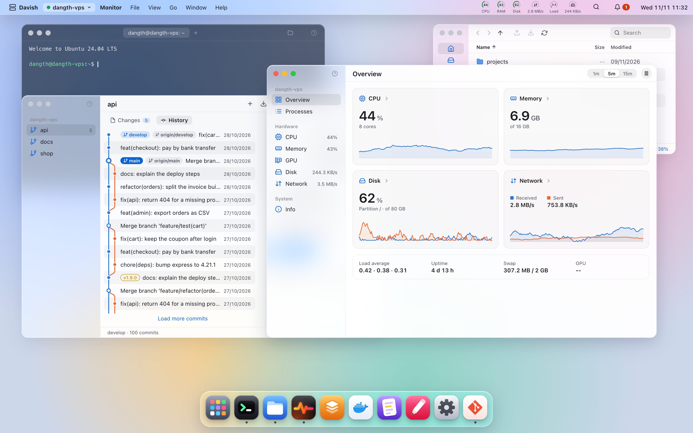

## Saved commands

Keep the commands you type often, each with a name, for one server or every server. One click types a command into the server's Terminal for you to check and press Enter; nothing runs on its own. Spotlight (`⌘K`) finds them by name or command, and every line of the Command log can be typed into Terminal again or saved as a command. They are stored on your computer, in plain text: when a command looks like it holds a password, token or key, Davish warns you before you save it.

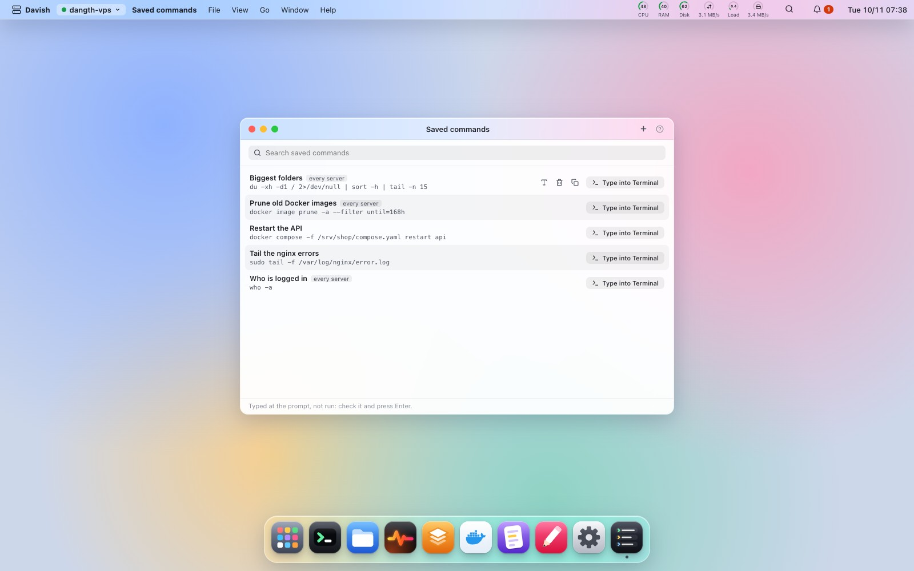

## Files

Finder-style browser over SFTP: upload, download, drag and drop from your OS, rename, delete, compress, and copy between servers through your machine. Hold a file and drag a little: a ring of actions opens around the pointer (open in Editor or Terminal, rename, delete, compress, copy the path, add to desktop); drop on a slice to pick it, in the middle or with Esc to cancel. Right-click empty space to create a file or folder in the folder on screen; Davish never overwrites an existing file.

## Desktop shortcuts

Drag a file, folder or script from Files onto the wallpaper, or right-click it and choose "Add to desktop" (`⌘⌥P`). Double-click to open: folders in Files, files in the Editor, scripts in a terminal tab. Each server has its own desktop, so staging's `deploy.sh` never shows on production. Right-click an icon and choose Customize (`F2`) to give it your own name, one of the built-in icons with a color, or a picture from your computer, as an alias would: the file on the server keeps its name, and the run dialog always shows the real one. Davish stores the path and these choices on your computer, never the file's content.

The first time a script runs, Davish shows the server name and the exact command. Choose "Run directly next time" and it runs right away from then on, as long as the script is unchanged; if it was edited, Davish asks again with a warning. While it runs, the terminal shows the elapsed time and a **Stop** button, and the icon shows an X; both send Ctrl-C to that session. A notification reports the end with the exit code, and every run goes in the command log.

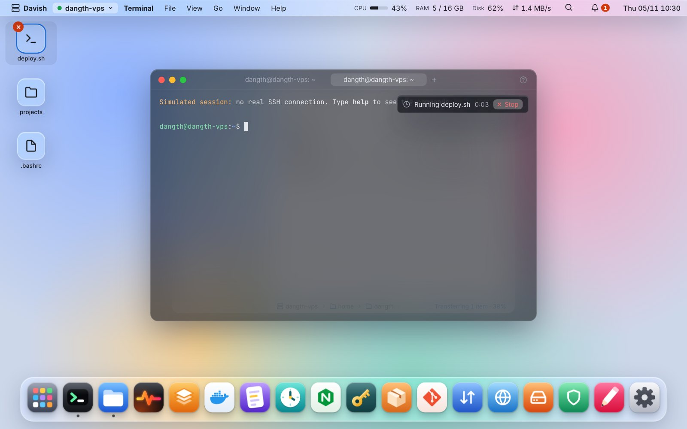

## Editor

CodeMirror 6 with highlighting for nginx, YAML, JSON, shell, env and config files. Atomic saves that keep mode and owner, backups under `/etc`, and a warning if the file changed on the server. A file you cannot write opens read-only, with **Edit with sudo…**: saving then shows the exact command and writes the file as root, or use `sudoedit` in a terminal.

## Logs

Follow a unit's journal, a file or a container. Filter, pause, highlight errors, and click a file path to open it in the Editor at that line. A log you may not read is followed again as root through `sudo`.

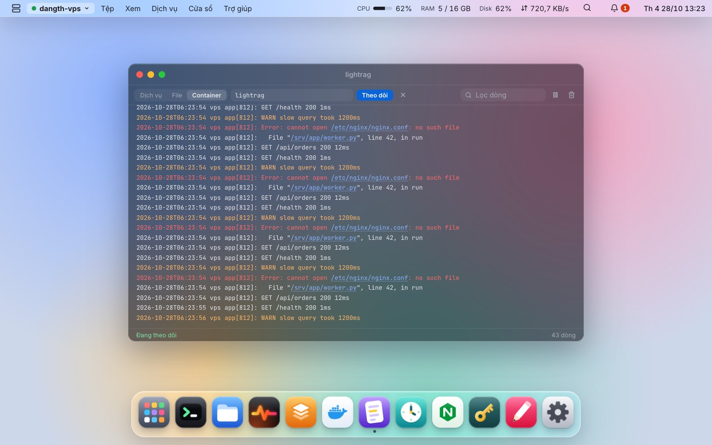

## Monitor

CPU per core, memory and swap, disks, network per interface, NVIDIA GPUs, processes. RAM and disk alerts you can tune.

On a Windows server (OpenSSH, Windows PowerShell 5.1, nothing installed) Monitor reads the same figures through PowerShell and CIM: CPU, memory, drives, network, disks and processes. Windows has no load average, I/O wait or steal time, so those are left out. The other apps that need Linux (Services, Docker, Logs, Cron, Nginx…) are not available on Windows servers yet; Launchpad shows them greyed out.

## All servers

Every server in one window, from the server menu, Launchpad or Spotlight: connected or not, CPU, memory, the `/` disk, load, uptime and network, with its alerts (a failed service, a restart loop, a full disk…) counted and the latest one shown. Connect a server or switch to it from its card. Readings are collected only while the window is open, over the same session Monitor uses.

**Map** on a connected server's card shows which requests reach which program: each nginx site as a chain `domain → nginx :443 → :3000 → container (stack)`, static sites with their folder, and ports open to the outside that no site proxies to. A database port open to the Internet, an upstream nobody listens on and a certificate expiring within 14 days are flagged at the top, each with a button to the app that fixes it; every link opens its app (Nginx, the Browser, Docker at that container). Below, what runs (compose stacks and listening programs) and the disks. It only reads what Nginx, Ports, Docker and Disk already read. With four servers or more, the window filters by name and puts servers with alerts first.

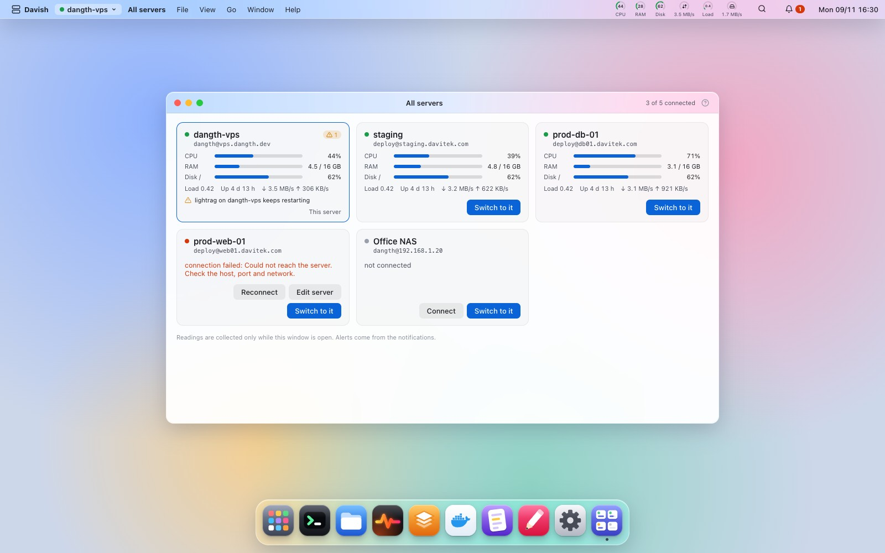

## Services

systemd units by state, their status and journal; start, stop and restart. Remove a unit you no longer use: an admin's unit is deleted, a package's (such as an old `certbot`) is masked with the timer that runs it. Logged in as a user who is not root, Davish runs what systemd refuses through `sudo`: it asks for the sudo password once per session, keeps it in memory only (never on disk, in the keychain or in a log, and gone after 15 minutes unused, when you disconnect or when you lock the app), and hands it to sudo on stdin, never on a command line.

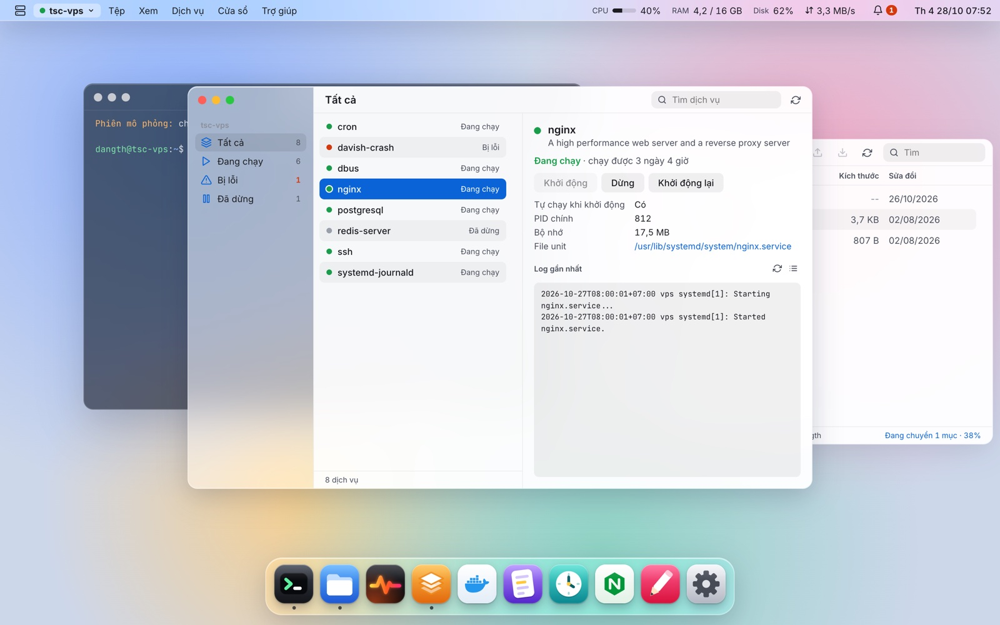

## Not root?

Logged in as a user who may use `sudo`, the apps run what the server refuses as root: Services, Docker (outside the `docker` group), Cron, Logs, Files and Editor, Disk, Nginx, Security and Database. Davish shows the exact command and asks for the sudo password once per server and session: the apps of that server then share it until it goes unused for 15 minutes (as sudo itself does; 5 minutes, an hour or the whole session in **Settings → App lock**), you disconnect, the connection drops or you lock the app. Then it is asked again. It is kept in memory only (never on disk, in the keychain or in a log) and hands it to sudo on stdin, never on a command line. **Forget sudo password** in the server menu wipes it. When sudo needs no password nothing is asked. A user who may not use sudo is not asked at all. What could lock you out of the server (turning ufw on, password logins off) and paths other users could swap stay in the terminal.

## Docker

Laid out like Docker Desktop. Containers as cards or in a table, switched from the toolbar. The table is the default. Cards give each compose project, or lone container, one card: the project's own favicon, else the framework its code uses (Next, Nest, Express, Django, Laravel…, read from `package.json` and the like in the project folder over SFTP), else the logo of an image Davish knows (n8n, WordPress, Postgres…); nothing when none is found, how many of its containers run, its image, the ports it publishes (click one to open it in Davish's browser), CPU and memory, and a red edge when one keeps restarting; click the card for its containers. The table (ID, image, ports, CPU, memory, status) groups them by compose project, with the CPU and memory they use together on top; start, stop, a ⋮ menu (logs, a shell in the container, restart, details) and delete right on the row, every destructive one showing its exact command first. A published port opens in Davish's own browser. Images with how much space the used ones take, their layers and config; run one in a terminal or remove the unused. Volumes with their size and whether a container still uses them. Restart-loop alerts stay.

**Pull an image…** and **Run a new container…**: a form for name, image, ports, environment (typed or a `.env` file), volumes, restart policy and network builds the full `docker run` line. Ports bind `127.0.0.1` unless you say otherwise, with a warning for `0.0.0.0`. The command is typed into a terminal so you press Enter and watch the progress.

**Compose**: each project's ⋮ menu has up, pull, restart and down, plus its compose file in the Editor; **New compose stack…** writes a `compose.yaml` from a template (one container, web + database, app + Redis) into a folder, never over an existing one. Create networks and volumes, and copy any container as the `docker run` command that would make it again.

<table><tr>
  <td>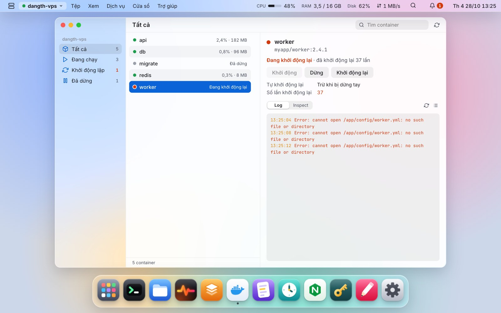</td>
  <td>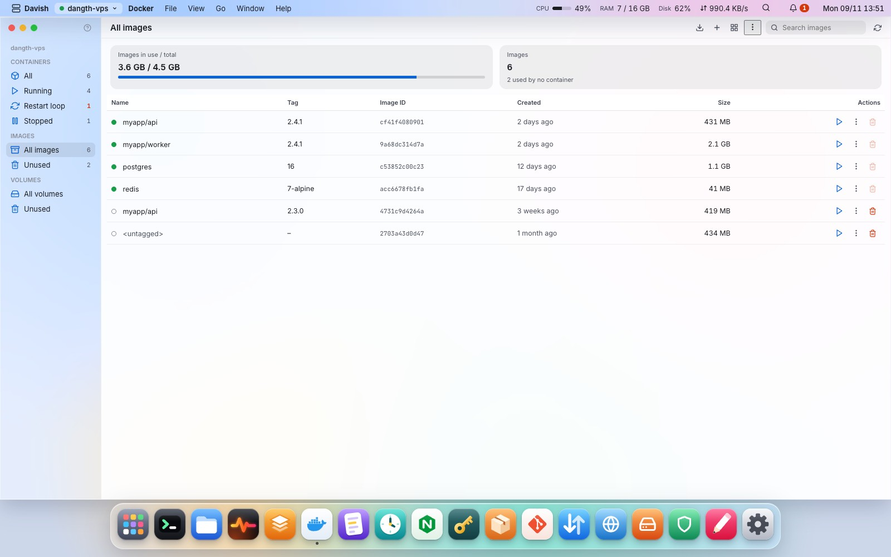</td>
</tr></table>

## Cron

Your crontab and the system ones, schedules in plain words, next runs in the server's time zone, safe edits with a backup. If you may use sudo, root's crontab is listed and edited too, and system cron files you cannot read are read as root.

Each job lists the files and folders in its command (script, log, `cd` folder), one click from the Editor or Files. System jobs open their cron file and its folder.

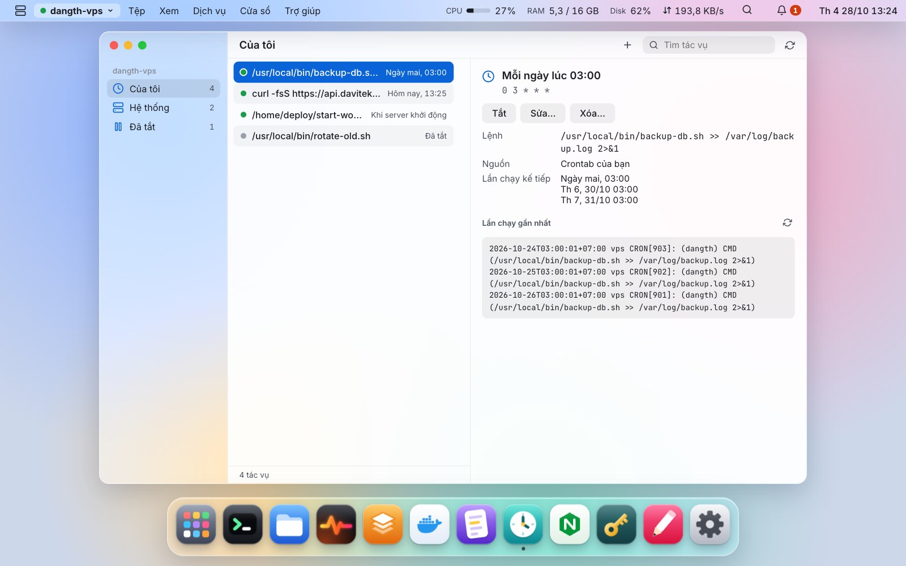

## Nginx

Sites, server blocks and upstreams; turn sites on or off, `nginx -t` before every reload, errors that open at the right line; TLS expiry alerts. Delete a site, and its Let's Encrypt certificate if no other site uses it.

**New site…** sets up a reverse proxy (to a port or a container, WebSocket optional), a static folder or PHP-FPM (the installed php-fpm socket is found for you). You see and can edit the generated config and the exact command before anything runs; the site is enabled only if `nginx -t` passes, otherwise it is turned off again and nginx's error is shown.

**Turn on HTTPS…** checks, from your machine, that each domain points to the server, warns about those that do not, then opens a terminal with `sudo certbot --nginx -d …` typed in (redirect HTTP to HTTPS optional).

**Quick change…** adds domains, points the proxy elsewhere (with what listens on the server as suggestions), turns gzip on or off and sets the upload size limit. The current file is backed up first and put back if `nginx -t` fails.

<table><tr>
  <td>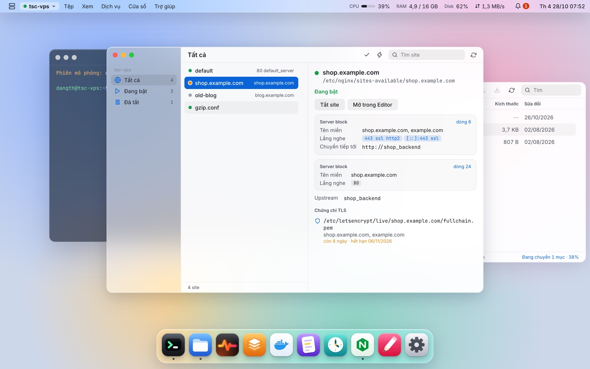</td>
  <td>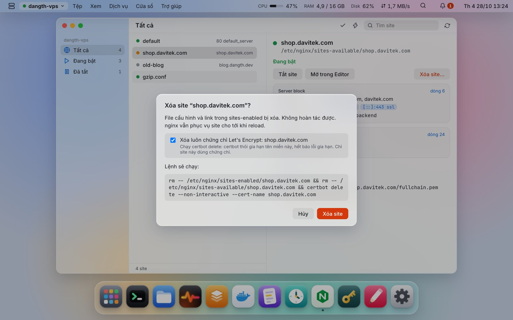</td>
</tr></table>

## Packages

What apt, dnf, yum or apk installed and can upgrade, security fixes first, with an alert when you connect. The runtimes and server programs it finds (nginx, MariaDB, Redis, Docker, Node.js with nvm, PHP with php-fpm, Python…), each with its version, config files and service; also in Spotlight. Installing and upgrading type the `sudo` command into a terminal for you.

When Docker, nginx, git, MariaDB or PostgreSQL is missing, their app says so and shows the command that installs it for the server's Linux (apt, dnf, yum or apk), then enables and starts its service; one button types it into a terminal for you to check and run. Docker's command also adds you to the `docker` group, which the app warns is as good as root, and offers to reconnect so the group takes effect. Come back to the window once it is installed and the app opens. An account without sudo rights just gets told to ask whoever runs the server.

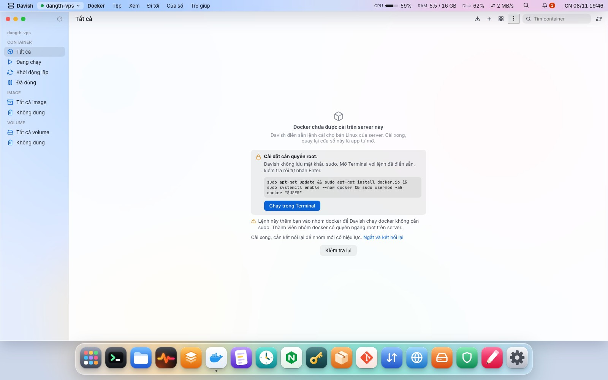

<table><tr>
  <td>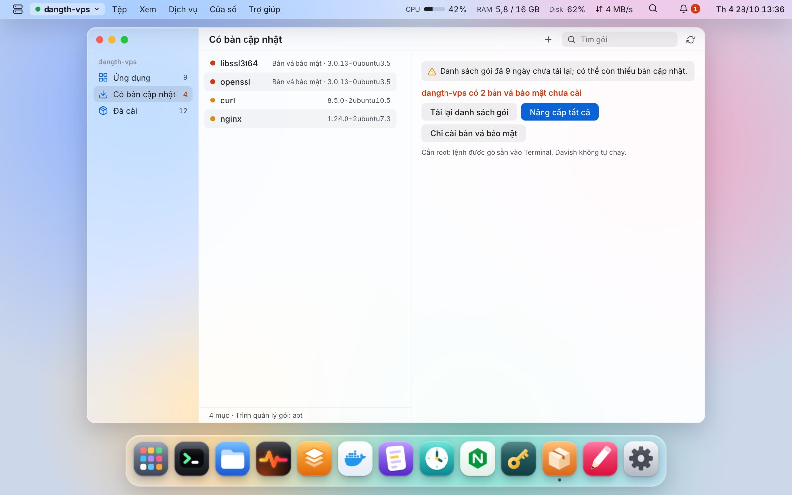</td>
  <td>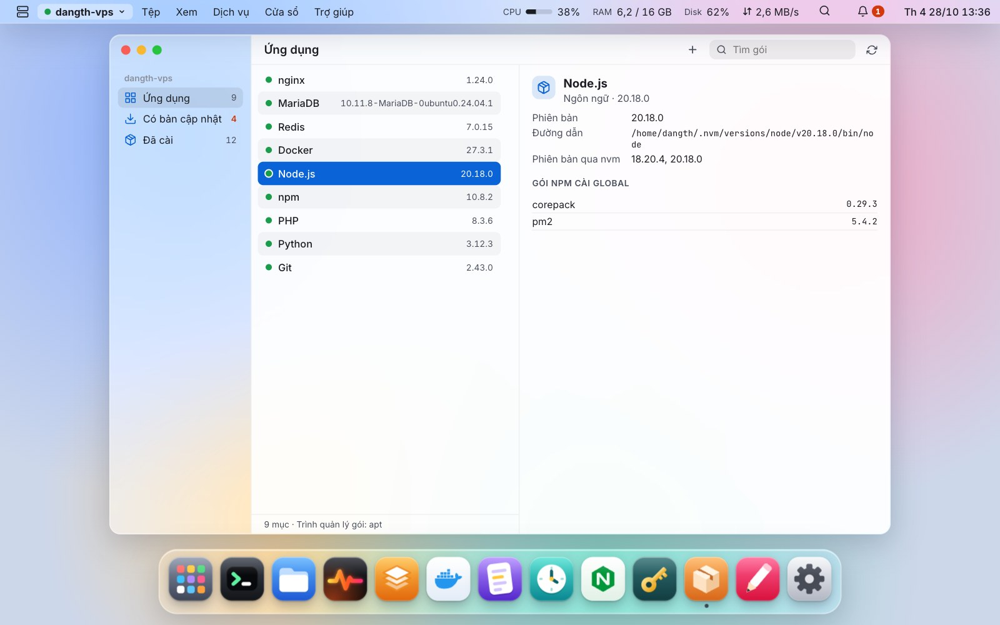</td>
</tr></table>

## Database

MariaDB/MySQL, PostgreSQL and MongoDB databases with their size, and SQLite files, from Launchpad or Spotlight. Create a database and a user that owns it with a random password, shown once and kept nowhere; the statement goes on stdin, so the password is neither in the command log nor in a shell history. Delete a database after typing its name. Dump one to `~/db-backups` (`mysqldump` / `pg_dump`, compressed) and download it from Files, or restore a dump after seeing the exact command and typing the name. Open the database server through a tunnel to use your own tools. Davish connects as you or as `postgres`; when only root may connect, it goes through `sudo`, asking for the sudo password once per session, and your dumps still land in your own `~/db-backups`.

**MongoDB** shows each database with its collections. When authentication is on, log in once with host, port, user and password or a connection string: Davish tries it first and only then keeps it in this computer's keychain, like your SSH password, never in a file; **Forget login** removes it. The connection string reaches `mongosh` on stdin, so it is never on a command line, in `ps` or in the command log; `mongodump` and `mongorestore` read it from a file only you can read, removed the moment they finish.

**Find** looks, read-only, for the database servers running (with MongoDB's port and whether authentication is on) and for SQLite files in `/var/lib`, `/opt`, `/srv` and the home folders, to add with one click. **SQLite** files, also added by path or with **Open in Database** in Files, show their tables and rows and back up with SQLite's online backup, safe while the app writes; putting one back is typed into a terminal, since the app using it has to stop first. **How does Davish connect?** in the app says all of this in plain words.

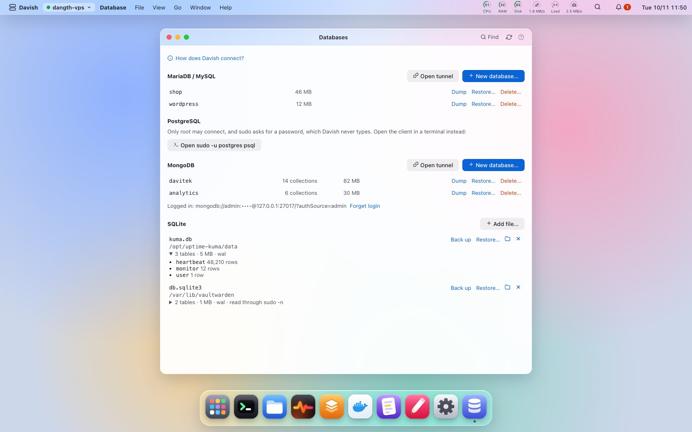

## Deploy an app

From Launchpad or Spotlight: a wizard from a git repository, a Docker image or a folder already on the server, run as a systemd service (the unit file is generated from a form), with docker compose, as a container or as static files, behind an nginx site on your domains with a Let's Encrypt certificate. Every file and command shows before anything runs; then it all runs step by step in a terminal and stops at the first step that fails. The last page lists what was made and gives one command that removes it all, to start over.

## Git

Finds the repositories in your home, `/var/www`, `/srv` and `/opt`, or folders you add. Branch, upstream and how far ahead or behind, changed files with their diffs, and a commit graph of every branch with merges and tags. Fetch, `pull --ff-only` (refused while the tree is dirty) and switch branches after confirming the exact command; `npm ci` / yarn / pnpm from the lockfile in a terminal. A rejected key leads to creating a deploy key.

**Clone a repository…** (SSH or HTTPS, folder, branch), **git init** and **Set a remote…** type the command into a terminal. For GitHub and GitLab over SSH, the host key they publish is added to `known_hosts` first; a button leads to creating a deploy key. **Deploy…** keeps a recipe per repository on your computer (pull, install, build, restart…) and runs it step by step in a terminal, stopping at the first step that fails. Davish looks at the repository (lockfile, `package.json` scripts, compose file, `go.mod`, `Makefile`) and at what runs the app from that folder (pm2, systemd, Docker compose), and offers the steps as switches: get the new code, install dependencies, build, restart the app, plus custom steps. Each step shows its exact command, and the choices are remembered. Deploy runs right away in a terminal; when a step needs sudo, the line is typed for you to press Enter and type the password. The terminal shows each step as done, running or failed with its time, a notification says when the deploy finished or which step failed, and the repository lists its last deploys with commit and duration.

<table><tr>
  <td>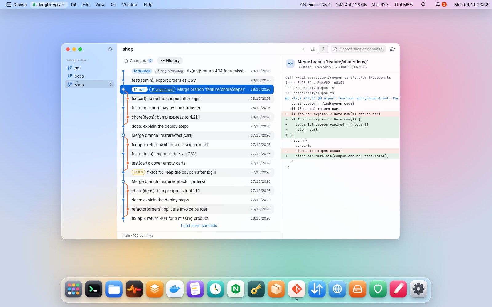</td>
  <td>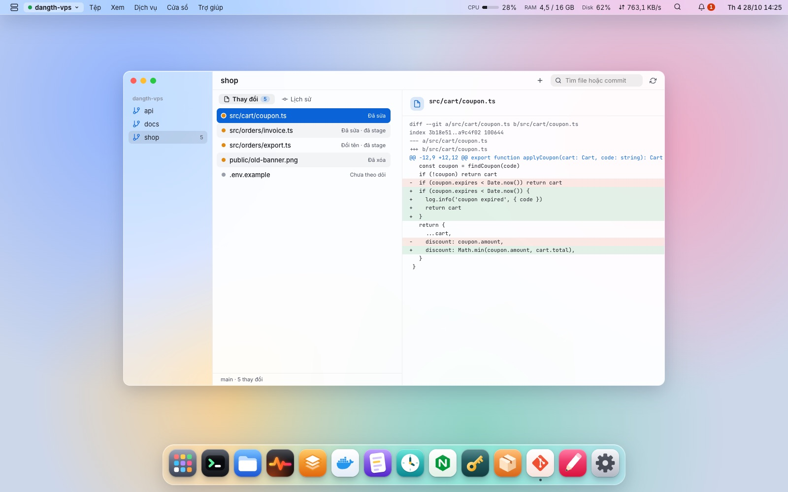</td>
</tr></table>

## Ports & tunnels

Every TCP port the server listens on, with its process or container. Open one in Davish's own browser window, or forward it to `127.0.0.1` on your machine over the SSH connection you already have, open it in your browser or point a database tool at it, even as a domain name for nginx sites. Nothing is opened to the outside.

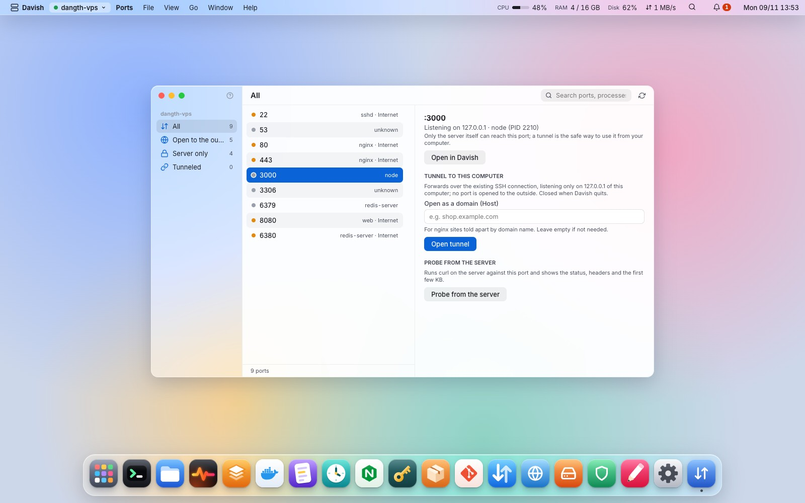

**Open to the Internet** tells, for each port, whether the Internet can reach it, from where it listens, ufw's rules (read with `sudo -n` when needed) and Docker, whose published ports bypass ufw. Open or close a port with `ufw`, typed into a terminal; the port of the SSH session in use is never closed, and closing 80/443 warns about nginx sites. Databases and admin tools found open (Redis, PostgreSQL, Grafana…) are listed with one command that closes them all.

## Browser

Type `localhost:3000` and see the web app running on the server, inside a Davish window: back, forward, reload, redirects and websockets (hot reload) stay on the server, logins keep working. It goes over SSH through a proxy on a random `127.0.0.1` port, so nothing clashes with what runs on your machine, and the page lives at its own origin, never able to reach Davish.

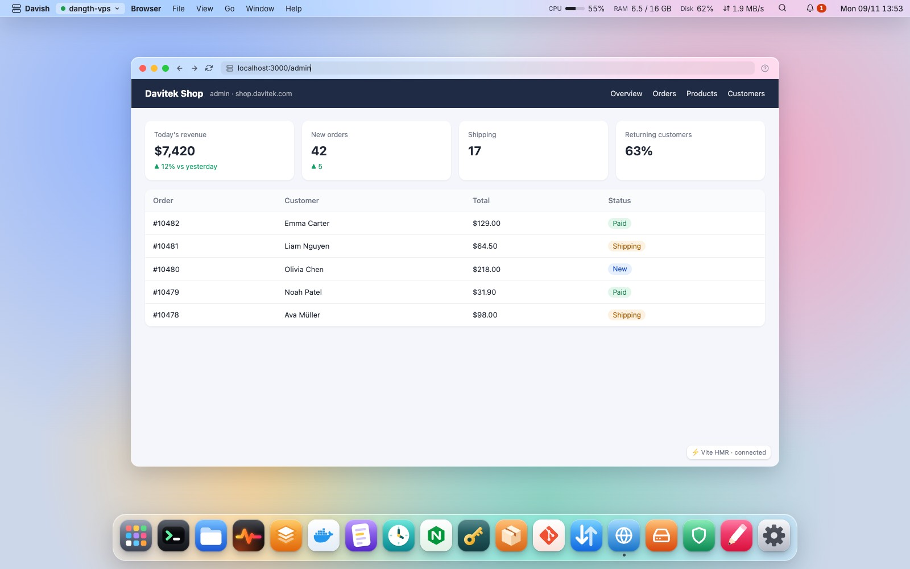

## Disk

Where each disk's space goes, from one scan of the whole disk (as root through `sudo` when sudo needs no password or the session has it; otherwise **Measure with sudo…**). The overview splits the disk into measured folders, deleted files a process still holds open, what could not be measured and free space, and explains the gaps: the folders this user cannot read, with a `sudo du` to run in a terminal, and which process holds which deleted file. Folders open in place as a tree, deeper levels measured when opened; a Large files tab lists every file from 50 MB.

Delete a folder or file, or empty a file such as a log so the program writing it carries on, after seeing the exact command; anything from 1 GB, or a folder with content, asks for its name. System folders, package databases, Docker's and databases' data and home folders are refused, and root's files are deleted or emptied through `sudo` once you confirm. When a path goes through a link or a folder other users may change, Davish types the command into a terminal instead. Cleanups that need root run through `sudo` too; your own caches always run as you. Cleanups list the space they free: Docker images, stopped containers, build cache, volumes (flagged as data) and container logs, the journal, rotated logs, package caches, crash dumps, old temporary files, old snap revisions, `~/.cache` and the npm cache, each with its exact command. A full-disk alert opens it at the right mount.

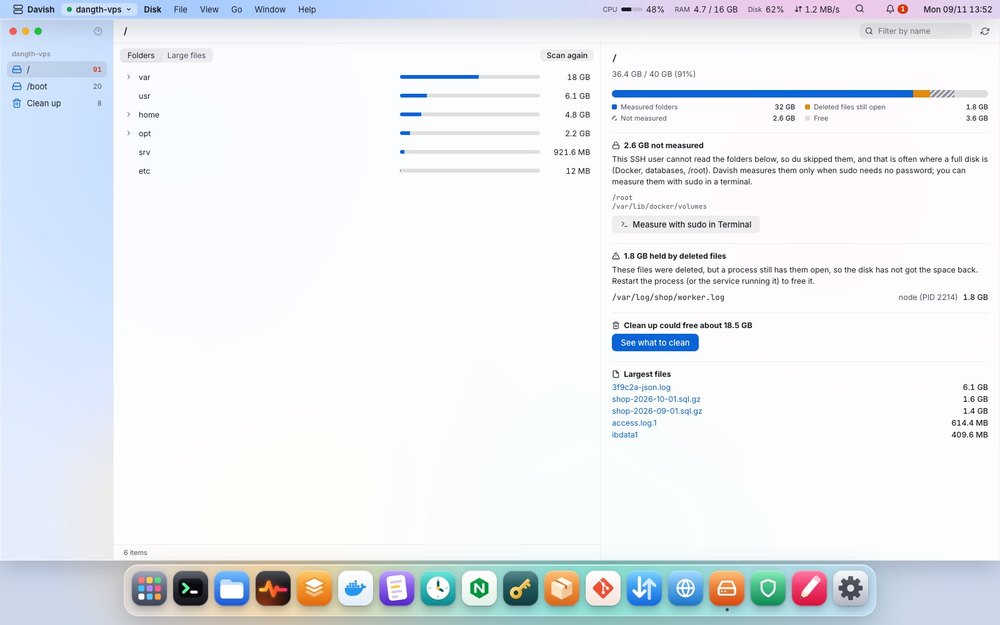

<table><tr>
  <td>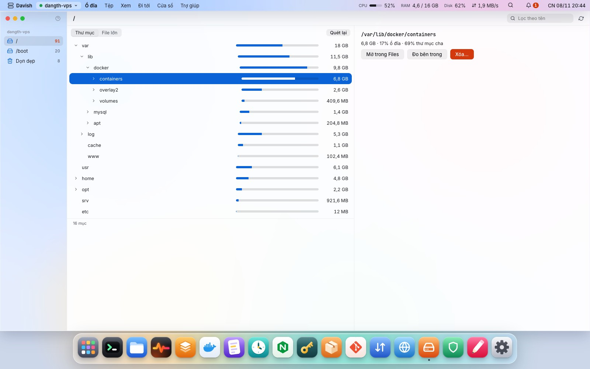</td>
  <td>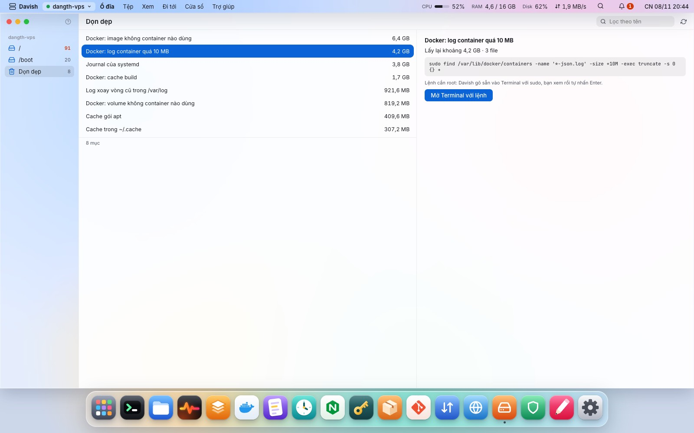</td>
</tr></table>

## Security

Who logs in over SSH and who keeps trying. At the top, the week in numbers (failed logins, unknown users, addresses, banned, successful logins), failed logins hour by hour, and the addresses and user names tried most, with those fail2ban banned or ufw blocks marked. Below, who is logged in right now, every address with the names it tried, recent logins, ufw and fail2ban. Failed logins and blocked addresses are tables you can select and copy from: each address with its tries, the names it tried, its last try and whether it is blocked, with Block or Unblock on the row; tick several to block them at once. Every block, unblock, ban or unban shows the exact commands first and runs once you confirm, through `sudo` with the sudo password asked once per session; what needs root to read (`lastb`, ufw, fail2ban) is read as root too. Password logins are turned off from a terminal, checked by `sshd -t` before the reload.

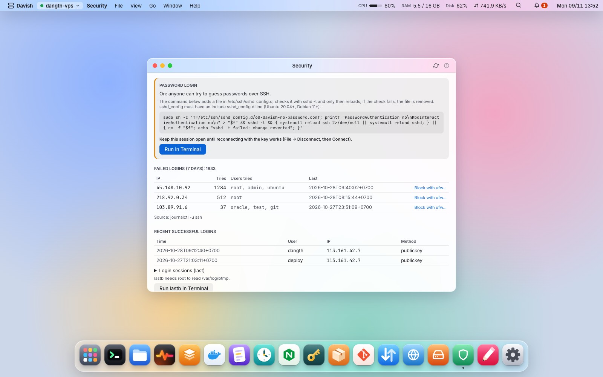

## SSH keys

The server's `authorized_keys` with the key Davish logs in with marked; add or remove keys with a backup. Create a deploy key on the server and test it against GitHub or GitLab, checked against their published host key. Generate a key on your machine, put it on the server and switch to it.

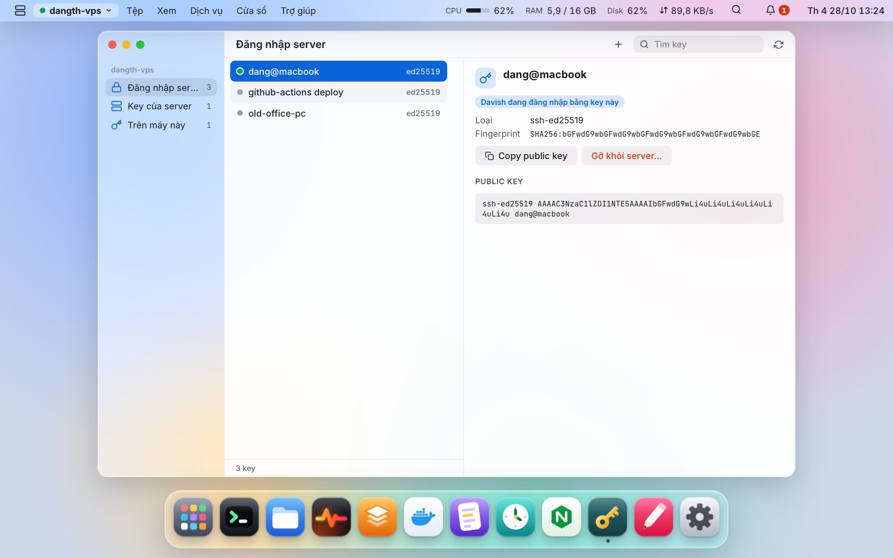

## ~/.ssh/config and ProxyJump

Import hosts from `~/.ssh/config` in one go, keys and `ProxyJump` included; Davish only reads the file. Servers behind a bastion connect through it, each hop with its own host key check, and the whole chain reconnects on its own.

## Spotlight & Launchpad

A real menu bar (File, View, Go, Window, Help and the focused app's own commands) with every shortcut listed under `⌘/`, and a `?` on each app explaining what it does and which commands it runs. `⌘K` (or the magnifier in the menu bar) to open an app, a service, a container, a folder, a `/path`, or `> a command` typed into a terminal. Launchpad (`⌘⇧A`) starts with the five apps you opened last, then every app in groups (files & terminal, monitoring, web & containers, security & access, development, system), with a tab per group and a search across all of them; `+` pins an app to the Dock, `−` takes it off, and one button puts the Dock back as it came.

<table><tr>
  <td>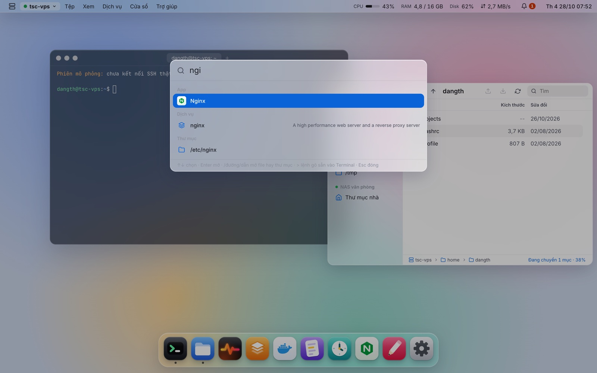</td>
  <td>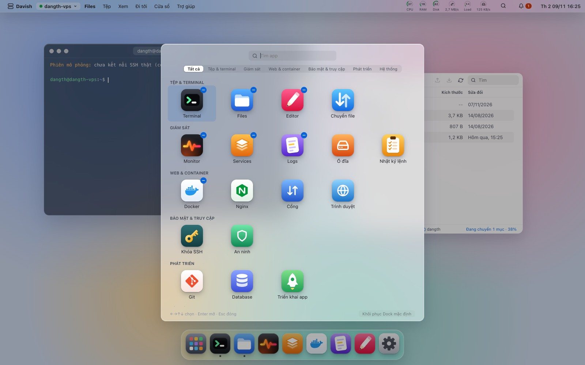</td>
</tr></table>

## Menu bar and help

A real menu bar (File, View, Go, Window, Help and the focused app's own commands), every shortcut under `⌘/`, a `?` on each app explaining what it does and which commands it runs on the server, a first-run tour and a demo mode with sample data.

<table><tr>
  <td>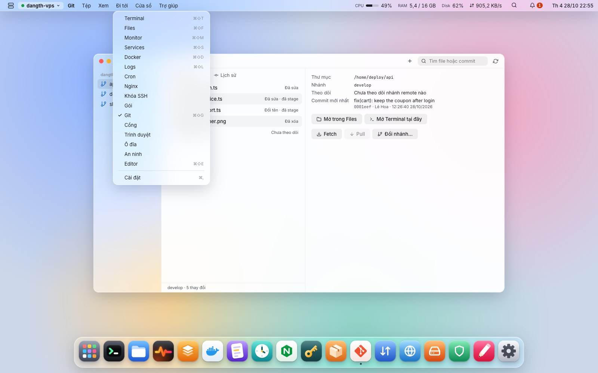</td>
  <td>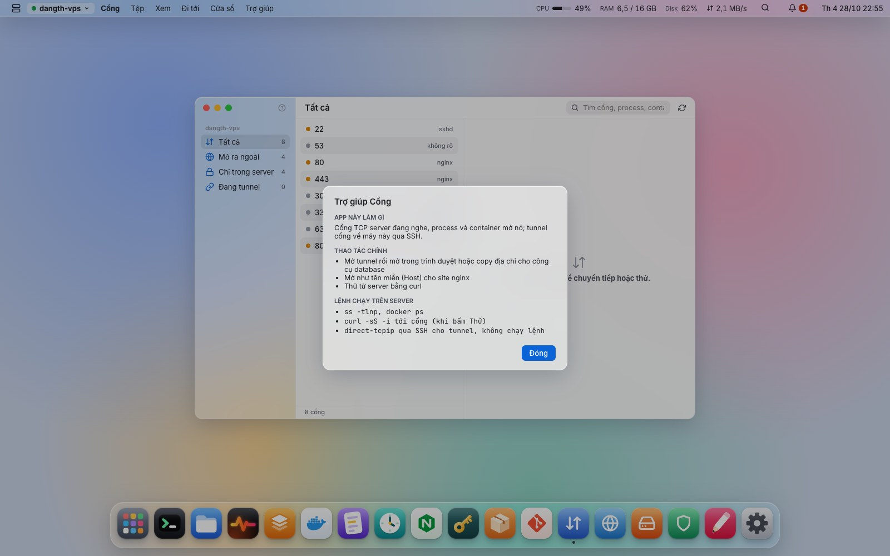</td>
</tr></table>

## App lock

Touch ID or a password of its own covers everything when you step away. Forgot the password? Resetting it removes the saved server passwords first, so it never opens a way into a server. Windows open, close and minimize into the Dock with a genie effect.

<table><tr>
  <td>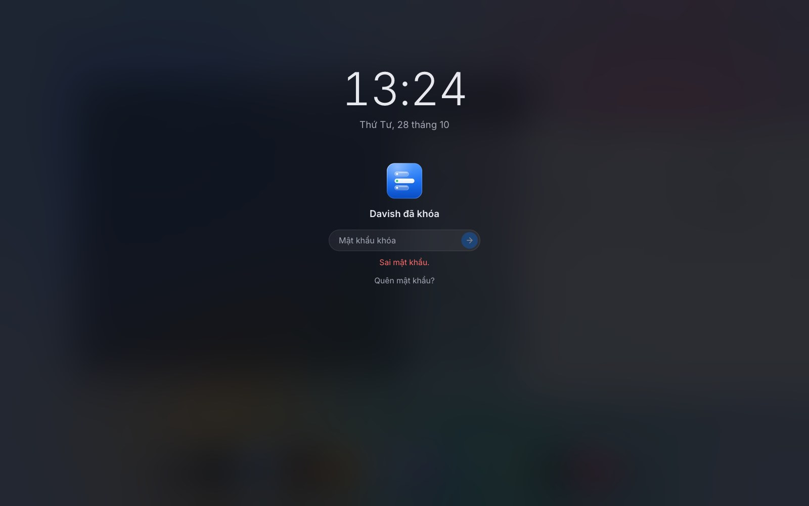</td>
  <td>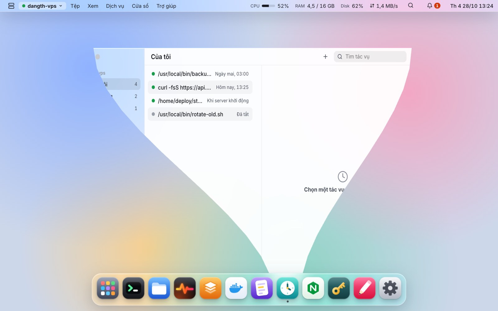</td>
</tr></table>

## Updates

Davish looks for a new release on GitHub when it starts and every six hours (you can turn that off in Settings, and check by hand from the menu). A new version shows what changed, with **Update**, **Later** and **Skip this version**. Update downloads the build for your machine, checks it against a checksum list signed with Davish's release key, swaps it in for the running app and restarts. Nothing to uninstall or reinstall; the previous copy is kept until the next start in case the new one fails to open. Right-click a Dock icon to open it, keep it in the Dock or close it, as on macOS.

## Light and dark

Davish comes in a light and a dark look. By default it follows your computer and switches when the system does; pick Light or Dark in Settings → Appearance → Theme to keep one. Terminal and Logs stay dark either way, and the wallpaper color you chose carries over, dimmed for the night.

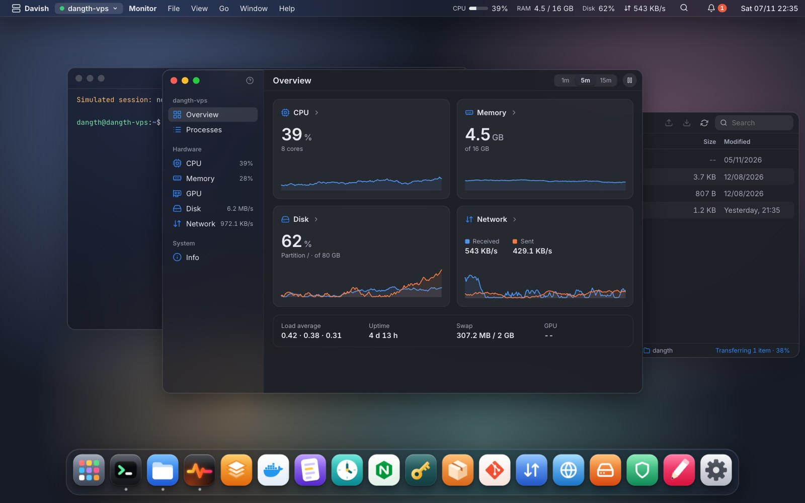

<table><tr>
  <td>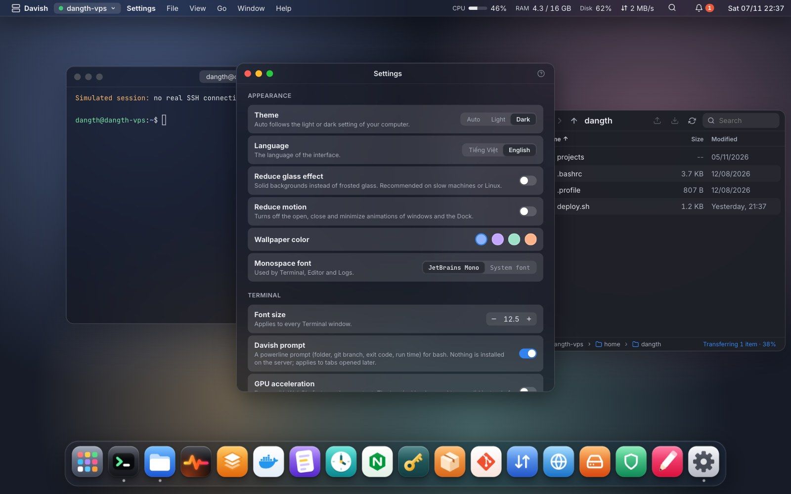</td>
  <td>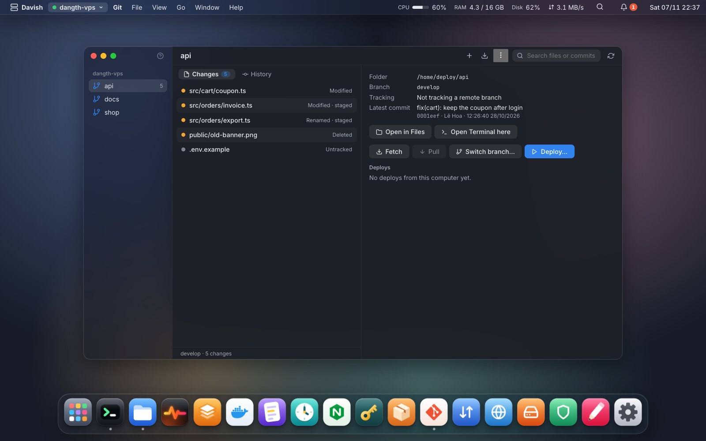</td>
</tr><tr>
  <td>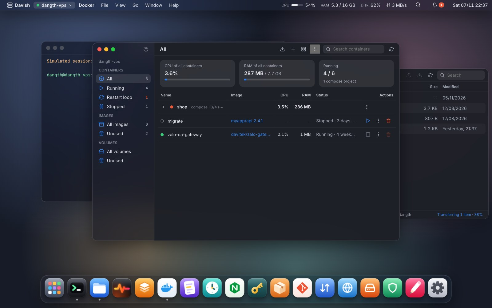</td>
  <td>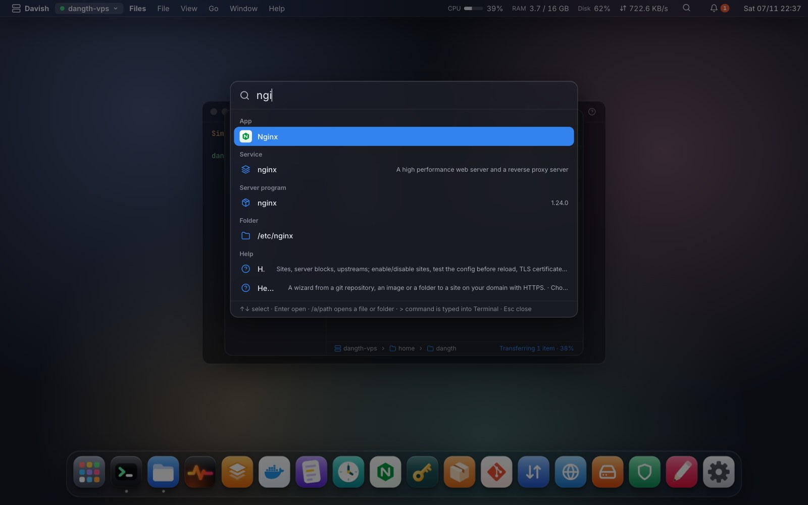</td>
</tr></table>

## Language

The whole interface comes in English, Vietnamese, Simplified Chinese and Spanish (Spain): menus, dialogs, help, error messages, the dates and numbers. The first time, Davish follows your system's language; after that, pick one in Settings → Appearance → Language. Davish restarts to switch, and your servers reconnect on their own.
