# Tính năng của Davish

[English](FEATURES.md) · **Tiếng Việt** · [Về README](README.vi.md)

Mọi app trong Davish, làm được gì và chạy gì trên server. Ảnh chụp dùng dữ liệu mẫu của bản xem trước trên trình duyệt.

## Terminal

xterm.js nhiều tab, copy/paste, vẽ bằng GPU, và prompt powerline tùy chọn được nạp vào bash lúc đăng nhập, không ghi gì lên server.

## Files

Trình duyệt kiểu Finder qua SFTP: tải lên, tải xuống, kéo thả từ hệ điều hành, đổi tên, xóa, nén, và copy giữa các server qua máy bạn.

## Editor

CodeMirror 6, tô màu cho nginx, YAML, JSON, shell, env và file cấu hình. Lưu atomic giữ nguyên mode và chủ file, sao lưu file trong `/etc`, cảnh báo khi file đã đổi trên server.

## Logs

Theo dõi journal của dịch vụ, một file hoặc một container. Lọc, tạm dừng, tô dòng lỗi, bấm đường dẫn file để mở trong Editor đúng dòng.

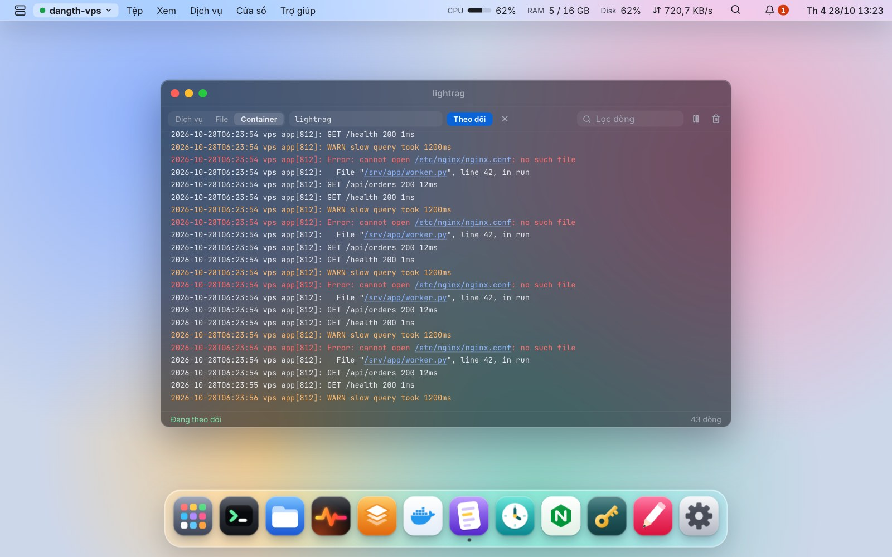

## Monitor

CPU từng nhân, bộ nhớ và swap, ổ đĩa, mạng theo interface, GPU NVIDIA, tiến trình. Cảnh báo RAM và ổ đĩa chỉnh được ngưỡng.

## Services

Dịch vụ systemd theo trạng thái, chi tiết và journal; khởi động, dừng, khởi động lại. Xóa dịch vụ không còn dùng: unit do admin tạo thì xóa file, unit của gói (như `certbot` cũ) thì chặn hẳn cùng timer chạy nó.

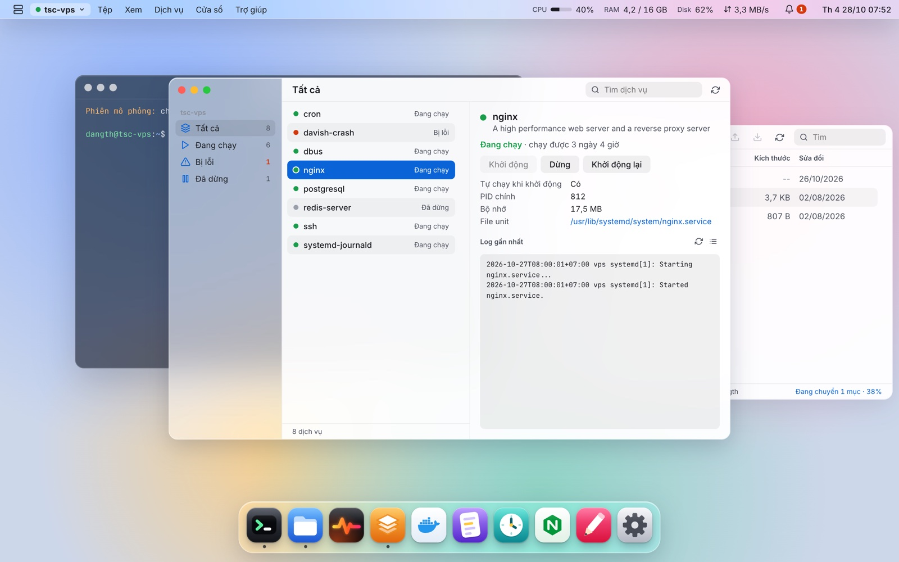

## Docker

Bố cục như Docker Desktop. Container dạng bảng (ID, image, cổng, CPU, RAM, trạng thái), gom theo project compose, phía trên là CPU và RAM chúng dùng chung; khởi động, dừng, menu ⋮ (log, shell trong container, khởi động lại, chi tiết) và xóa ngay trên dòng, mọi thao tác phá hủy đều hiện đúng lệnh trước. Cổng publish bấm là mở trong Trình duyệt của Davish. Image kèm dung lượng image đang được dùng, các layer và cấu hình; chạy image trong Terminal hoặc xóa image không dùng. Volume kèm dung lượng và còn container nào dùng không. Vẫn cảnh báo container khởi động lại liên tục.

**Pull image…** và **Chạy container mới…**: form nhập tên, image, cổng, biến môi trường (gõ tay hoặc file `.env`), volume, chính sách khởi động lại, network rồi sinh đủ lệnh `docker run`. Cổng mặc định bind `127.0.0.1`, cảnh báo khi bind `0.0.0.0`. Lệnh được gõ sẵn vào Terminal để bạn nhấn Enter và xem tiến độ.

**Compose**: menu ⋮ của mỗi project có up, pull, restart, down và mở file compose trong Editor; **Stack compose mới…** ghi `compose.yaml` từ mẫu (một container, web + database, app + Redis) vào một thư mục, không bao giờ ghi đè file đã có. Tạo network, volume, và sao chép container bất kỳ thành lệnh `docker run` dựng lại nó.

<table><tr>
  <td>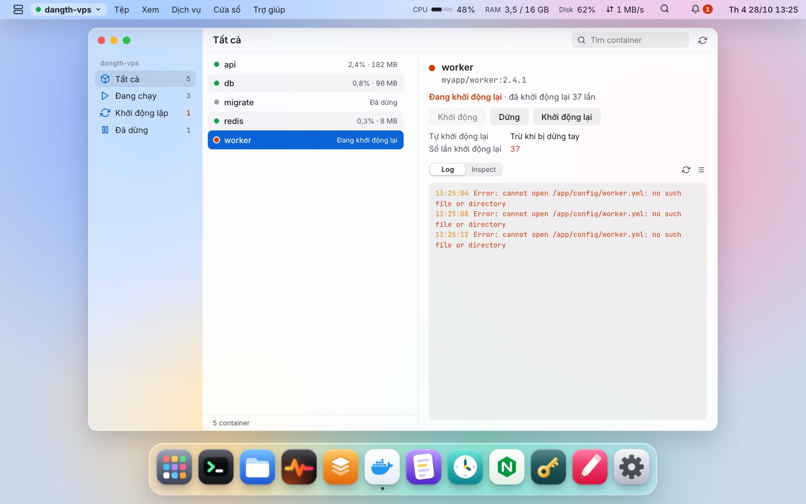</td>
  <td></td>
</tr></table>

## Cron

Crontab của bạn và của hệ thống, lịch nói bằng lời, lần chạy kế tiếp theo giờ server, sửa an toàn có sao lưu.

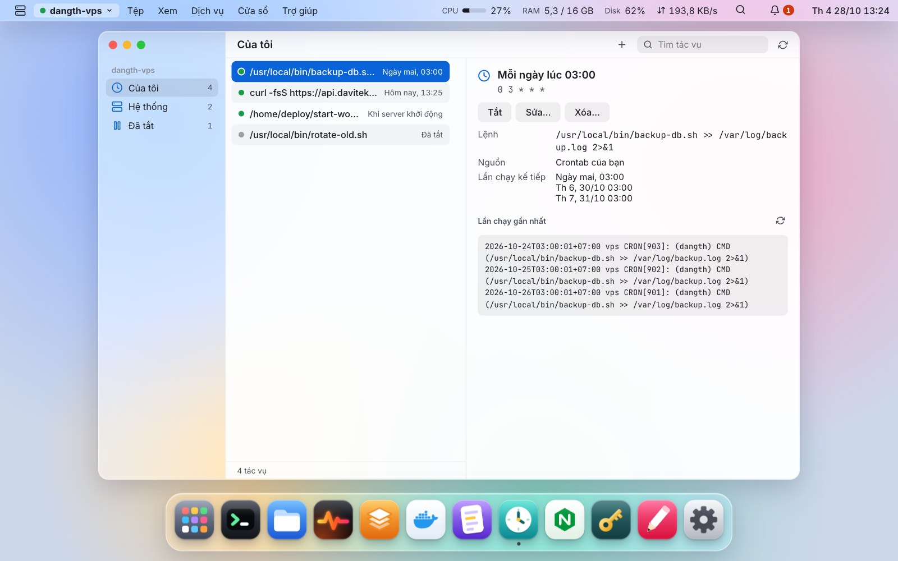

## Nginx

Site, server block và upstream; bật/tắt site, `nginx -t` trước mỗi lần reload, lỗi mở đúng dòng; cảnh báo chứng chỉ TLS sắp hết hạn. Xóa site, kèm chứng chỉ Let's Encrypt nếu không site nào khác dùng.

**Site mới…** dựng reverse proxy (tới một cổng hoặc container, có tùy chọn WebSocket), thư mục tĩnh hoặc PHP-FPM (tự tìm socket php-fpm đã cài). Bạn thấy và sửa được cấu hình sinh ra cùng lệnh chính xác trước khi chạy; site chỉ được bật khi `nginx -t` qua, lỗi thì tắt lại và hiện lỗi của nginx.

**Bật HTTPS…** kiểm tra (từ máy bạn) từng tên miền đã trỏ về server chưa, cảnh báo tên nào chưa, rồi mở Terminal với `sudo certbot --nginx -d …` gõ sẵn (tùy chọn chuyển HTTP sang HTTPS).

**Sửa nhanh…** thêm tên miền, đổi địa chỉ proxy (gợi ý từ những gì đang nghe trên server), bật/tắt gzip, đặt giới hạn dung lượng tải lên. File hiện tại được sao lưu trước và trả lại nếu `nginx -t` lỗi.

<table><tr>
  <td>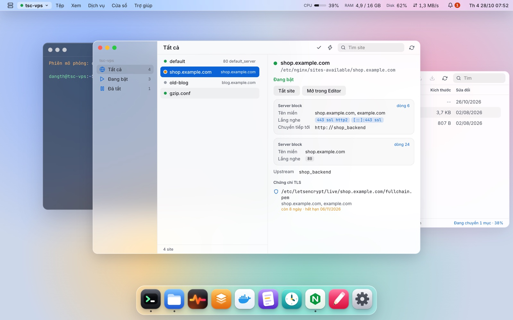</td>
  <td>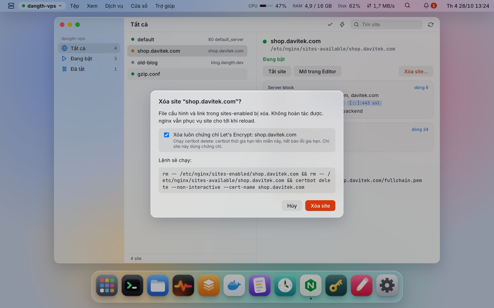</td>
</tr></table>

## Gói

Gói apt, dnf, yum hoặc apk đã cài và có bản cập nhật, bản vá bảo mật lên đầu, có thông báo khi kết nối. Các runtime và chương trình trên server (nginx, MariaDB, Redis, Docker, Node.js qua nvm, PHP với php-fpm, Python…) kèm phiên bản, file cấu hình và dịch vụ; tìm được bằng Spotlight. Cài và nâng cấp thì gõ sẵn lệnh `sudo` vào Terminal cho bạn.

<table><tr>
  <td>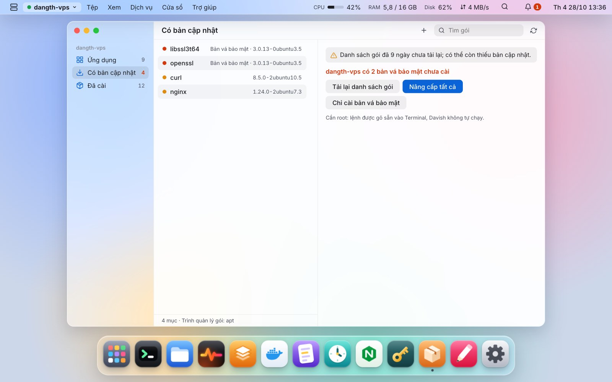</td>
  <td>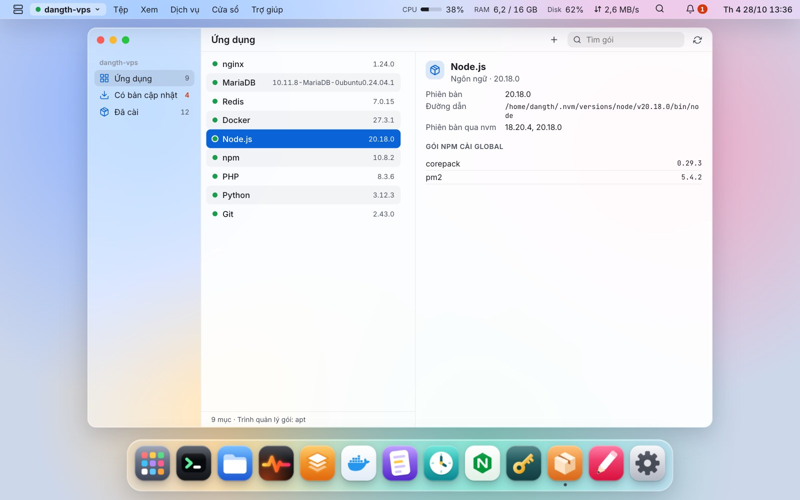</td>
</tr></table>

## Git

Tìm repo trong home, `/var/www`, `/srv`, `/opt` hoặc thư mục bạn thêm. Nhánh, nhánh remote và số commit chưa đẩy/chưa kéo, file thay đổi kèm diff, biểu đồ commit của mọi nhánh với merge và tag. Fetch, `pull --ff-only` (bị chặn khi repo còn thay đổi chưa commit) và đổi nhánh sau khi xác nhận đúng lệnh; `npm ci` / yarn / pnpm theo lockfile trong Terminal. Remote từ chối key thì dẫn tới tạo deploy key.

<table><tr>
  <td></td>
  <td>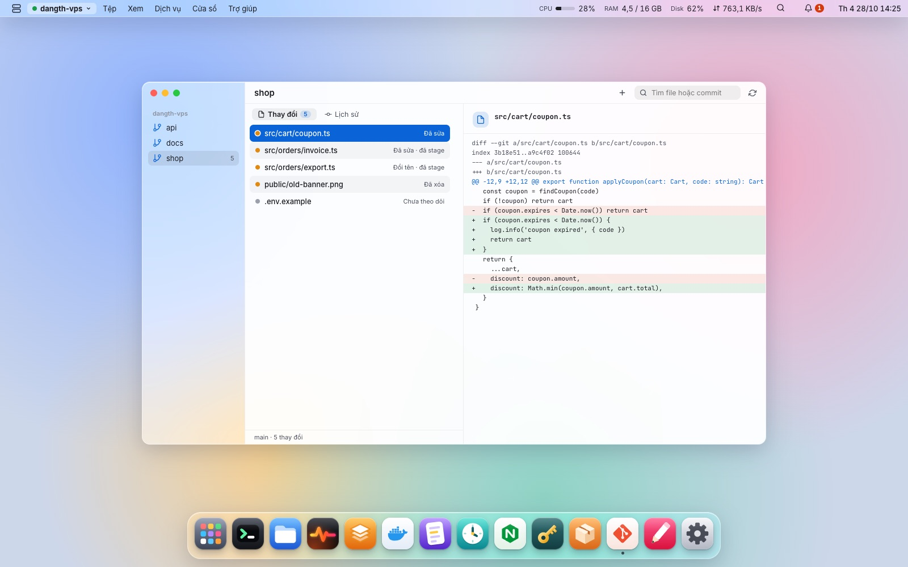</td>
</tr></table>

## Cổng và tunnel

Mọi cổng TCP server đang nghe, kèm process hoặc container. Tunnel một cổng về `127.0.0.1` trên máy qua chính kết nối SSH đang có, mở trong trình duyệt hoặc trỏ công cụ database vào, kể cả mở như một tên miền cho site nginx. Không mở cổng nào ra ngoài.

## Trình duyệt

Gõ `localhost:3000` để xem web app đang chạy trên server, ngay trong một cửa sổ Davish: lùi, tới, tải lại, redirect và websocket (hot reload) đều ở lại server, đăng nhập vẫn chạy. Đi qua SSH bằng một proxy nghe `127.0.0.1` ở cổng ngẫu nhiên nên không đụng app nào trên máy, và trang ở origin riêng, không bao giờ chạm được Davish.

## Ổ đĩa

Thứ gì chiếm từng ổ đĩa, đo từng thư mục một và đi sâu khi bấm đúp, không quét cả cây. Gợi ý dọn dẹp kèm dung lượng lấy lại (Docker, journal, log xoay vòng, cache gói), mỗi mục hiện đúng lệnh; thông báo ổ đầy mở thẳng đúng mount.

<table><tr>
  <td></td>
  <td>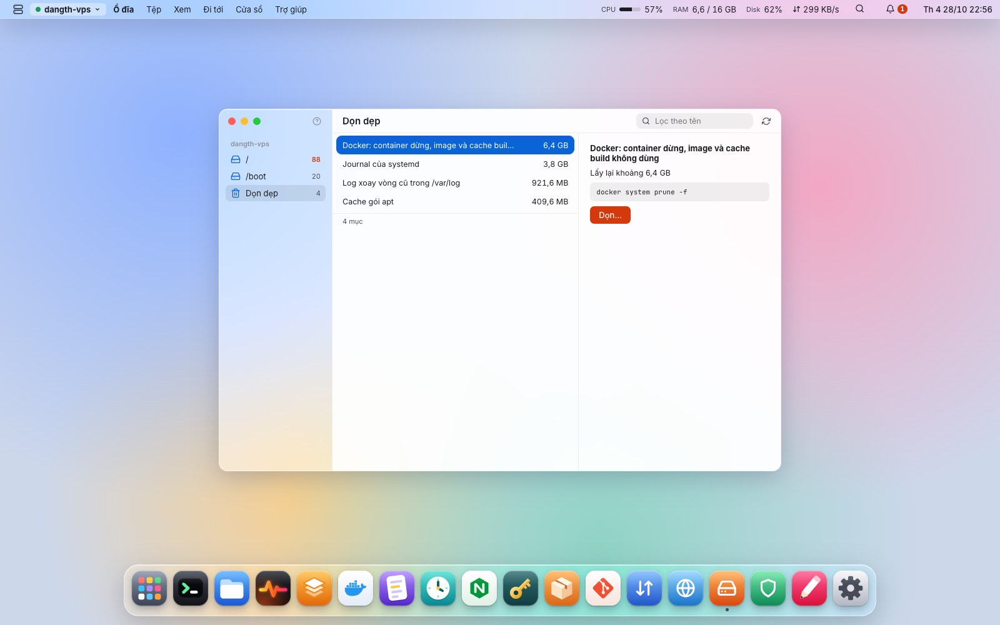</td>
</tr></table>

## An ninh

Ai đăng nhập qua SSH và ai đang dò: lần thử sai gom theo IP kèm tên user đã thử, đăng nhập gần đây, ufw và fail2ban. Chặn một IP hoặc tắt đăng nhập mật khẩu bằng lệnh `sudo` gõ sẵn vào Terminal, có `sshd -t` trước khi reload.

## Khóa SSH

`authorized_keys` của server, đánh dấu key Davish đang đăng nhập; thêm, gỡ key có sao lưu. Tạo deploy key trên server và thử với GitHub, GitLab (kiểm tra đúng host key họ công bố). Tạo key trên máy, đưa lên server rồi chuyển sang đăng nhập bằng nó.

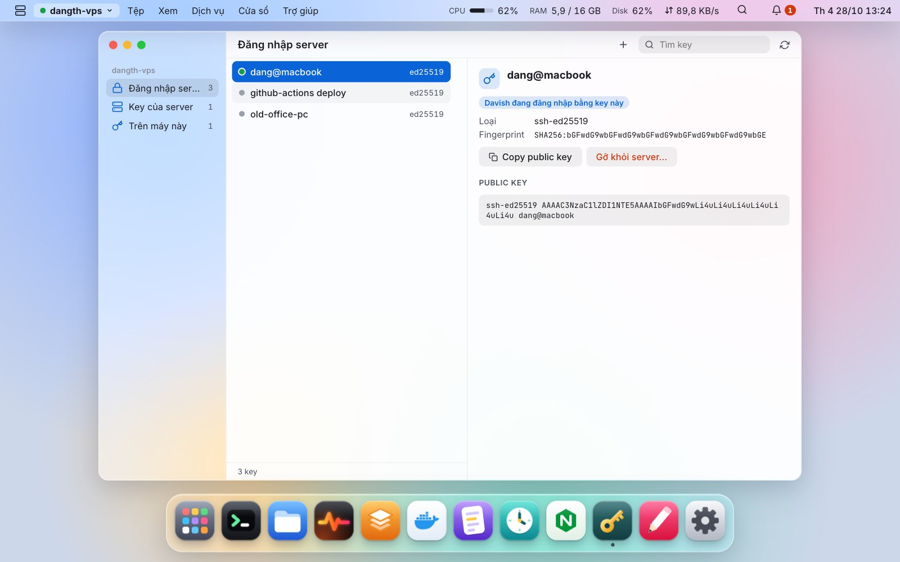

## ~/.ssh/config và ProxyJump

Nhập server từ `~/.ssh/config` một lần, kèm key và `ProxyJump`; Davish chỉ đọc file. Server sau bastion kết nối qua nó, mỗi bậc kiểm tra host key riêng, cả chuỗi tự kết nối lại.

## Spotlight & Launchpad

`⌘K` (hoặc kính lúp trên menu bar) để mở app, dịch vụ, container, thư mục, một `/đường/dẫn`, hoặc `> một lệnh` gõ sẵn vào Terminal. Launchpad (`⌘⇧A`) hiện mọi app và cho ghim vào Dock.

<table><tr>
  <td>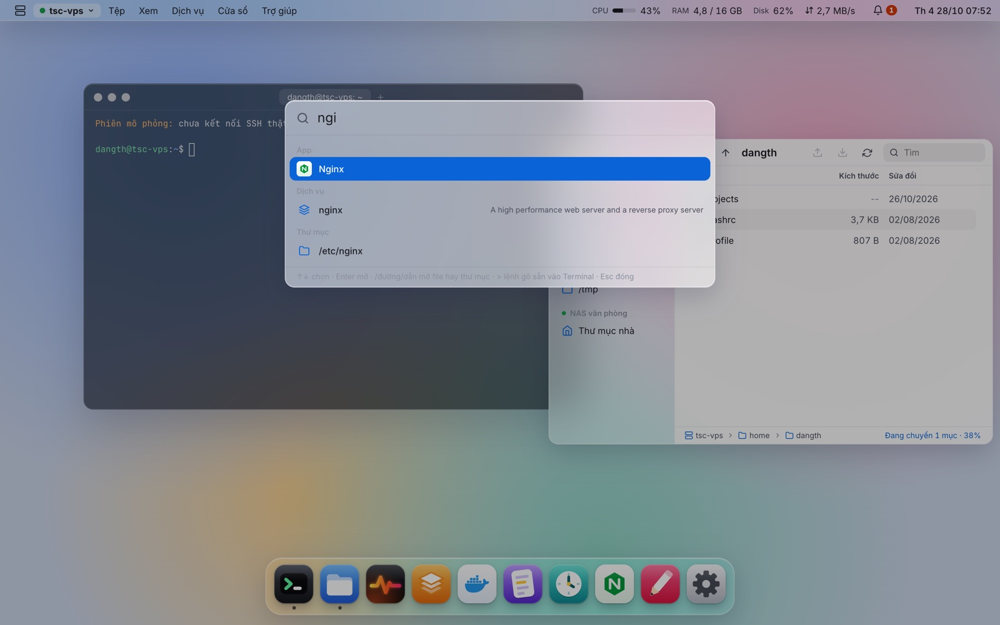</td>
  <td>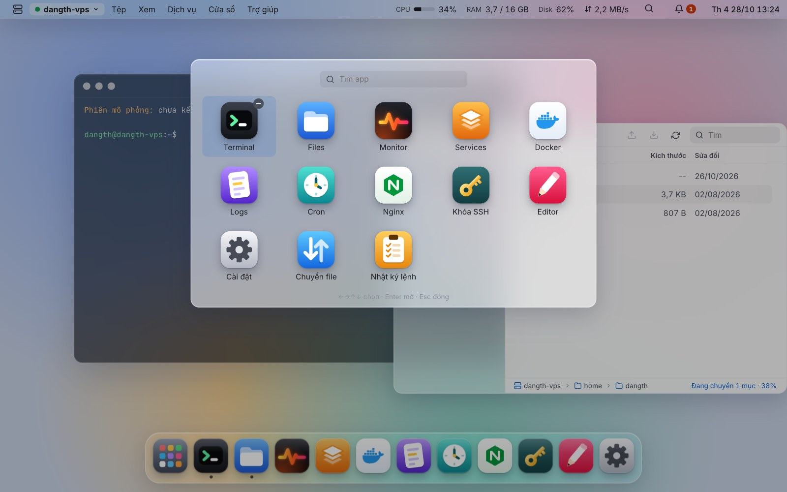</td>
</tr></table>

## Menu bar và trợ giúp

Menu bar thật (Tệp, Xem, Đi tới, Cửa sổ, Trợ giúp và lệnh của app đang mở), mọi phím tắt trong `⌘/`, nút `?` trên mỗi app giải thích app làm gì và chạy lệnh nào trên server, hướng dẫn nhanh lần đầu và chế độ xem thử với dữ liệu mẫu.

<table><tr>
  <td>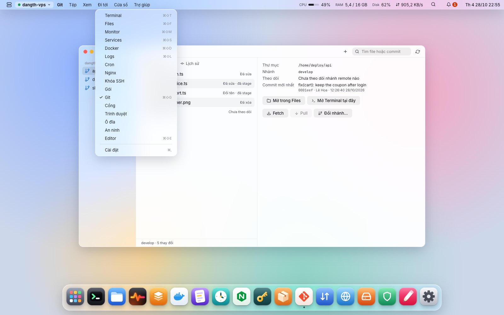</td>
  <td>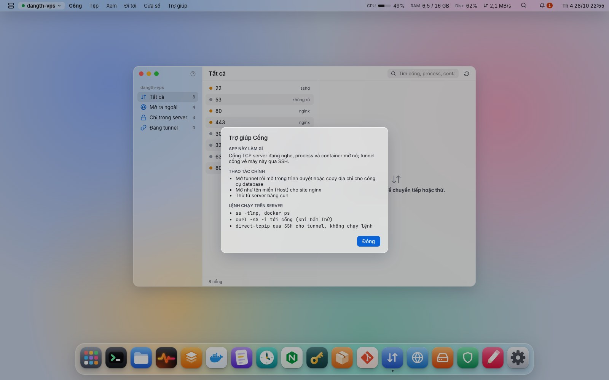</td>
</tr></table>

## Khóa app

Touch ID hoặc mật khẩu riêng che mọi thứ khi bạn rời máy. Quên mật khẩu thì đặt lại, nhưng Davish xóa mật khẩu server đã lưu trước, nên đặt lại không mở được đường vào server. Cửa sổ mở, đóng, thu nhỏ về Dock bằng hiệu ứng Genie.

<table><tr>
  <td>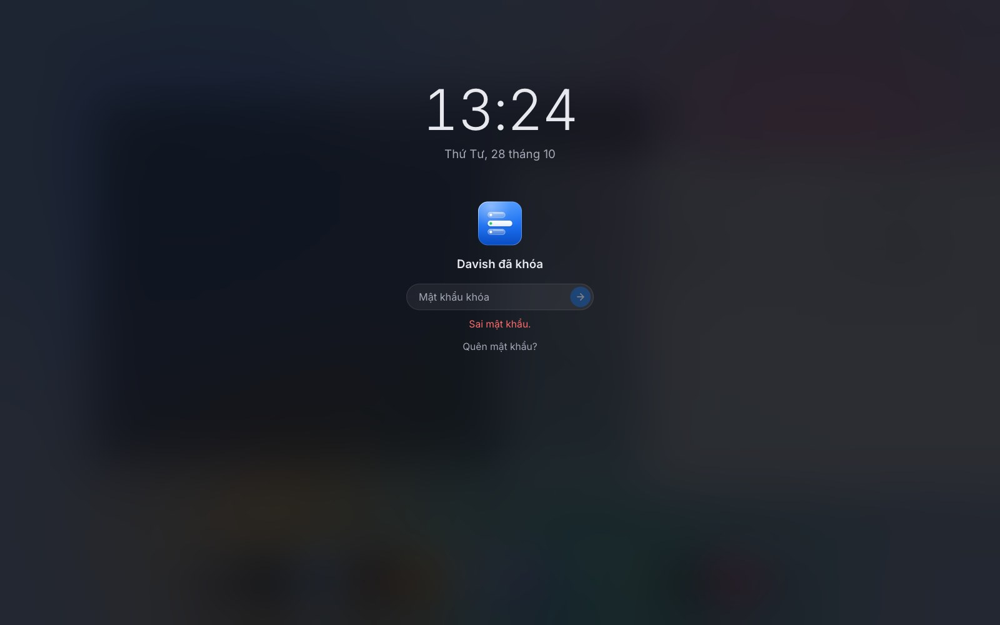</td>
  <td>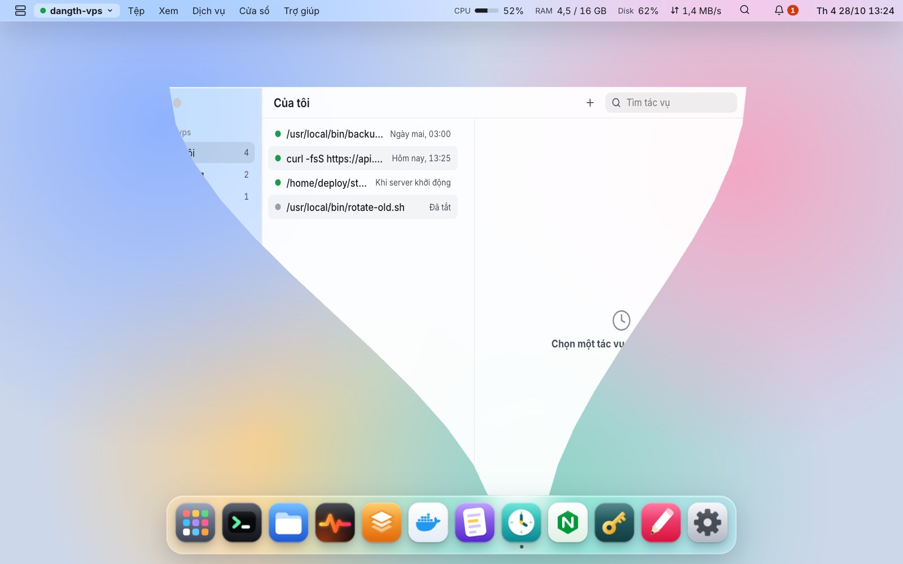</td>
</tr></table>

## Cập nhật

Davish tìm bản mới trên GitHub lúc mở và mỗi 6 giờ (tắt được trong Cài đặt, vẫn kiểm tra tay được từ menu). Có bản mới thì hiện những gì thay đổi, kèm **Cập nhật**, **Để sau** và **Bỏ qua bản này**. Cập nhật tải đúng bản cho máy bạn, đối chiếu với danh sách checksum được ký bằng khóa phát hành của Davish, thay bản đang chạy rồi khởi động lại. Không phải gỡ hay cài lại; bản cũ được giữ tới lần mở sau phòng khi bản mới không chạy. Chuột phải icon trên Dock để mở, giữ trên Dock hoặc đóng, như macOS.

## Ngôn ngữ

Toàn bộ giao diện có tiếng Việt và tiếng Anh: menu, hộp thoại, trợ giúp, thông báo lỗi, ngày tháng và số. Lần đầu Davish theo ngôn ngữ của máy; sau đó chọn trong Cài đặt → Giao diện → Ngôn ngữ. Davish khởi động lại để đổi, server tự kết nối lại.
