# Tính năng của Davish

[English](FEATURES.md) · **Tiếng Việt** · [Về README](README.vi.md)

Mọi app trong Davish, làm được gì và chạy gì trên server. Ảnh chụp dùng dữ liệu mẫu của bản xem trước trên trình duyệt.

## Terminal

xterm.js nhiều tab, copy/paste, vẽ bằng GPU, và prompt powerline tùy chọn được nạp vào bash lúc đăng nhập, không ghi gì lên server.

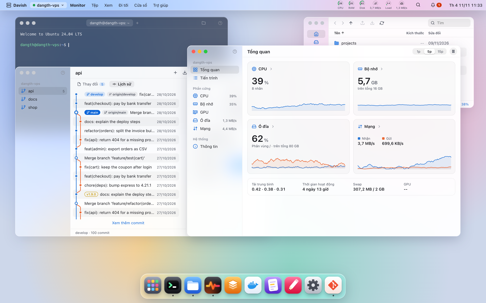

## Lệnh hay dùng

Lưu các lệnh hay gõ kèm tên, cho một server hoặc mọi server. Một cú bấm gõ sẵn lệnh vào Terminal của server để bạn kiểm tra rồi bấm Enter; không có gì tự chạy. Spotlight (`⌘K`) tìm được theo tên hoặc nội dung lệnh, và mỗi dòng trong Nhật ký lệnh có thể gõ lại vào Terminal hoặc lưu thành lệnh hay dùng. Lệnh được lưu trên máy bạn, dạng chữ thường: lệnh nào có vẻ chứa mật khẩu, token hay key thì Davish cảnh báo trước khi lưu.

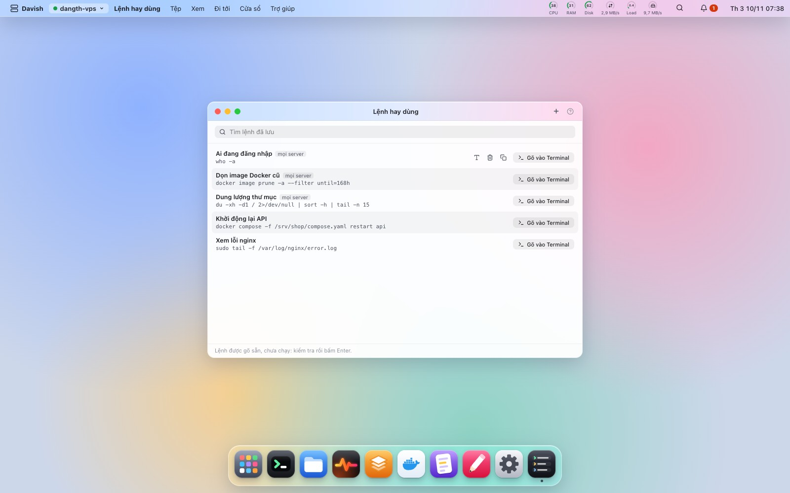

## Files

Trình duyệt kiểu Finder qua SFTP: tải lên, tải xuống, kéo thả từ hệ điều hành, đổi tên, xóa, nén, và copy giữa các server qua máy bạn. Chuột phải trên file để thấy mọi thao tác. Giữ chuột trên file rồi kéo nhẹ: một vòng thao tác mở quanh con trỏ (mở trong Editor hoặc Terminal, đổi tên, xóa, nén, copy đường dẫn, thêm vào màn hình chính); thả vào ô nào là chọn ô đó, thả ở giữa hoặc nhấn Esc để hủy. Chuột phải vào khoảng trống để tạo tệp hoặc thư mục ngay trong thư mục đang xem; Davish không bao giờ ghi đè file đã có.

## Lối tắt trên màn hình chính

Kéo file, thư mục hoặc script từ Files ra nền desktop, hoặc chuột phải và chọn "Thêm vào màn hình chính" (`⌘⌥P`). Double-click để mở: thư mục vào Files, file vào Editor, script chạy trong một tab Terminal. Mỗi server có màn hình riêng, nên `deploy.sh` của staging không xuất hiện trên production. Chuột phải vào icon và chọn Tùy chỉnh (`F2`) để đặt tên riêng, chọn icon có sẵn kèm màu, hoặc dùng ảnh từ máy, giống một alias: file trên server giữ nguyên tên, và hộp thoại chạy luôn hiện tên thật. Davish lưu đường dẫn và các lựa chọn này trên máy bạn, không bao giờ lưu nội dung file.

Lần đầu chạy một script, Davish hiện tên server và đúng lệnh. Chọn "Lần sau chạy luôn" thì lần sau chạy ngay, với điều kiện nội dung script còn nguyên; script bị sửa thì Davish hỏi lại kèm cảnh báo. Trong lúc chạy, Terminal hiện thời gian và nút **Dừng**, icon có nút X; cả hai gửi Ctrl-C vào đúng phiên đó. Xong thì có thông báo kèm mã thoát, và mỗi lần chạy được ghi vào nhật ký lệnh.

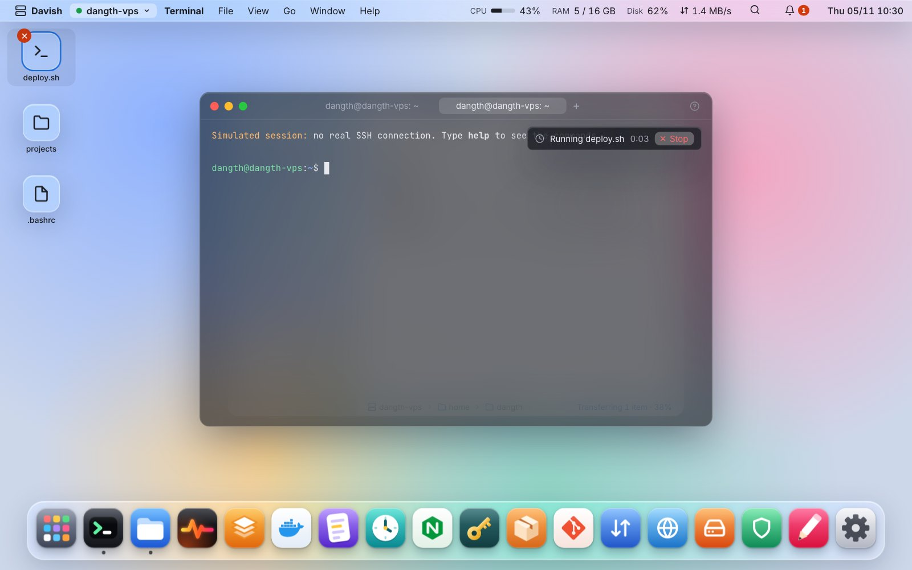

## Editor

CodeMirror 6, tô màu cho nginx, YAML, JSON, shell, env và file cấu hình. Lưu atomic giữ nguyên mode và chủ file, sao lưu file trong `/etc`, cảnh báo khi file đã đổi trên server.

## Logs

Theo dõi journal của dịch vụ, một file hoặc một container. Lọc, tạm dừng, tô dòng lỗi, bấm đường dẫn file để mở trong Editor đúng dòng.

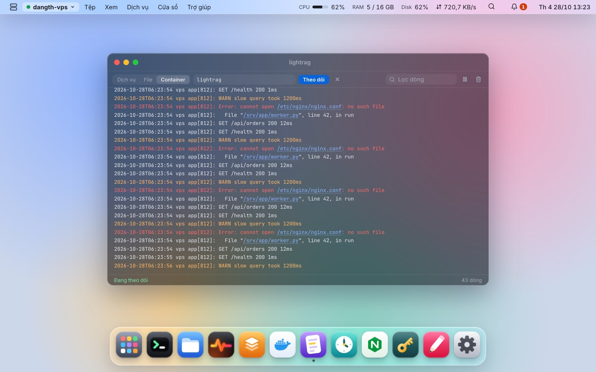

## Monitor

CPU từng nhân, bộ nhớ và swap, ổ đĩa, mạng theo interface, GPU NVIDIA, tiến trình. Cảnh báo RAM và ổ đĩa chỉnh được ngưỡng.

Trên server Windows (OpenSSH, Windows PowerShell 5.1, không cài thêm gì) Monitor đọc cùng các số liệu qua PowerShell và CIM: CPU, bộ nhớ, ổ đĩa, mạng, I/O đĩa và tiến trình. Windows không có load average, I/O wait hay steal nên các mục đó được ẩn. Các app cần Linux (Services, Docker, Logs, Cron, Nginx…) chưa dùng được trên server Windows; Launchpad hiện chúng mờ.

## Tất cả server

Mọi server trong một cửa sổ, mở từ menu server, Launchpad hoặc Spotlight: đã kết nối chưa, CPU, RAM, ổ `/`, load, thời gian chạy và mạng, kèm số cảnh báo (service lỗi, container khởi động lại liên tục, ổ đầy…) và cảnh báo mới nhất. Kết nối hoặc chuyển sang server ngay trên thẻ của nó. Số liệu chỉ được thu khi cửa sổ đang mở, qua cùng phiên mà Monitor dùng.

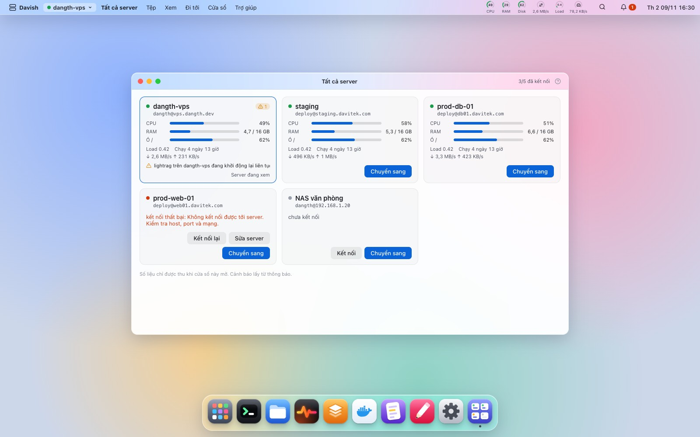

## Services

Dịch vụ systemd theo trạng thái, chi tiết và journal; khởi động, dừng, khởi động lại. Xóa dịch vụ không còn dùng: unit do admin tạo thì xóa file, unit của gói (như `certbot` cũ) thì chặn hẳn cùng timer chạy nó. Đăng nhập bằng user thường, Davish chạy qua `sudo` những gì systemd từ chối: hỏi mật khẩu sudo một lần mỗi phiên, chỉ giữ trong bộ nhớ (không lưu ổ đĩa, keychain hay nhật ký, mất khi ngắt kết nối hoặc khóa app), đưa cho sudo qua stdin, không bao giờ nằm trên dòng lệnh.

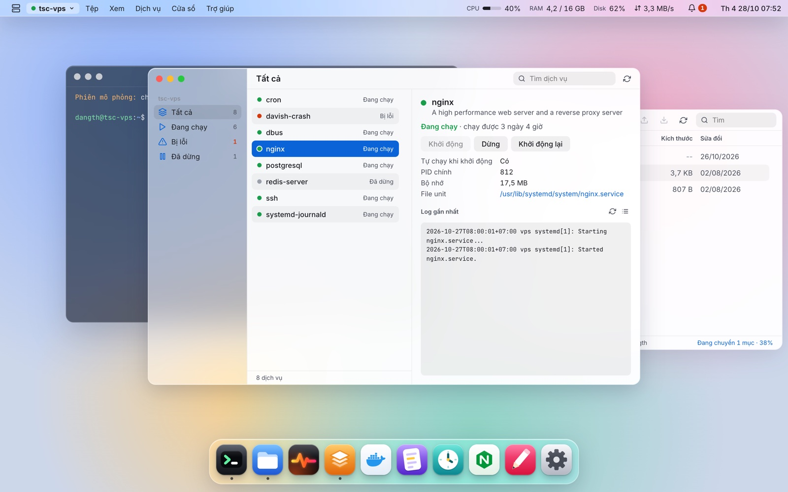

## Docker

Bố cục như Docker Desktop. Container dạng bảng (ID, image, cổng, CPU, RAM, trạng thái), gom theo project compose, phía trên là CPU và RAM chúng dùng chung; khởi động, dừng, menu ⋮ (log, shell trong container, khởi động lại, chi tiết) và xóa ngay trên dòng, mọi thao tác phá hủy đều hiện đúng lệnh trước. Cổng publish bấm là mở trong Trình duyệt của Davish. Image kèm dung lượng image đang được dùng, các layer và cấu hình; chạy image trong Terminal hoặc xóa image không dùng. Volume kèm dung lượng và còn container nào dùng không. Vẫn cảnh báo container khởi động lại liên tục.

**Pull image…** và **Chạy container mới…**: form nhập tên, image, cổng, biến môi trường (gõ tay hoặc file `.env`), volume, chính sách khởi động lại, network rồi sinh đủ lệnh `docker run`. Cổng mặc định bind `127.0.0.1`, cảnh báo khi bind `0.0.0.0`. Lệnh được gõ sẵn vào Terminal để bạn nhấn Enter và xem tiến độ.

**Compose**: menu ⋮ của mỗi project có up, pull, restart, down và mở file compose trong Editor; **Stack compose mới…** ghi `compose.yaml` từ mẫu (một container, web + database, app + Redis) vào một thư mục, không bao giờ ghi đè file đã có. Tạo network, volume, và sao chép container bất kỳ thành lệnh `docker run` dựng lại nó.

<table><tr>
  <td>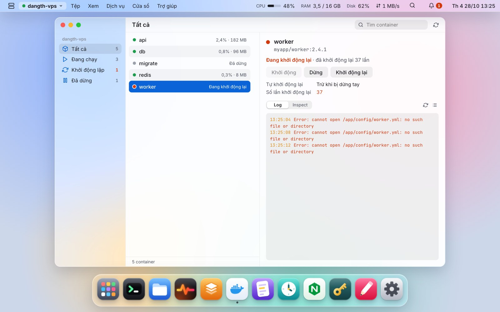</td>
  <td>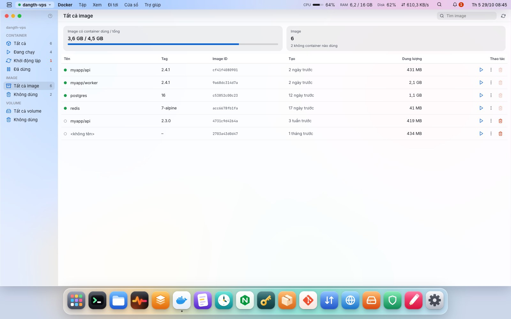</td>
</tr></table>

## Cron

Crontab của bạn và của hệ thống, lịch nói bằng lời, lần chạy kế tiếp theo giờ server, sửa an toàn có sao lưu.

Mỗi tác vụ liệt kê các file và thư mục trong lệnh của nó (script, log, thư mục `cd`), bấm là mở trong Editor hoặc Files. Tác vụ hệ thống mở được file cron và thư mục chứa nó.

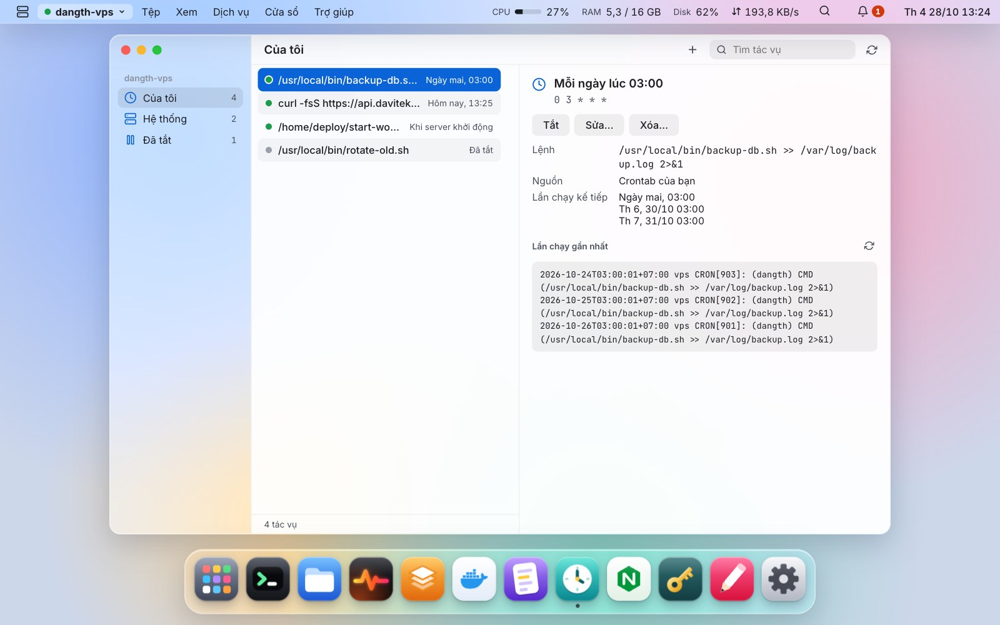

## Nginx

Site, server block và upstream; bật/tắt site, `nginx -t` trước mỗi lần reload, lỗi mở đúng dòng; cảnh báo chứng chỉ TLS sắp hết hạn. Xóa site, kèm chứng chỉ Let's Encrypt nếu không site nào khác dùng.

**Site mới…** dựng reverse proxy (tới một cổng hoặc container, có tùy chọn WebSocket), thư mục tĩnh hoặc PHP-FPM (tự tìm socket php-fpm đã cài). Bạn thấy và sửa được cấu hình sinh ra cùng lệnh chính xác trước khi chạy; site chỉ được bật khi `nginx -t` qua, lỗi thì tắt lại và hiện lỗi của nginx.

**Bật HTTPS…** kiểm tra (từ máy bạn) từng tên miền đã trỏ về server chưa, cảnh báo tên nào chưa, rồi mở Terminal với `sudo certbot --nginx -d …` gõ sẵn (tùy chọn chuyển HTTP sang HTTPS).

**Sửa nhanh…** thêm tên miền, đổi địa chỉ proxy (gợi ý từ những gì đang nghe trên server), bật/tắt gzip, đặt giới hạn dung lượng tải lên. File hiện tại được sao lưu trước và trả lại nếu `nginx -t` lỗi.

<table><tr>
  <td>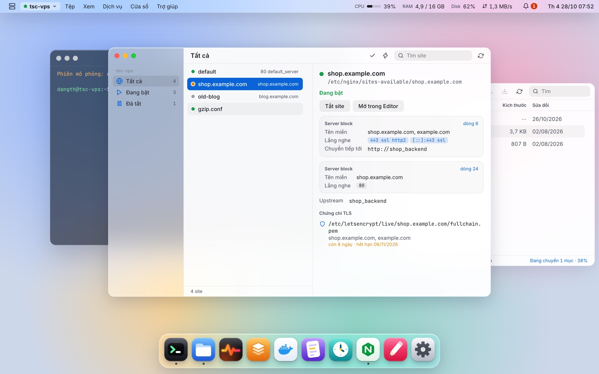</td>
  <td>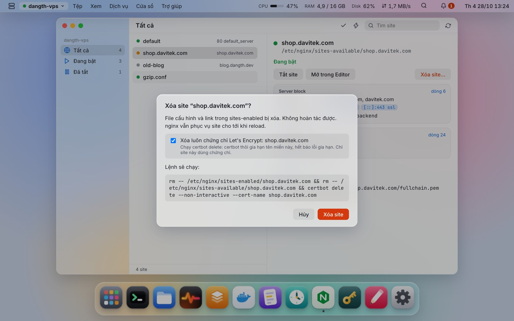</td>
</tr></table>

## Gói

Gói apt, dnf, yum hoặc apk đã cài và có bản cập nhật, bản vá bảo mật lên đầu, có thông báo khi kết nối. Các runtime và chương trình trên server (nginx, MariaDB, Redis, Docker, Node.js qua nvm, PHP với php-fpm, Python…) kèm phiên bản, file cấu hình và dịch vụ; tìm được bằng Spotlight. Cài và nâng cấp thì gõ sẵn lệnh `sudo` vào Terminal cho bạn.

Server chưa có Docker, nginx, git, MariaDB hay PostgreSQL thì app tương ứng báo ngay và hiện lệnh cài cho đúng bản Linux của server (apt, dnf, yum hoặc apk), kèm bật và chạy dịch vụ; một nút gõ sẵn lệnh vào Terminal để bạn xem rồi tự chạy. Lệnh của Docker còn thêm bạn vào nhóm `docker`, app nói rõ nhóm này có quyền ngang root và có nút kết nối lại để nhóm có hiệu lực. Cài xong, quay lại cửa sổ là app mở bình thường. Tài khoản không có quyền sudo thì chỉ được báo nhờ người quản trị server cài.

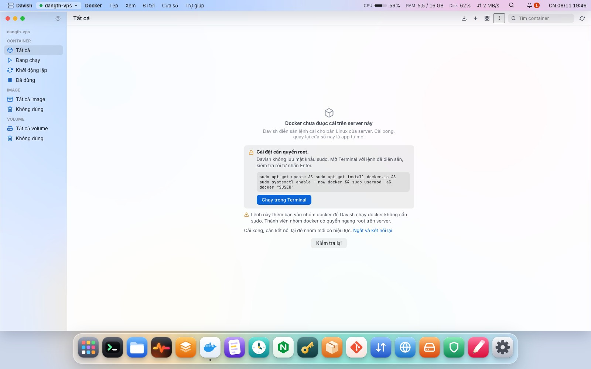

<table><tr>
  <td>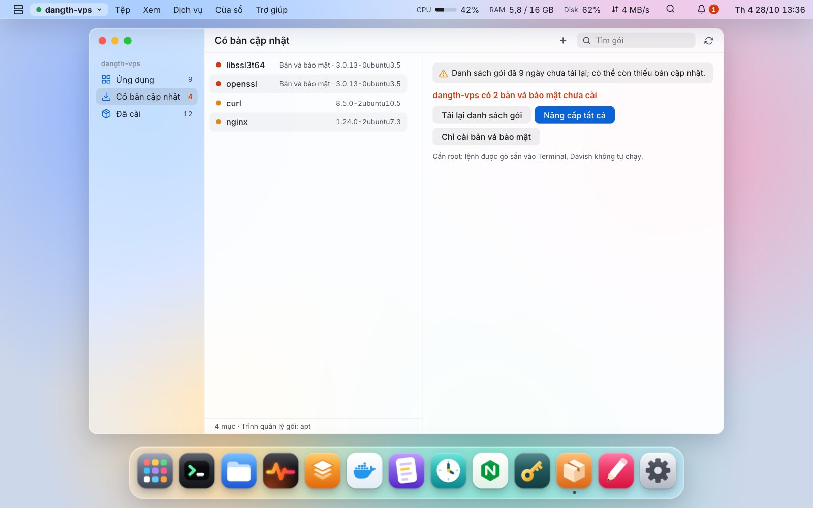</td>
  <td>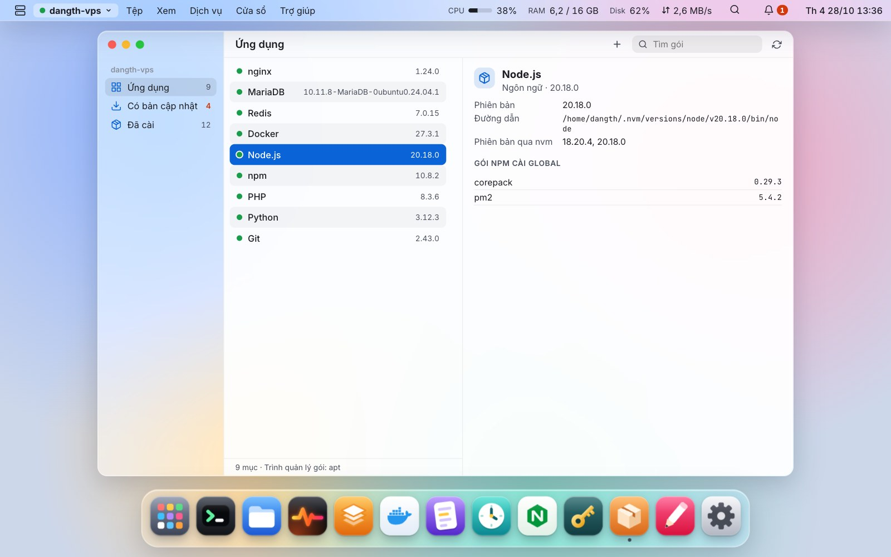</td>
</tr></table>

## Database

Database MariaDB/MySQL, PostgreSQL và MongoDB kèm dung lượng, cùng các file SQLite, mở từ Launchpad hoặc Spotlight. Tạo database và user sở hữu nó với mật khẩu ngẫu nhiên, chỉ hiện một lần và không lưu ở đâu; câu lệnh gửi qua stdin nên mật khẩu không nằm trong nhật ký lệnh hay lịch sử shell. Xóa database sau khi gõ đúng tên. Dump ra `~/db-backups` (`mysqldump` / `pg_dump`, nén gzip) rồi tải về từ Files, hoặc khôi phục từ bản dump sau khi xem lệnh chính xác và gõ đúng tên. Mở database server qua tunnel để dùng công cụ của bạn. Davish kết nối bằng user của bạn, qua `sudo -n` hoặc user `postgres`; khi chỉ root vào được thì mở client trong Terminal.

**MongoDB** hiện từng database kèm số collection. Khi bật xác thực, đăng nhập một lần bằng host, cổng, user, mật khẩu hoặc connection string: Davish thử trước, được mới lưu vào keychain của máy này như mật khẩu SSH, không bao giờ vào file; **Quên thông tin đăng nhập** để xóa. Connection string đi vào `mongosh` qua stdin nên không nằm trên dòng lệnh, trong `ps` hay nhật ký lệnh; `mongodump` và `mongorestore` đọc nó từ một file chỉ bạn đọc được, bị xóa ngay khi chạy xong.

**Dò** tìm (chỉ đọc) database server đang chạy (kèm cổng MongoDB và có bật xác thực không) và file SQLite trong `/var/lib`, `/opt`, `/srv` và thư mục home, bấm một lần để thêm. File **SQLite**, thêm bằng đường dẫn hoặc **Mở bằng Database** trong Files, hiện bảng và số dòng, backup bằng cơ chế backup trực tuyến của SQLite (an toàn khi app đang ghi); khôi phục thì gõ sẵn vào Terminal vì app đang dùng file phải dừng trước. Khối **Davish kết nối thế nào?** trong app giải thích tất cả bằng lời dễ hiểu.

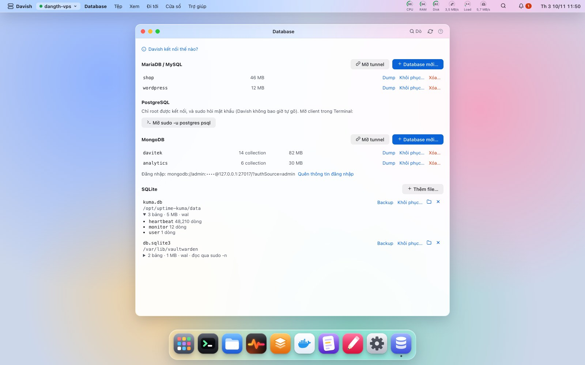

## Triển khai app

Mở từ Launchpad hoặc Spotlight: trình hướng dẫn từ repo git, image Docker hoặc thư mục có sẵn trên server, chạy bằng dịch vụ systemd (unit file sinh từ form), docker compose, container hoặc file tĩnh, sau một site nginx trên tên miền của bạn kèm chứng chỉ Let's Encrypt. Mọi file và lệnh hiện ra trước khi chạy; sau đó chạy từng bước trong Terminal, dừng ở bước đầu tiên bị lỗi. Trang cuối liệt kê những gì đã tạo và một lệnh gỡ toàn bộ để làm lại.

## Git

Tìm repo trong home, `/var/www`, `/srv`, `/opt` hoặc thư mục bạn thêm. Nhánh, nhánh remote và số commit chưa đẩy/chưa kéo, file thay đổi kèm diff, biểu đồ commit của mọi nhánh với merge và tag. Fetch, `pull --ff-only` (bị chặn khi repo còn thay đổi chưa commit) và đổi nhánh sau khi xác nhận đúng lệnh; `npm ci` / yarn / pnpm theo lockfile trong Terminal. Remote từ chối key thì dẫn tới tạo deploy key.

**Clone repo…** (SSH hoặc HTTPS, thư mục, nhánh), **git init** và **Đặt remote…** gõ sẵn lệnh vào Terminal. Với GitHub và GitLab qua SSH, host key họ công bố được thêm vào `known_hosts` trước; có nút dẫn tới tạo deploy key. **Deploy…** giữ công thức cho mỗi repo trên máy bạn (pull, cài, build, khởi động lại…) và chạy từng bước trong Terminal, dừng ở bước đầu tiên bị lỗi. Davish xem repo (lockfile, script trong `package.json`, file compose, `go.mod`, `Makefile`) và tìm app đang chạy từ thư mục đó (pm2, systemd, Docker compose), rồi đưa ra các bước bật/tắt được: lấy code mới, cài thư viện, build, khởi động lại app, cộng thêm bước tùy chỉnh. Mỗi bước hiện đúng lệnh sẽ chạy, lựa chọn được nhớ cho lần sau. Bấm Deploy là chạy ngay trong Terminal; có bước cần sudo thì lệnh được gõ sẵn để bạn nhấn Enter và nhập mật khẩu. Terminal hiện từng bước xong, đang chạy hay lỗi kèm thời gian, có thông báo khi deploy xong hoặc lỗi ở bước nào, và repo liệt kê các lần deploy gần đây kèm commit và thời gian chạy.

<table><tr>
  <td>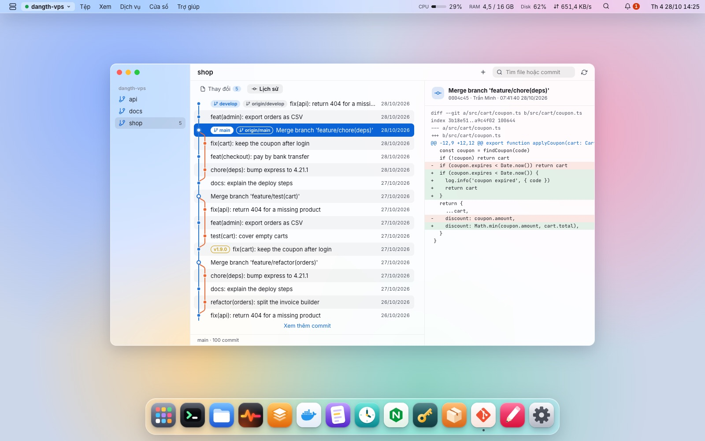</td>
  <td>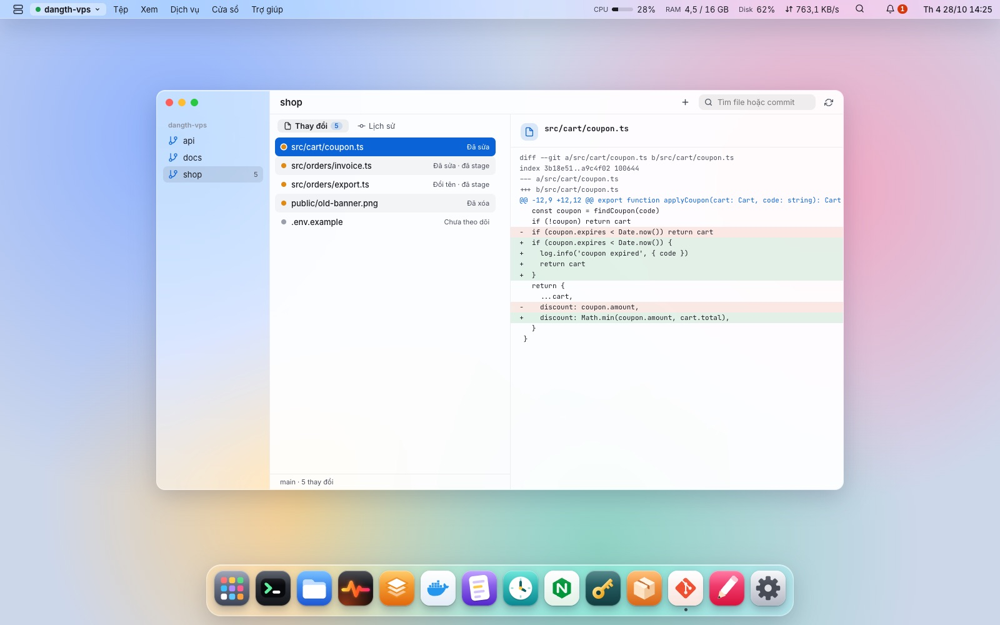</td>
</tr></table>

## Cổng và tunnel

Mọi cổng TCP server đang nghe, kèm process hoặc container. Tunnel một cổng về `127.0.0.1` trên máy qua chính kết nối SSH đang có, mở trong trình duyệt hoặc trỏ công cụ database vào, kể cả mở như một tên miền cho site nginx. Không mở cổng nào ra ngoài.

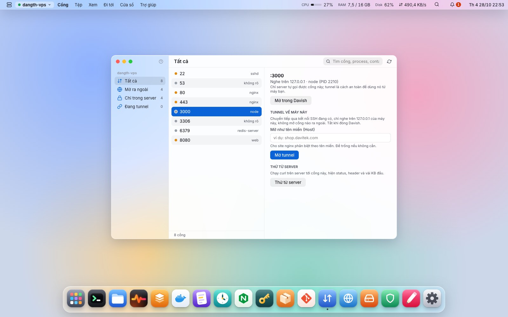

**Lộ ra Internet** cho biết từng cổng Internet có vào được không, dựa trên nơi cổng đang nghe, luật ufw (đọc bằng `sudo -n` khi cần) và Docker (cổng publish của Docker vượt qua ufw). Mở hoặc đóng cổng bằng `ufw`, gõ sẵn vào Terminal; không bao giờ đóng cổng của phiên SSH đang dùng, đóng 80/443 thì cảnh báo về site nginx. Database và công cụ quản trị đang lộ ra (Redis, PostgreSQL, Grafana…) được liệt kê kèm một lệnh đóng tất cả.

## Trình duyệt

Gõ `localhost:3000` để xem web app đang chạy trên server, ngay trong một cửa sổ Davish: lùi, tới, tải lại, redirect và websocket (hot reload) đều ở lại server, đăng nhập vẫn chạy. Đi qua SSH bằng một proxy nghe `127.0.0.1` ở cổng ngẫu nhiên nên không đụng app nào trên máy, và trang ở origin riêng, không bao giờ chạm được Davish.

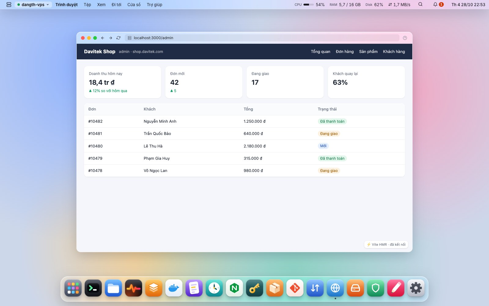

## Ổ đĩa

Ổ đĩa nặng ở đâu, từ một lần quét cả ổ (bằng root qua `sudo -n` nếu sudo không cần mật khẩu). Trang tổng quan chia ổ thành thư mục đo được, file đã xóa mà tiến trình còn giữ, phần chưa đo được và chỗ trống, rồi giải thích phần hụt: các thư mục user này không đọc được, kèm lệnh `sudo du` để chạy trong Terminal, và tiến trình nào giữ file đã xóa nào. Thư mục mở tại chỗ dạng cây, tầng sâu hơn được đo khi mở; tab File lớn liệt kê mọi file từ 50 MB.

Xóa thư mục hoặc file, hoặc làm rỗng file như log để chương trình đang ghi vẫn ghi tiếp, sau khi xem đúng lệnh; từ 1 GB hoặc thư mục có nội dung thì phải gõ tên. Thư mục hệ thống, cơ sở dữ liệu gói, dữ liệu của Docker và database, thư mục home đều bị từ chối; file của root thì chuyển sang Terminal với `sudo`. Mục Dọn dẹp kèm dung lượng lấy lại: image, container dừng, cache build, volume (đánh dấu là dữ liệu) và log container của Docker, journal, log xoay vòng, cache gói, dump lỗi, file tạm cũ, bản snap cũ, `~/.cache` và cache npm, mỗi mục hiện đúng lệnh. Thông báo ổ đầy mở thẳng đúng mount.

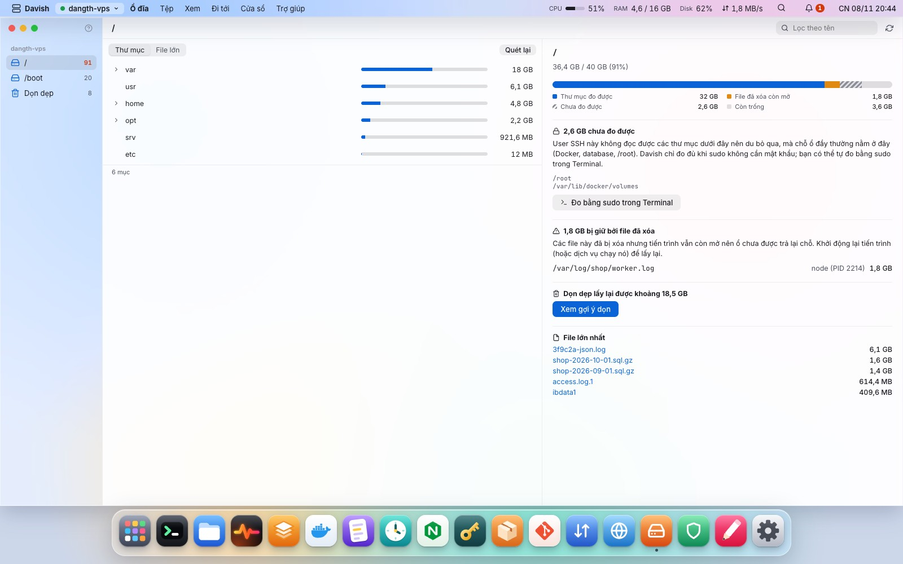

<table><tr>
  <td>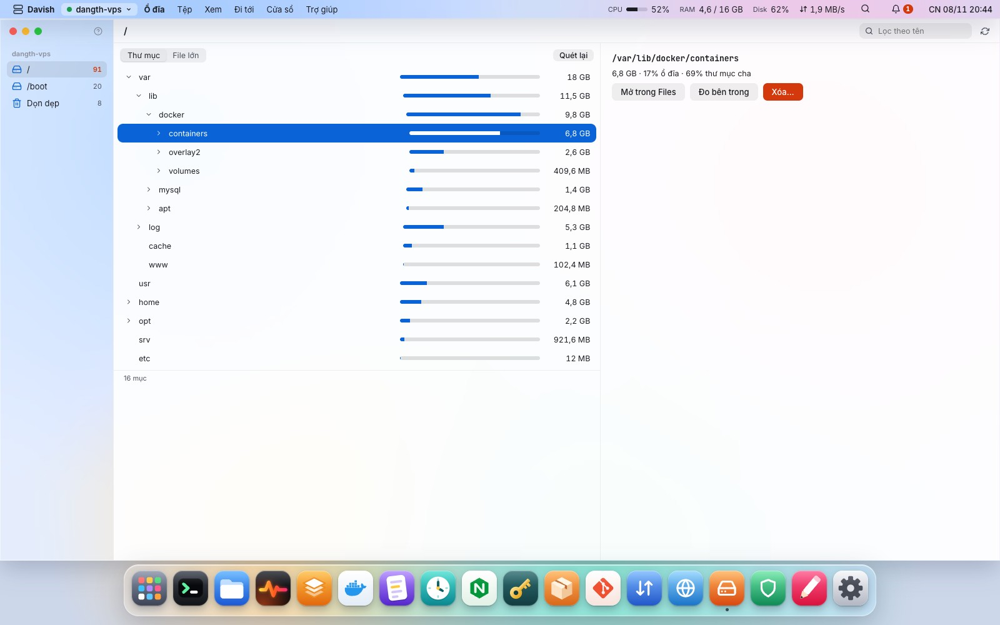</td>
  <td>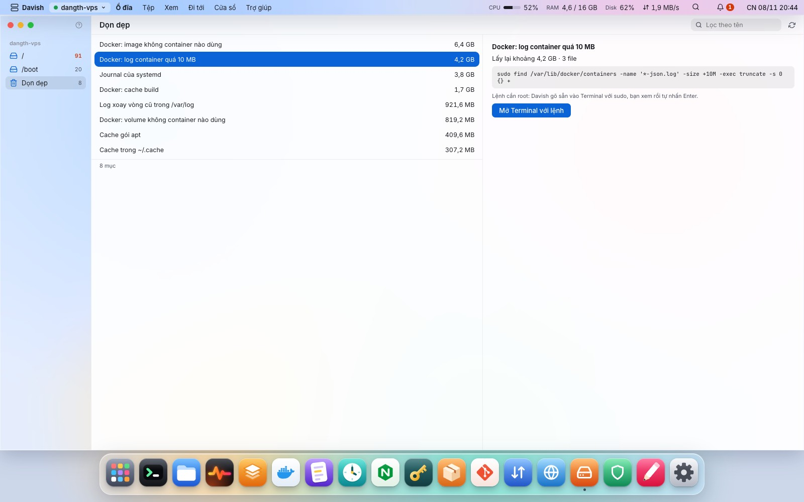</td>
</tr></table>

## An ninh

Ai đăng nhập qua SSH và ai đang dò. Phía trên là số liệu 7 ngày (lần sai, user không tồn tại, số địa chỉ, đã ban, đăng nhập thành công), biểu đồ lần sai theo giờ, địa chỉ và user bị thử nhiều nhất, đánh dấu địa chỉ fail2ban đã ban hoặc ufw đã chặn. Bên dưới là ai đang đăng nhập lúc này, mọi địa chỉ kèm tên user đã thử, đăng nhập gần đây, ufw và fail2ban. Đăng nhập sai và Đã chặn là bảng bôi đen, copy được: mỗi địa chỉ kèm số lần, user đã thử, lần thử cuối, đã chặn hay chưa, nút Chặn hoặc Bỏ chặn ngay trên dòng; tick nhiều dòng để chặn một lần. Mọi lần chặn, bỏ chặn, ban, bỏ ban đều hiện đúng lệnh trước, xác nhận là chạy (`sudo -n`), hoặc gõ sẵn vào Terminal khi sudo cần mật khẩu. Tắt đăng nhập mật khẩu qua Terminal, có `sshd -t` trước khi reload.

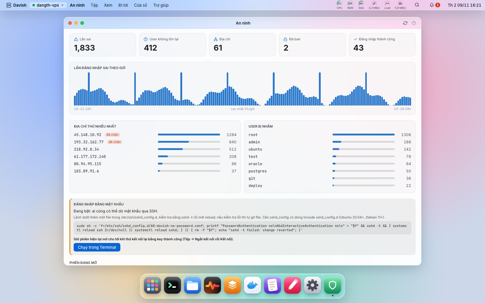

## Khóa SSH

`authorized_keys` của server, đánh dấu key Davish đang đăng nhập; thêm, gỡ key có sao lưu. Tạo deploy key trên server và thử với GitHub, GitLab (kiểm tra đúng host key họ công bố). Tạo key trên máy, đưa lên server rồi chuyển sang đăng nhập bằng nó.

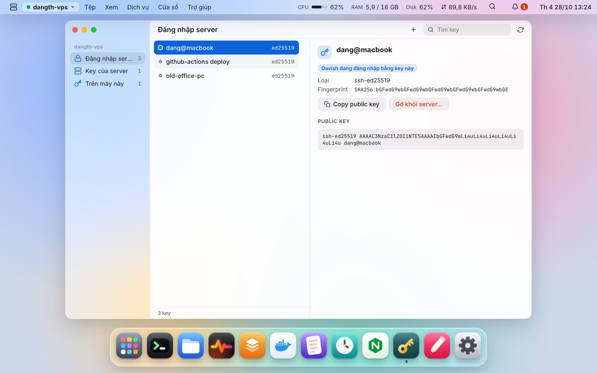

## ~/.ssh/config và ProxyJump

Nhập server từ `~/.ssh/config` một lần, kèm key và `ProxyJump`; Davish chỉ đọc file. Server sau bastion kết nối qua nó, mỗi bậc kiểm tra host key riêng, cả chuỗi tự kết nối lại.

## Spotlight & Launchpad

`⌘K` (hoặc kính lúp trên menu bar) để mở app, dịch vụ, container, thư mục, một `/đường/dẫn`, hoặc `> một lệnh` gõ sẵn vào Terminal. Launchpad (`⌘⇧A`) hiện mọi app chia theo nhóm (tệp & terminal, giám sát, web & container, bảo mật & truy cập, phát triển, hệ thống), mỗi nhóm một tab, ô tìm kiếm tìm trên mọi nhóm; `+` ghim app vào Dock, `−` bỏ ra, và một nút đưa Dock về như lúc mới cài.

<table><tr>
  <td>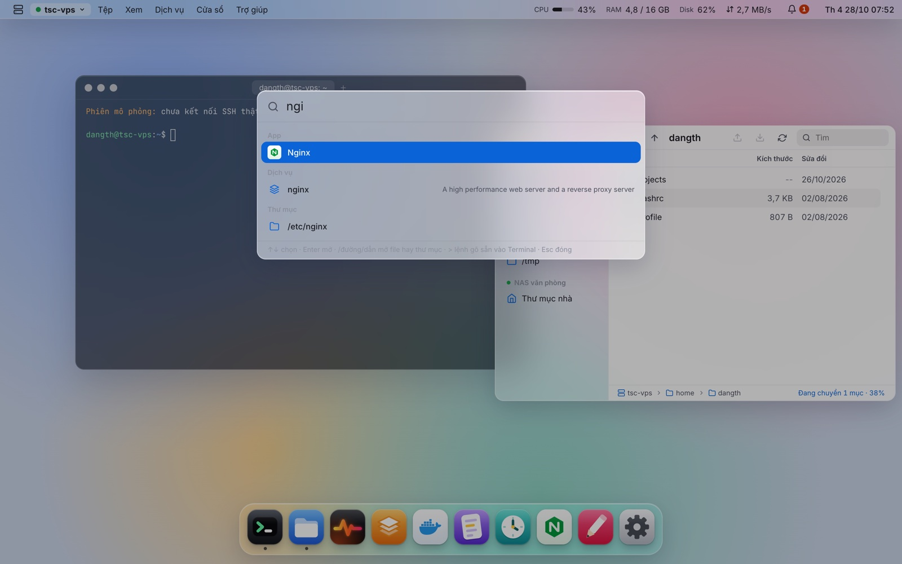</td>
  <td>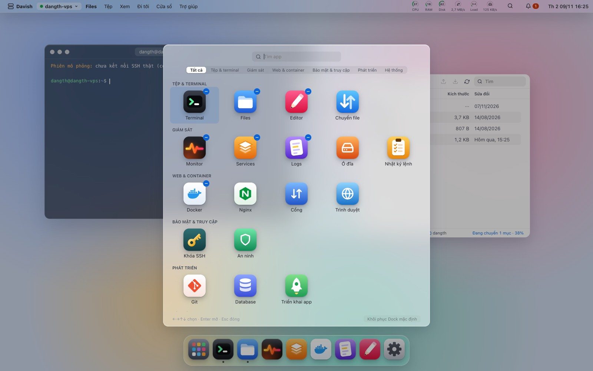</td>
</tr></table>

## Menu bar và trợ giúp

Menu bar thật (Tệp, Xem, Đi tới, Cửa sổ, Trợ giúp và lệnh của app đang mở), mọi phím tắt trong `⌘/`, nút `?` trên mỗi app giải thích app làm gì và chạy lệnh nào trên server, hướng dẫn nhanh lần đầu và chế độ xem thử với dữ liệu mẫu.

<table><tr>
  <td>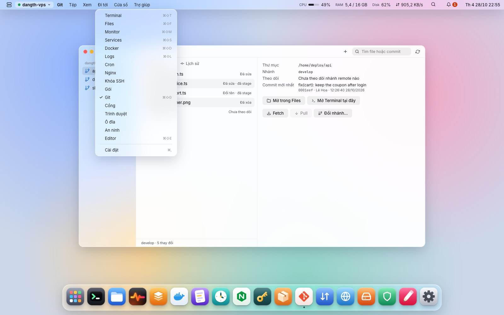</td>
  <td>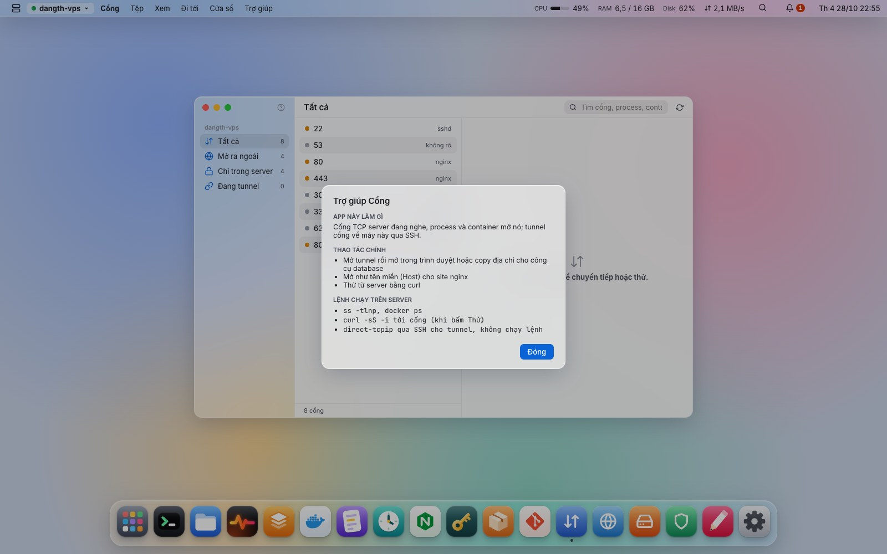</td>
</tr></table>

## Khóa app

Touch ID hoặc mật khẩu riêng che mọi thứ khi bạn rời máy. Quên mật khẩu thì đặt lại, nhưng Davish xóa mật khẩu server đã lưu trước, nên đặt lại không mở được đường vào server. Cửa sổ mở, đóng, thu nhỏ về Dock bằng hiệu ứng Genie.

<table><tr>
  <td>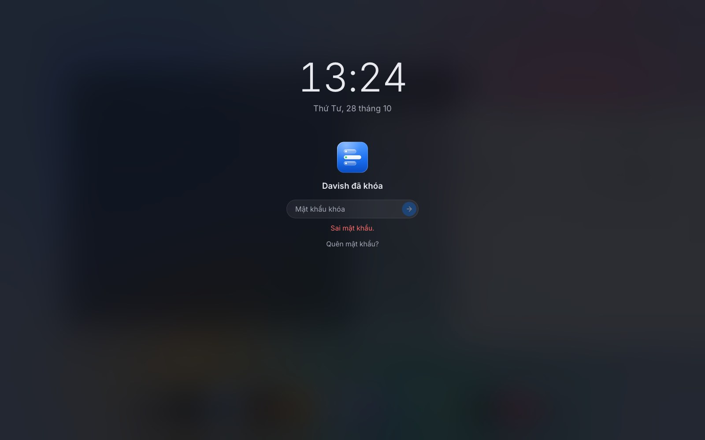</td>
  <td>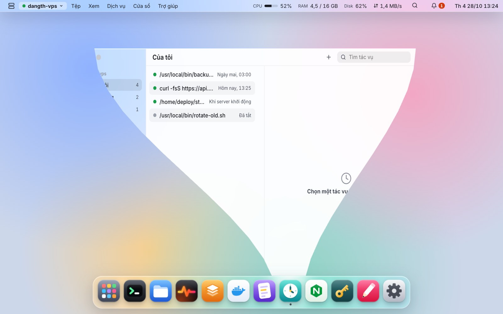</td>
</tr></table>

## Cập nhật

Davish tìm bản mới trên GitHub lúc mở và mỗi 6 giờ (tắt được trong Cài đặt, vẫn kiểm tra tay được từ menu). Có bản mới thì hiện những gì thay đổi, kèm **Cập nhật**, **Để sau** và **Bỏ qua bản này**. Cập nhật tải đúng bản cho máy bạn, đối chiếu với danh sách checksum được ký bằng khóa phát hành của Davish, thay bản đang chạy rồi khởi động lại. Không phải gỡ hay cài lại; bản cũ được giữ tới lần mở sau phòng khi bản mới không chạy. Chuột phải icon trên Dock để mở, giữ trên Dock hoặc đóng, như macOS.

## Sáng và tối

Davish có giao diện sáng và tối. Mặc định theo máy và tự đổi khi hệ điều hành đổi; muốn giữ một kiểu thì chọn Sáng hoặc Tối trong Cài đặt → Giao diện → Chế độ. Terminal và Logs vẫn tối như cũ, màu hình nền đã chọn được giữ và dịu đi cho nền tối.

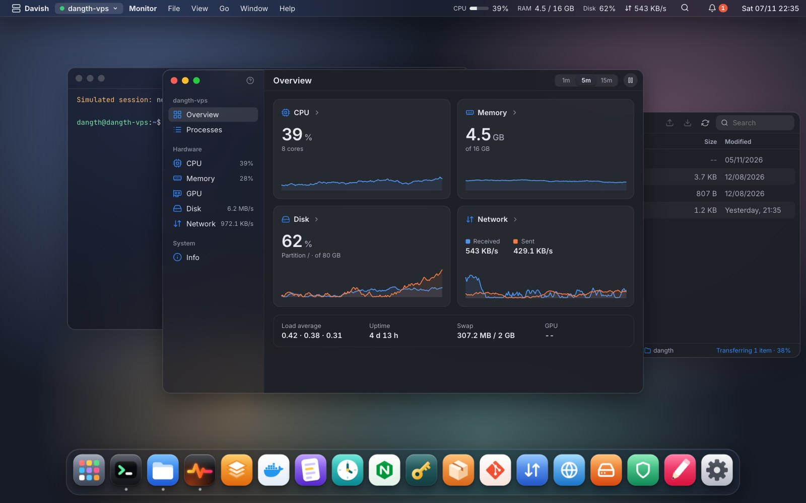

<table><tr>
  <td>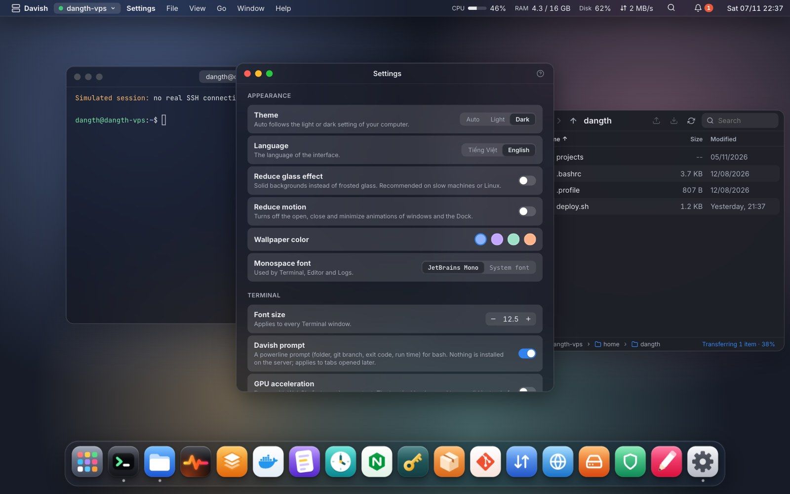</td>
  <td>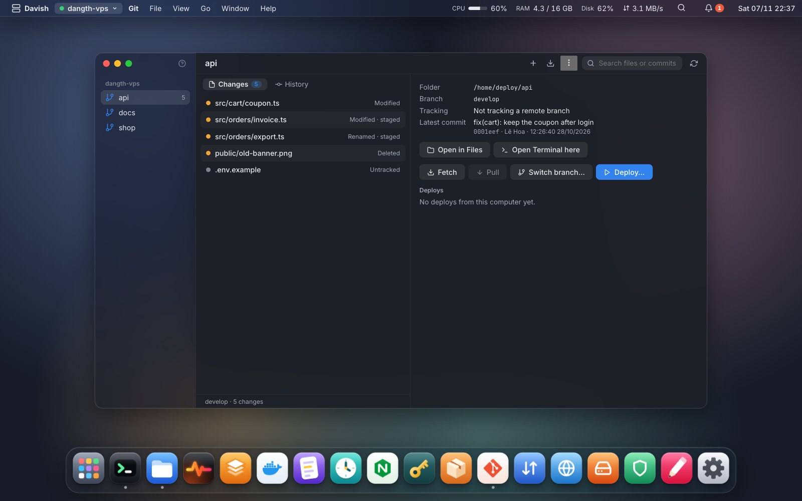</td>
</tr><tr>
  <td>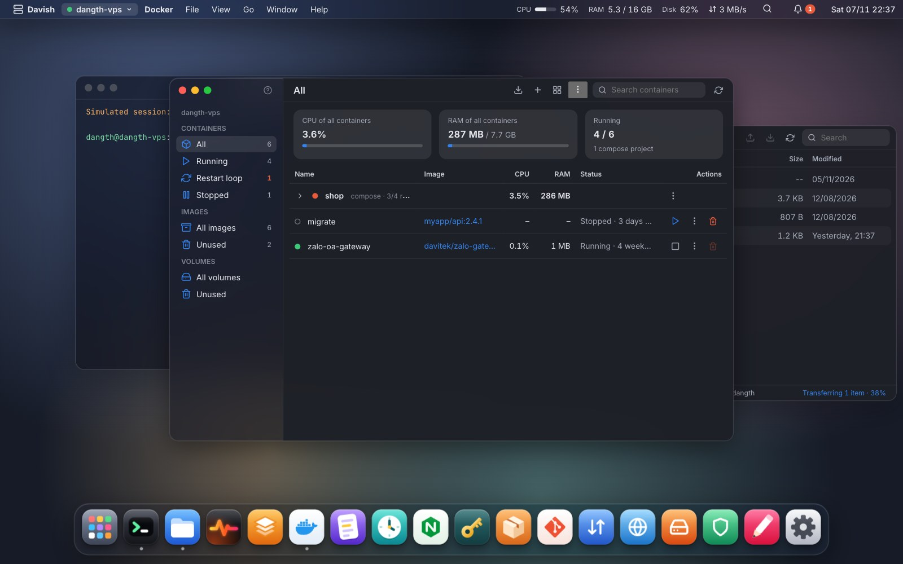</td>
  <td>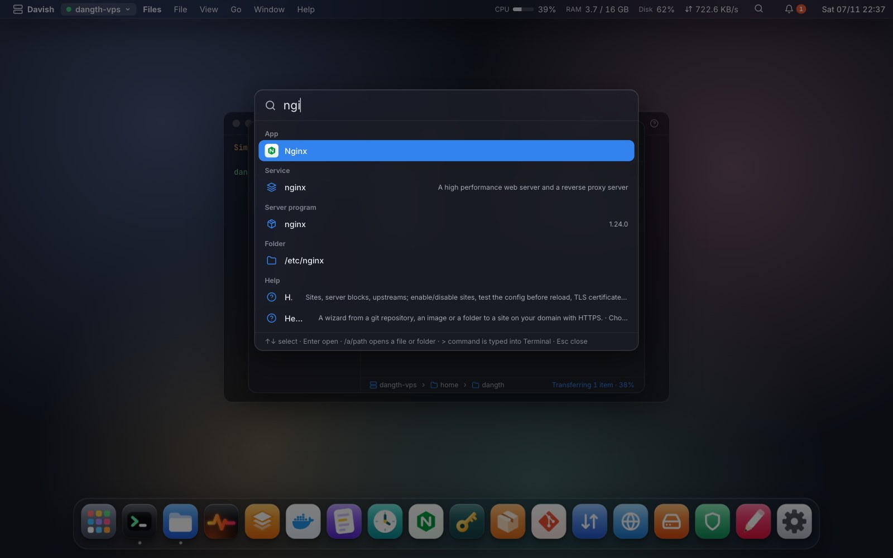</td>
</tr></table>

## Ngôn ngữ

Toàn bộ giao diện có tiếng Việt, tiếng Anh, tiếng Trung giản thể và tiếng Tây Ban Nha (Tây Ban Nha): menu, hộp thoại, trợ giúp, thông báo lỗi, ngày tháng và số. Lần đầu Davish theo ngôn ngữ của máy; sau đó chọn trong Cài đặt → Giao diện → Ngôn ngữ. Davish khởi động lại để đổi, server tự kết nối lại.
