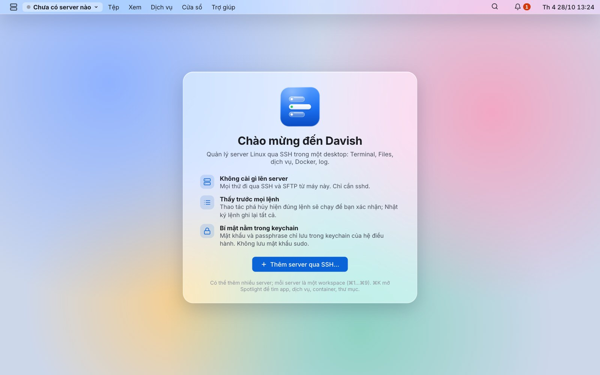

<div align="center">


# Davish

**A desktop for your Linux servers.**<br>
Terminal, files, services, Docker, logs, cron, nginx and SSH keys over plain SSH, in one place that feels like an operating system.<br>
Nothing to install on the server.

[](https://github.com/2hjaito/davish/actions/workflows/ci.yml)


**English** · [Tiếng Việt](README.vi.md)


</div>

## Why Davish

- **Agentless.** Davish only needs `sshd` and SFTP. Everything runs from your machine over SSH; nothing is copied to, installed on or left behind on the server.
- **You see every command.** Anything destructive (stop a service, remove a file, restart a container, replace a crontab) shows the exact command before it runs. The command log records everything Davish ran on your behalf.
- **Secrets stay in your keychain.** Passwords and passphrases live only in the OS keychain. Davish never stores or types a `sudo` password: when root is needed, it opens a terminal with the command typed in and lets you press Enter.
- **Locks when you step away.** A lock password of its own, Touch ID on macOS; it locks when the machine wakes, after idle time or with `⌘L`. Sessions keep running behind the lock, but nothing reaches a server until you unlock.
- **Many servers, one desktop.** Each server is a workspace (`⌘1`…`⌘9`) that remembers its own windows. Copy files between servers by dragging them.

## Features

| | |
|---|---|
| **Terminal**<br>xterm.js with tabs, copy/paste, GPU rendering, and an optional powerline prompt injected into bash at login, with nothing written on the server. | **Files**<br>Finder-style browser over SFTP: upload, download, drag and drop from your OS, rename, delete, compress, and copy between servers through your machine. |
| **Monitor**<br>CPU per core, memory and swap, disks, network per interface, NVIDIA GPUs, processes. RAM and disk alerts you can tune. | **Editor**<br>CodeMirror 6 with highlighting for nginx, YAML, JSON, shell, env and config files. Atomic saves that keep mode and owner, backups under `/etc`, and a warning if the file changed on the server. |
| **Services**<br>systemd units by state, their status and journal; start, stop and restart. Remove a unit you no longer use: an admin's unit is deleted, a package's (such as an old `certbot`) is masked with the timer that runs it. | **Docker**<br>Containers with live CPU and memory, logs with stderr marked, inspect, start/stop/restart, restart-loop alerts. |
| **Logs**<br>Follow a unit's journal, a file or a container. Filter, pause, highlight errors, and click a file path to open it in the Editor at that line. | **Cron**<br>Your crontab and the system ones, schedules in plain words, next runs in the server's time zone, safe edits with a backup. |
| **Nginx**<br>Sites, server blocks and upstreams; turn sites on or off, `nginx -t` before every reload, errors that open at the right line; TLS expiry alerts. Delete a site, and its Let's Encrypt certificate if no other site uses it. | **Spotlight & Launchpad**<br>`⌘K` (or the magnifier in the menu bar) to open an app, a service, a container, a folder, a `/path`, or `> a command` typed into a terminal. Launchpad (`⌘⇧A`) shows every app and lets you pin them to the Dock. |
| **SSH keys**<br>The server's `authorized_keys` with the key Davish logs in with marked; add or remove keys with a backup. Create a deploy key on the server and test it against GitHub or GitLab, checked against their published host key. Generate a key on your machine, put it on the server and switch to it. | **App lock**<br>Touch ID or a password of its own covers everything when you step away. Forgot the password? Resetting it removes the saved server passwords first, so it never opens a way into a server. Windows open, close and minimize into the Dock with a genie effect. |

<table>
  <tr>
    <td></td>
    <td></td>
  </tr>
  <tr>
    <td></td>
    <td></td>
  </tr>
  <tr>
    <td></td>
    <td></td>
  </tr>
  <tr>
    <td></td>
    <td></td>
  </tr>
  <tr>
    <td></td>
    <td></td>
  </tr>
  <tr>
    <td></td>
    <td></td>
  </tr>
</table>

> The interface is in Vietnamese. Screenshots show demo data from the browser preview.

## Install

Prebuilt apps for macOS (universal), Windows and Linux are attached to each [release](https://github.com/2hjaito/davish/releases).

- **macOS 12 or later.** Open `Davish-…-macos-universal.pkg` to install into Applications. The app is not signed yet, so macOS blocks it the first time: click **Done**, open **System Settings → Privacy & Security** and click **Open Anyway** next to the line about Davish (again for `Davish.app` if it is blocked). Or run `xattr -dr com.apple.quarantine` on the file.
- **Windows 10 or later.** Run `Davish-…-windows-amd64-setup.exe`; it installs the WebView2 runtime if it is missing. Windows SmartScreen may warn about an unknown publisher: choose **More info** → **Run anyway**.
- **Linux** with GTK 3 and WebKitGTK 4.1.

### What the server needs

| Feature | Requirement |
|---|---|
| Everything | OpenSSH server with the SFTP subsystem |
| Services, Logs (journal) | systemd; to read system logs, a user in the `adm` or `systemd-journal` group |
| Docker | the `docker` CLI; a user in the `docker` group |
| Cron | `crontab` |
| Nginx | nginx with `sites-available` / `sites-enabled` or `conf.d` |

Actions that need root (stopping a system service, editing a root-owned file) are handed to a terminal with `sudo` typed in, never run silently.

## Keyboard shortcuts

| Shortcut | Action |
|---|---|
| `⌘K` | Spotlight |
| `⌘1` … `⌘9` | Switch server workspace |
| `⌘W` · `⌘M` | Close · minimize window |
| `⌘,` | Settings |
| `⌘S` | Save in the Editor |
| `⌘F` · `⌘[` · `⌘]` · `⌘↑` | Files: search, back, forward, up |
| `⌘U` · `⌘D` | Files: upload, download |
| `⌘⌥S` | Files: copy the selection to another server |
| `⌘⌥L` | Transfers window |

On Windows and Linux, use `Ctrl` instead of `⌘`. Inside a terminal, `Ctrl` shortcuts go to the shell.

## Build from source

Requirements: Go 1.27+, Node.js LTS, [Wails](https://wails.io) v2.17 (`go install github.com/wailsapp/wails/v2/cmd/wails@v2.17.0`, then `wails doctor`), golangci-lint v2, and Docker for the integration tests. On Linux also `libgtk-3-dev` and `libwebkit2gtk-4.1-dev` (build with `-tags webkit2_41`).

```bash
make frontend-install   # first time only
wails dev               # run with hot reload
wails build             # package into build/bin/
```

### Tests

```bash
make check              # go vet, golangci-lint, go test, svelte-check, eslint, prettier, vitest

make sshd-up            # two throwaway SSH servers in Docker (127.0.0.1:2222 and :2223)
make test-integration   # real SSH, SFTP, systemd, Docker, cron and nginx against them
make sshd-down
```

The integration tests only ever talk to the containers in `test/sshd/`, never to a real server.

## Stack

| Layer | Technology |
|---|---|
| Backend | Go · Wails v2 · `golang.org/x/crypto/ssh` · `pkg/sftp` · `go-keyring` |
| Frontend | Svelte 5 (runes) · TypeScript strict · Vite |
| Components | xterm.js · CodeMirror 6 · icons from [davi-icons](https://github.com/2hjaito/davi-icons) |

## Changelog

See [CHANGELOG.md](CHANGELOG.md).
