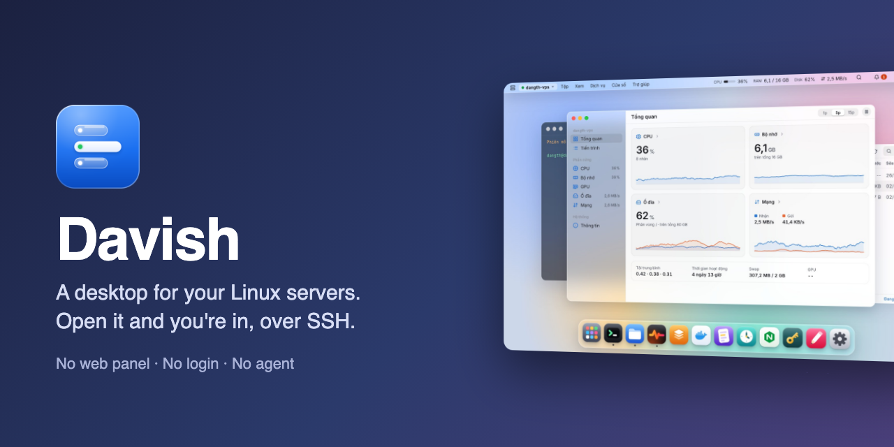

<div align="center">



# Davish

**A desktop for your Linux servers.**<br>
Terminal, files, services, Docker, logs, cron, nginx, ports, a browser, disk, login security, SSH keys, packages and git over plain SSH, in one place that feels like an operating system.<br>
Nothing to install on the server.

[](https://github.com/2hjaito/davish/actions/workflows/ci.yml)


**English** · [Tiếng Việt](README.vi.md)


</div>

## Why Davish

- **Open it and you're in.** No login screen, no web panel: Davish connects to the server you used last with your SSH key and puts you on its desktop. Nothing extra listens on the server, so there is no new port to open or protect.
- **Agentless.** Davish only needs `sshd` and SFTP. Everything runs from your machine over SSH; nothing is copied to, installed on or left behind on the server.
- **You see every command.** Anything destructive (stop a service, remove a file, restart a container, replace a crontab) shows the exact command before it runs. The command log records everything Davish ran on your behalf.
- **Secrets stay in your keychain.** Passwords and passphrases live only in the OS keychain. Davish never stores or types a `sudo` password: when root is needed, it opens a terminal with the command typed in and lets you press Enter.
- **Locks when you step away.** A lock password of its own, Touch ID on macOS; it locks when the machine wakes, after idle time or with `⌘L`. Sessions keep running behind the lock, but nothing reaches a server until you unlock.
- **Many servers, one desktop.** Each server is a workspace (`⌘1`…`⌘9`) that remembers its own windows. Copy files between servers by dragging them.
- **Updates itself.** A new version shows its changes with Update, Later and Skip this version; Davish downloads it, checks its signature and restarts into it. No reinstalling.
- **English or Vietnamese.** Pick the language in Settings; the first time, Davish follows your system's.
- **Your `~/.ssh/config` works.** Import its hosts in one go, keys and `ProxyJump` included; Davish only reads the file. Servers behind a bastion connect through it, each hop with its own host key check, and the whole chain reconnects on its own.

## Features

**On the server**

- [Terminal](FEATURES.md#terminal): tabs, GPU rendering, an optional powerline prompt
- [Files](FEATURES.md#files): Finder-style SFTP, drag and drop, copy between servers
- [Editor](FEATURES.md#editor): CodeMirror with atomic saves and backups
- [Logs](FEATURES.md#logs): journal, files and containers, live
- [Monitor](FEATURES.md#monitor): CPU, memory, disks, network, GPUs, processes

**Services and apps**

- [Services](FEATURES.md#services): systemd units, status, journal
- [Docker](FEATURES.md#docker): containers by compose project, images and layers, volumes
- [Cron](FEATURES.md#cron): schedules in plain words
- [Nginx](FEATURES.md#nginx): sites, `nginx -t` before reload, TLS expiry
- [Packages](FEATURES.md#packages): updates with security fixes first, runtimes
- [Git](FEATURES.md#git): status, diffs, commit graph, fetch and pull

**Network and security**

- [Ports & tunnels](FEATURES.md#ports--tunnels): listening ports, tunnels to `127.0.0.1`
- [Browser](FEATURES.md#browser): open the server's `localhost:3000` inside Davish
- [Disk](FEATURES.md#disk): what fills the disk, cleanups
- [Security](FEATURES.md#security): failed logins by address, ufw, fail2ban
- [SSH keys](FEATURES.md#ssh-keys): authorized_keys, deploy keys, your own keys
- [~/.ssh/config and ProxyJump](FEATURES.md#sshconfig-and-proxyjump): import hosts, connect through a bastion

**The desktop**

- [Spotlight & Launchpad](FEATURES.md#spotlight--launchpad): open anything with `⌘K`
- [Menu bar and help](FEATURES.md#menu-bar-and-help): every command and shortcut, a `?` on each app
- [App lock](FEATURES.md#app-lock): Touch ID or a password, locks on wake
- [Updates](FEATURES.md#updates): one click to a new version, signature checked
- [Language](FEATURES.md#language): English or Vietnamese

<table>
  <tr>
    <td></td>
    <td></td>
  </tr>
  <tr>
    <td></td>
    <td></td>
  </tr>
  <tr>
    <td></td>
    <td></td>
  </tr>
</table>

**[Every app in detail, with screenshots →](FEATURES.md)**

> Screenshots show demo data from the browser preview.

## Install

Prebuilt apps for macOS (universal), Windows and Linux are attached to each [release](https://github.com/2hjaito/davish/releases).

- **macOS 12 or later.** Open `Davish-…-macos-universal.pkg` to install into Applications. The app is not signed yet, so macOS blocks it the first time: click **Done**, open **System Settings → Privacy & Security** and click **Open Anyway** next to the line about Davish (again for `Davish.app` if it is blocked). Or run `xattr -dr com.apple.quarantine` on the file.
- **Windows 10 or later.** Run `Davish-…-windows-amd64-setup.exe`; it installs the WebView2 runtime if it is missing. Windows SmartScreen may warn about an unknown publisher: choose **More info** → **Run anyway**.
- **Linux** with GTK 3 and WebKitGTK 4.1.

### What the server needs

| Feature | Requirement |
|---|---|
| Everything | OpenSSH server with the SFTP subsystem |
| Services, Logs (journal) | systemd; to read system logs, a user in the `adm` or `systemd-journal` group |
| Docker | the `docker` CLI; a user in the `docker` group |
| Cron | `crontab` |
| Nginx | nginx with `sites-available` / `sites-enabled` or `conf.d` |

Actions that need root (stopping a system service, editing a root-owned file) are handed to a terminal with `sudo` typed in, never run silently.

## Keyboard shortcuts

| Shortcut | Action |
|---|---|
| `⌘K` | Spotlight |
| `⌘1` … `⌘9` | Switch server workspace |
| `⌘W` · `⌘M` | Close · minimize window |
| `⌘,` | Settings |
| `⌘S` | Save in the Editor |
| `⌘F` · `⌘[` · `⌘]` · `⌘↑` | Files: search, back, forward, up |
| `⌘U` · `⌘D` | Files: upload, download |
| `⌘⌥S` | Files: copy the selection to another server |
| `⌘⌥L` | Transfers window |

On Windows and Linux, use `Ctrl` instead of `⌘`. Inside a terminal, `Ctrl` shortcuts go to the shell.

## Build from source

Requirements: Go 1.27+, Node.js LTS, [Wails](https://wails.io) v2.17 (`go install github.com/wailsapp/wails/v2/cmd/wails@v2.17.0`, then `wails doctor`), golangci-lint v2, and Docker for the integration tests. On Linux also `libgtk-3-dev` and `libwebkit2gtk-4.1-dev` (build with `-tags webkit2_41`).

```bash
make frontend-install   # first time only
wails dev               # run with hot reload
wails build             # package into build/bin/
```

### Tests

```bash
make check              # go vet, golangci-lint, go test, svelte-check, eslint, prettier, vitest

make sshd-up            # two throwaway SSH servers in Docker (127.0.0.1:2222 and :2223)
make test-integration   # real SSH, SFTP, systemd, Docker, cron and nginx against them
make sshd-down
```

The integration tests only ever talk to the containers in `test/sshd/`, never to a real server.

## Stack

| Layer | Technology |
|---|---|
| Backend | Go · Wails v2 · `golang.org/x/crypto/ssh` · `pkg/sftp` · `go-keyring` |
| Frontend | Svelte 5 (runes) · TypeScript strict · Vite |
| Components | xterm.js · CodeMirror 6 · icons from [davi-icons](https://github.com/2hjaito/davi-icons) |

## Changelog

See [CHANGELOG.md](CHANGELOG.md).

## License

Davish is free software under the [GNU General Public License v3.0](LICENSE). Contributions need the [Contributor License Agreement](CLA.md); see [CONTRIBUTING.md](CONTRIBUTING.md). The Davish name and logo are not covered by the license: see [TRADEMARKS.md](TRADEMARKS.md).
