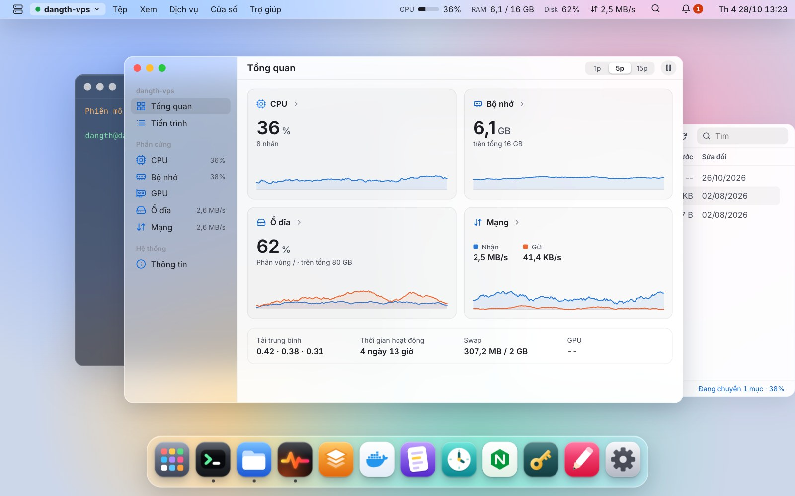
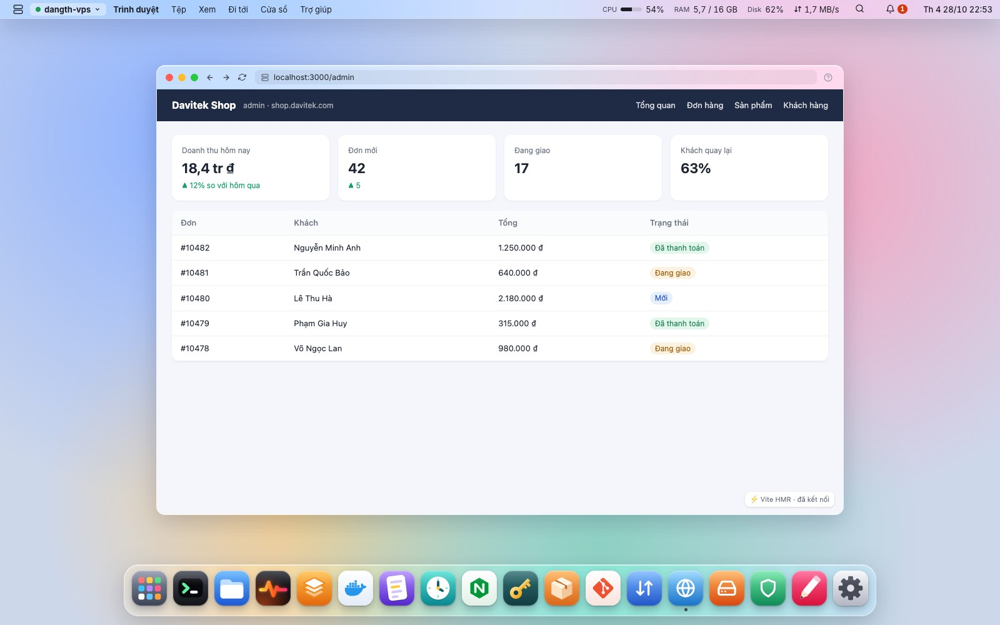
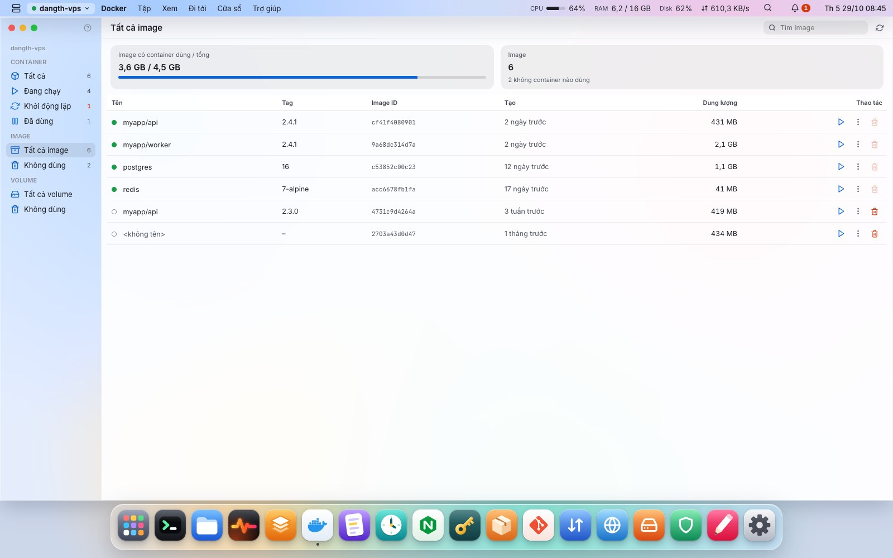
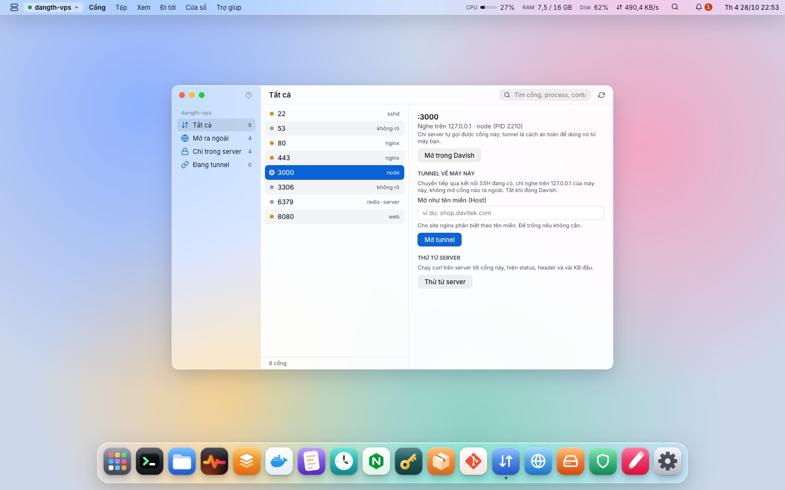
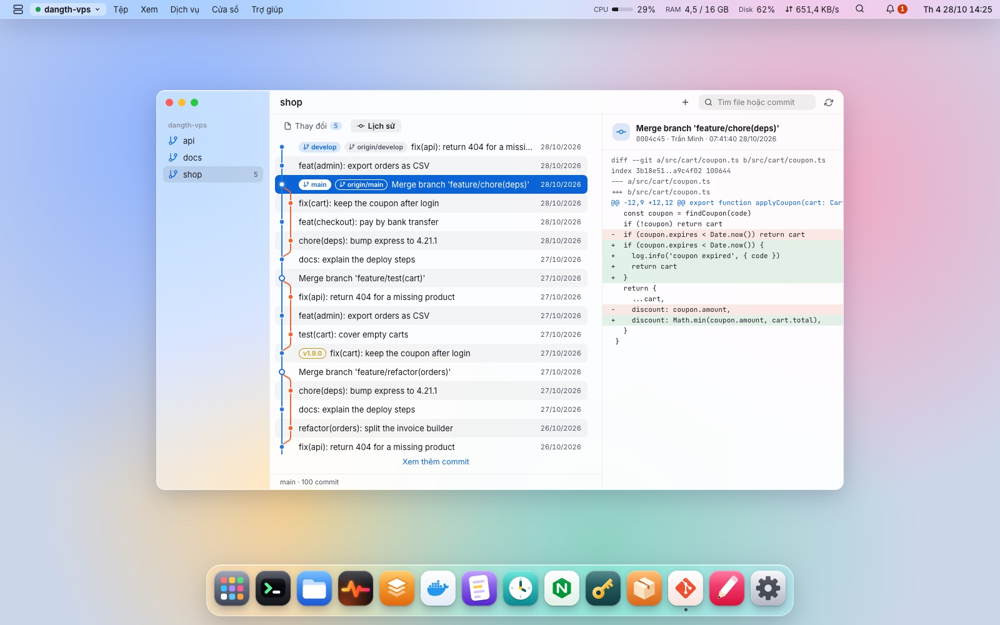
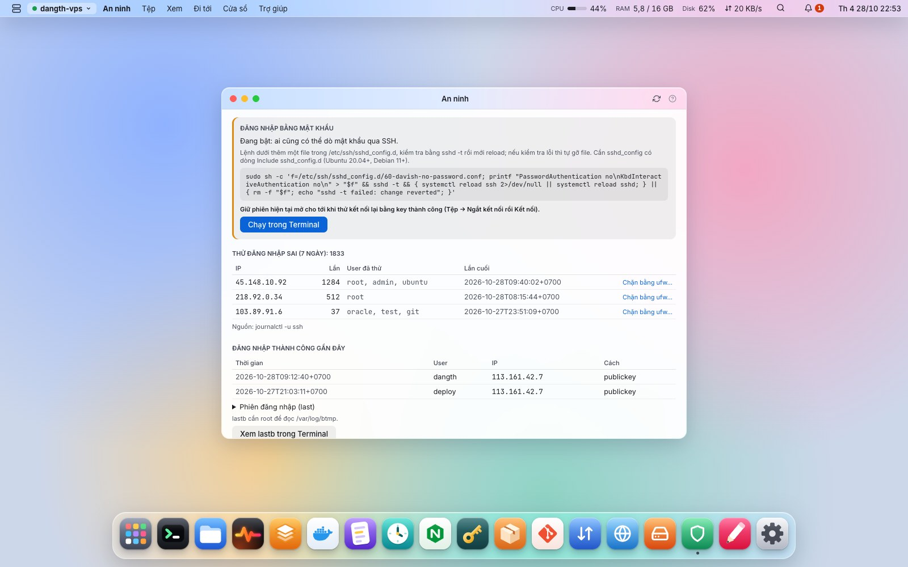
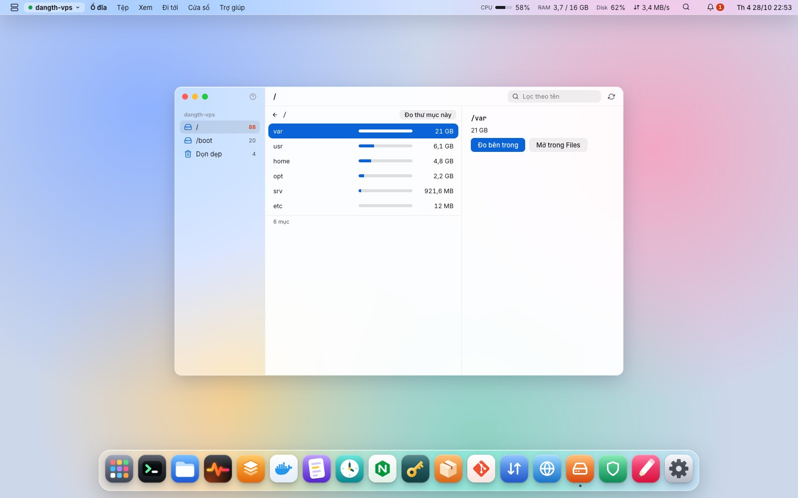

<div align="center">


# Davish

**Một desktop cho các server Linux của bạn.**<br>
Terminal, file, dịch vụ, Docker, log, cron, nginx, cổng, trình duyệt, ổ đĩa, an ninh đăng nhập, khóa SSH, gói phần mềm và git qua SSH thuần, gom trong một giao diện như một hệ điều hành.<br>
Không cài gì lên server.

[](https://github.com/2hjaito/davish/actions/workflows/ci.yml)


[English](README.md) · **Tiếng Việt**



</div>

## Vì sao là Davish

- **Không cần agent.** Davish chỉ cần `sshd` và SFTP. Mọi thứ chạy từ máy bạn qua SSH; không chép, không cài, không để lại gì trên server.
- **Thấy trước mọi lệnh.** Thao tác phá hủy (dừng dịch vụ, xóa file, khởi động lại container, thay crontab) hiện đúng lệnh sẽ chạy trước khi chạy. Nhật ký lệnh ghi lại mọi thứ Davish đã chạy thay bạn.
- **Bí mật nằm trong keychain.** Mật khẩu và passphrase chỉ lưu trong keychain của hệ điều hành. Davish không bao giờ lưu hay tự gõ mật khẩu `sudo`: khi cần root, nó mở Terminal với lệnh gõ sẵn để bạn tự nhấn Enter.
- **Tự khóa khi bạn rời máy.** Mật khẩu khóa riêng, Touch ID trên macOS; khóa khi máy ngủ dậy, sau thời gian không dùng, hoặc `⌘L`. Phiên SSH vẫn chạy sau màn khóa, nhưng không thao tác nào tới được server cho tới khi mở khóa.
- **Nhiều server, một desktop.** Mỗi server là một workspace (`⌘1`…`⌘9`) nhớ cửa sổ riêng của nó. Kéo file để copy giữa các server.
- **Tự cập nhật.** Có bản mới thì hiện thay đổi kèm Cập nhật, Để sau, Bỏ qua bản này; Davish tự tải, kiểm chữ ký rồi khởi động lại vào bản mới. Không phải cài lại.
- **Dùng luôn `~/.ssh/config`.** Nhập host một lần, kèm key và `ProxyJump`; Davish chỉ đọc file. Server sau bastion kết nối qua nó, mỗi bậc kiểm tra host key riêng, cả chuỗi tự kết nối lại.

## Tính năng

**Trên server**

- [Terminal](FEATURES.vi.md#terminal): nhiều tab, vẽ bằng GPU, prompt powerline tùy chọn
- [Files](FEATURES.vi.md#files): SFTP kiểu Finder, kéo thả, copy giữa server
- [Editor](FEATURES.vi.md#editor): CodeMirror, lưu atomic, có sao lưu
- [Logs](FEATURES.vi.md#logs): journal, file, container, theo dõi trực tiếp
- [Monitor](FEATURES.vi.md#monitor): CPU, RAM, ổ đĩa, mạng, GPU, tiến trình

**Dịch vụ và ứng dụng**

- [Services](FEATURES.vi.md#services): dịch vụ systemd, trạng thái, journal
- [Docker](FEATURES.vi.md#docker): container, image và các layer
- [Cron](FEATURES.vi.md#cron): lịch nói bằng lời
- [Nginx](FEATURES.vi.md#nginx): site, `nginx -t` trước khi reload, hạn TLS
- [Gói](FEATURES.vi.md#gói): bản cập nhật, bản vá bảo mật lên đầu, runtime
- [Git](FEATURES.vi.md#git): trạng thái, diff, biểu đồ commit, fetch và pull

**Mạng và an ninh**

- [Cổng và tunnel](FEATURES.vi.md#cổng-và-tunnel): cổng đang nghe, tunnel về `127.0.0.1`
- [Trình duyệt](FEATURES.vi.md#trình-duyệt): mở `localhost:3000` của server ngay trong Davish
- [Ổ đĩa](FEATURES.vi.md#ổ-đĩa): thứ gì chiếm ổ đĩa, gợi ý dọn dẹp
- [An ninh](FEATURES.vi.md#an-ninh): đăng nhập sai theo IP, ufw, fail2ban
- [Khóa SSH](FEATURES.vi.md#khóa-ssh): authorized_keys, deploy key, key trên máy
- [~/.ssh/config và ProxyJump](FEATURES.vi.md#sshconfig-và-proxyjump): nhập host, kết nối qua bastion

**Desktop**

- [Spotlight & Launchpad](FEATURES.vi.md#spotlight--launchpad): mở mọi thứ bằng `⌘K`
- [Menu bar và trợ giúp](FEATURES.vi.md#menu-bar-và-trợ-giúp): mọi lệnh và phím tắt, nút `?` trên mỗi app
- [Khóa app](FEATURES.vi.md#khóa-app): Touch ID hoặc mật khẩu, tự khóa khi máy dậy
- [Cập nhật](FEATURES.vi.md#cập-nhật): một lần bấm lên bản mới, có kiểm chữ ký

<table>
  <tr>
    <td></td>
    <td></td>
  </tr>
  <tr>
    <td></td>
    <td></td>
  </tr>
  <tr>
    <td></td>
    <td></td>
  </tr>
</table>

**[Chi tiết từng app, kèm ảnh chụp →](FEATURES.vi.md)**

> Ảnh chụp dùng dữ liệu mẫu của bản xem trước trên trình duyệt.

## Cài đặt

Bản build sẵn cho macOS (universal), Windows và Linux nằm trong từng [release](https://github.com/2hjaito/davish/releases).

- **macOS 12 trở lên.** Mở `Davish-…-macos-universal.pkg` để cài vào Applications. App chưa được ký nên macOS sẽ chặn lần đầu: bấm **Done**, mở **Cài đặt hệ thống → Quyền riêng tư & Bảo mật**, bấm **Vẫn mở** ở dòng nhắc tới Davish (làm lại cho `Davish.app` nếu bị chặn). Hoặc chạy `xattr -dr com.apple.quarantine` trên file đó.
- **Windows 10 trở lên.** Chạy `Davish-…-windows-amd64-setup.exe`; bộ cài tự cài WebView2 runtime nếu máy chưa có. SmartScreen có thể cảnh báo nhà phát hành không xác định: chọn **More info** → **Run anyway**.
- **Linux** có GTK 3 và WebKitGTK 4.1.

### Server cần gì

| Tính năng | Yêu cầu |
|---|---|
| Tất cả | OpenSSH server có subsystem SFTP |
| Services, Logs (journal) | systemd; muốn đọc log hệ thống thì user thuộc nhóm `adm` hoặc `systemd-journal` |
| Docker | lệnh `docker`; user thuộc nhóm `docker` |
| Cron | `crontab` |
| Nginx | nginx với `sites-available` / `sites-enabled` hoặc `conf.d` |

Thao tác cần root (dừng dịch vụ hệ thống, sửa file của root) được chuyển sang Terminal với `sudo` gõ sẵn, không bao giờ chạy ngầm.

## Phím tắt

| Phím | Tác dụng |
|---|---|
| `⌘K` | Spotlight |
| `⌘1` … `⌘9` | Chuyển workspace server |
| `⌘W` · `⌘M` | Đóng · thu nhỏ cửa sổ |
| `⌘,` | Cài đặt |
| `⌘S` | Lưu trong Editor |
| `⌘F` · `⌘[` · `⌘]` · `⌘↑` | Files: tìm, lùi, tiến, lên thư mục cha |
| `⌘U` · `⌘D` | Files: tải lên, tải xuống |
| `⌘⌥S` | Files: copy mục đang chọn sang server khác |
| `⌘⌥L` | Cửa sổ Chuyển file |

Trên Windows và Linux dùng `Ctrl` thay cho `⌘`. Khi đang ở trong Terminal, phím `Ctrl` thuộc về shell.

## Build từ mã nguồn

Cần: Go 1.27+, Node.js LTS, [Wails](https://wails.io) v2.17 (`go install github.com/wailsapp/wails/v2/cmd/wails@v2.17.0`, rồi `wails doctor`), golangci-lint v2, và Docker cho integration test. Trên Linux thêm `libgtk-3-dev` và `libwebkit2gtk-4.1-dev` (build với `-tags webkit2_41`).

```bash
make frontend-install   # lần đầu
wails dev               # chạy, hot reload
wails build             # đóng gói vào build/bin/
```

### Kiểm thử

```bash
make check              # go vet, golangci-lint, go test, svelte-check, eslint, prettier, vitest

make sshd-up            # hai SSH server dùng một lần trong Docker (127.0.0.1:2222 và :2223)
make test-integration   # SSH, SFTP, systemd, Docker, cron và nginx thật trên hai server đó
make sshd-down
```

Integration test chỉ nói chuyện với container trong `test/sshd/`, không bao giờ với server thật.

## Công nghệ

| Lớp | Công nghệ |
|---|---|
| Backend | Go · Wails v2 · `golang.org/x/crypto/ssh` · `pkg/sftp` · `go-keyring` |
| Frontend | Svelte 5 (runes) · TypeScript strict · Vite |
| Thành phần | xterm.js · CodeMirror 6 · icon từ [davi-icons](https://github.com/2hjaito/davi-icons) |

## Nhật ký thay đổi

Xem [CHANGELOG.md](CHANGELOG.md).
