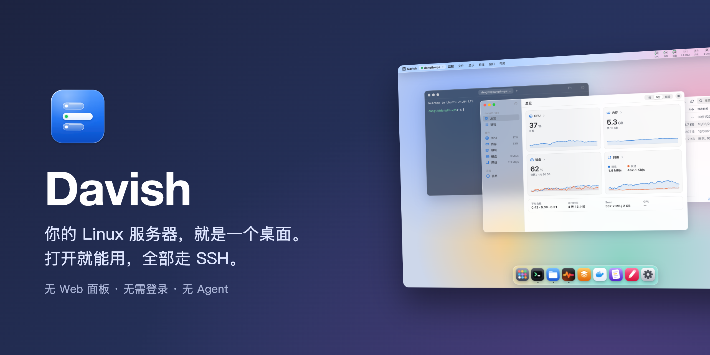
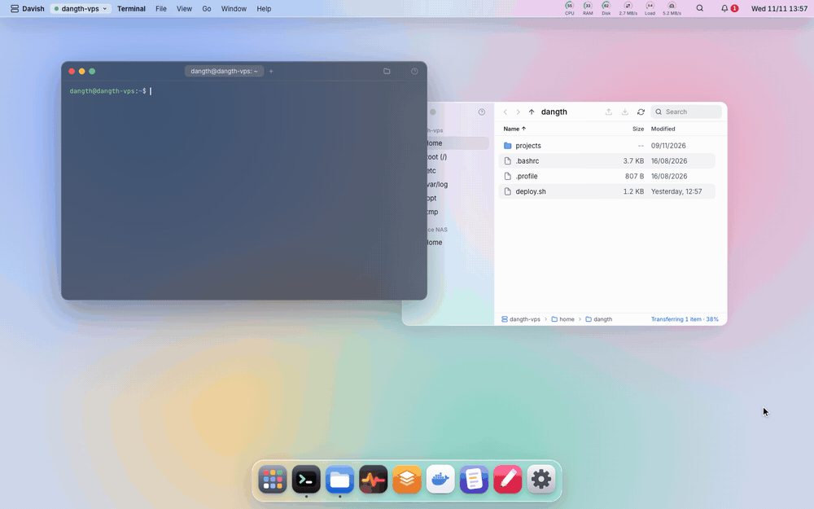
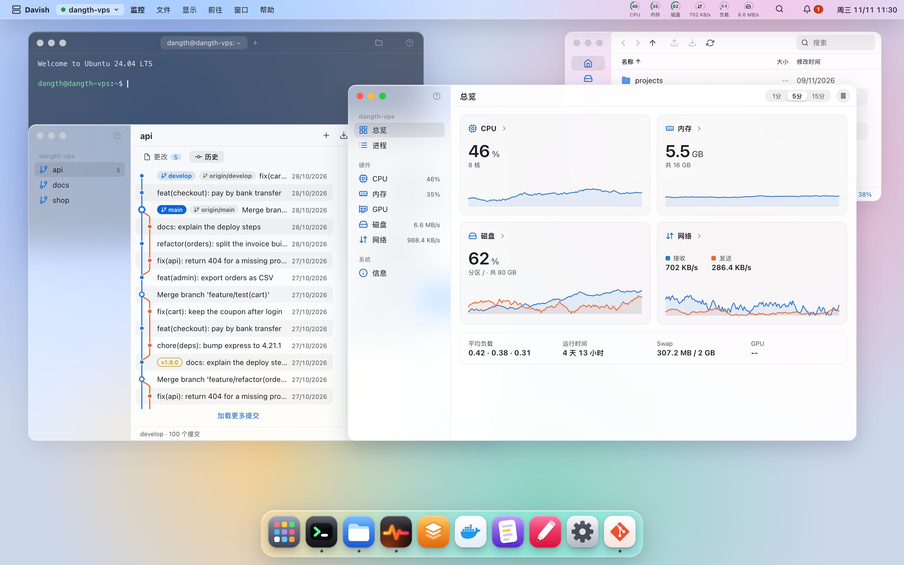
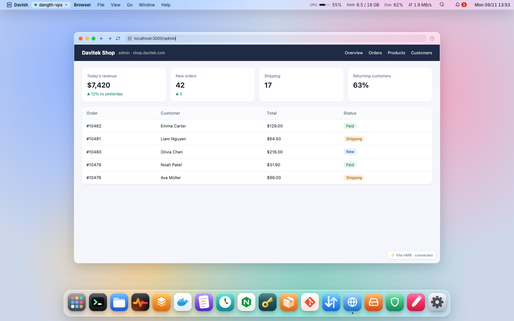
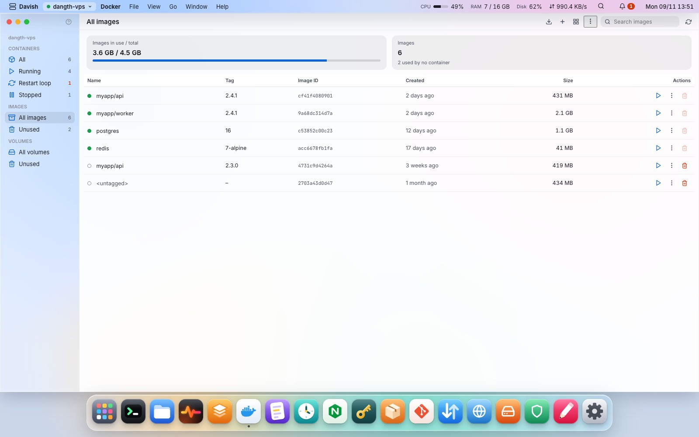
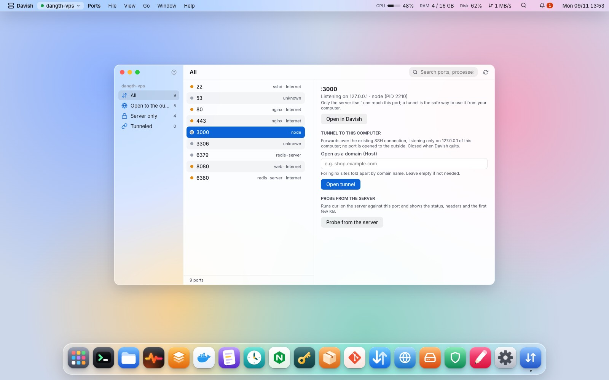
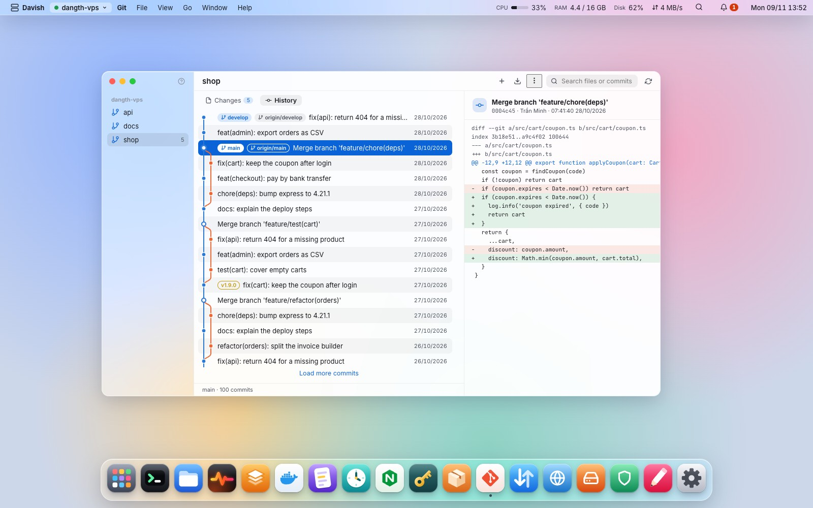
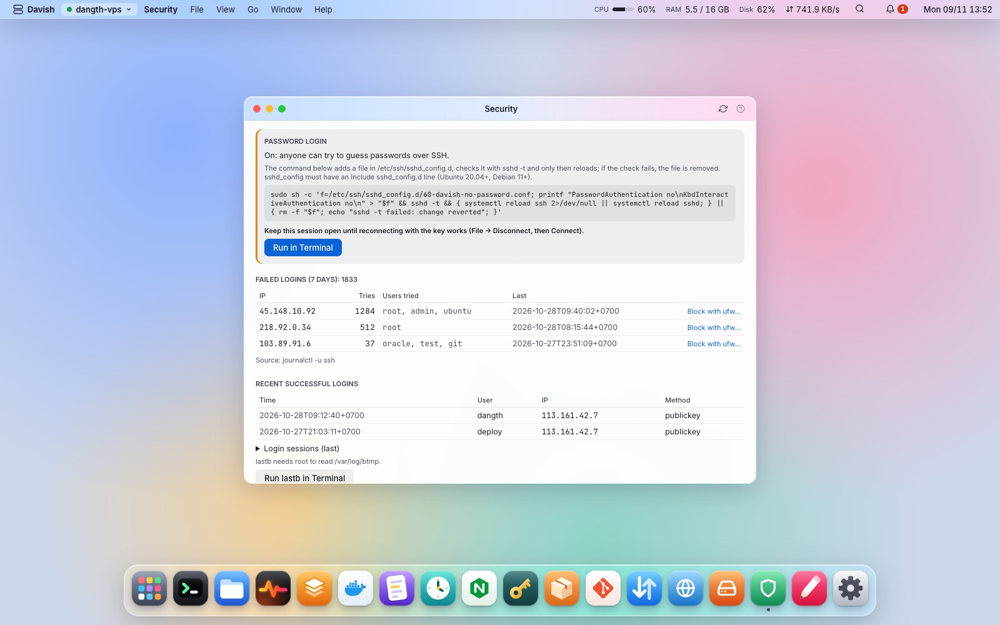
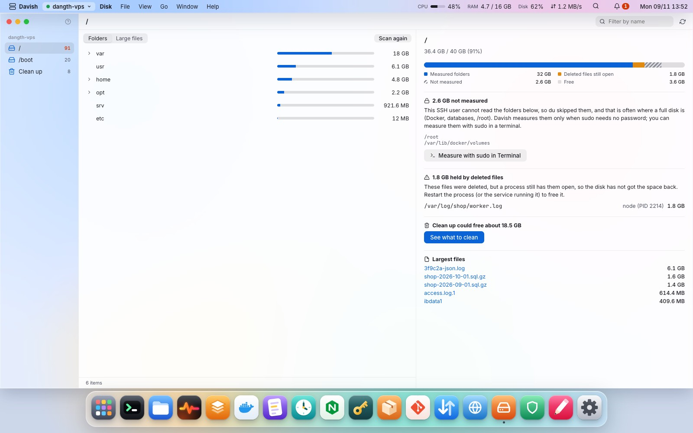

<div align="center">



# Davish

**你的 Linux 服务器，就是一个桌面。**<br>
终端、文件、服务、Docker、日志、cron、nginx、端口、浏览器、磁盘、登录安全、SSH 密钥、软件包和 git，全部走普通 SSH，集中在一个像操作系统一样的界面里。<br>
服务器上什么都不用装。

<p align="center">
  
</p>

[](https://github.com/2hjaito/davish/stargazers)
[](https://github.com/2hjaito/davish/releases)
[](https://github.com/2hjaito/davish/releases/latest)
[](https://github.com/2hjaito/davish/actions/workflows/ci.yml)


[English](README.md) · [Tiếng Việt](README.vi.md) · **简体中文**



</div>

## 为什么选择 Davish

- **打开就能用。** 没有登录页，也没有 Web 面板：Davish 用你的 SSH 密钥连上你上次使用的服务器，直接进入它的桌面。服务器上不会多出任何监听服务，所以不需要额外开放或保护新的端口。
- **无 Agent。** Davish 只需要 `sshd` 和 SFTP。所有操作都从你的电脑通过 SSH 完成，不会往服务器上复制、安装或留下任何东西。
- **每条命令都看得见。** 任何有破坏性的操作（停止服务、删除文件、重启容器、替换 crontab）在执行前都会显示完整的命令。命令日志记录了 Davish 代你执行过的所有操作。
- **密码只存在钥匙串里。** 密码和私钥口令只保存在系统钥匙串中。Davish 从不保存也不代你输入 `sudo` 密码：需要 root 时，它会打开一个已经输入好命令的终端，由你自己按回车。
- **离开时自动锁定。** 独立的锁屏密码，macOS 上支持 Touch ID；电脑唤醒、空闲一段时间或按 `⌘L` 时锁定。锁定期间会话照常运行，但解锁前不会向服务器发送任何操作。
- **多台服务器，一个桌面。** 每台服务器是一个工作区（`⌘1`…`⌘9`），各自记住自己的窗口。拖动文件即可在服务器之间复制。
- **自动更新。** 有新版本时会显示更新内容，可选择更新、稍后或跳过此版本；Davish 自动下载、校验签名并重启到新版本，无需重新安装。
- **简体中文、英文、越南文或西班牙文界面。** 在设置中选择语言；首次启动时跟随系统语言。中文翻译刚刚加入，欢迎在 [Issues](https://github.com/2hjaito/davish/issues) 中指出不通顺的地方。
- **直接使用你的 `~/.ssh/config`。** 一次导入其中的主机，包括密钥和 `ProxyJump`；Davish 只读取这个文件。堡垒机后面的服务器会经由堡垒机连接，每一跳都单独校验主机密钥，整条链路断开后会自动重连。

## 功能

**服务器上**

- [终端](FEATURES.md#terminal)：多标签、GPU 渲染、可选的 powerline 提示符
- [常用命令](FEATURES.md#saved-commands)：保存常用命令，一键输入到终端
- [文件](FEATURES.md#files)：Finder 风格的 SFTP，拖放上传下载，跨服务器复制，按住文件拖动即弹出环形操作菜单
- [编辑器](FEATURES.md#editor)：基于 CodeMirror，原子保存并自动备份
- [日志](FEATURES.md#logs)：journal、日志文件和容器日志，实时查看
- [监控](FEATURES.md#monitor)：CPU、内存、磁盘、网络、GPU、进程
- [所有服务器](FEATURES.md#all-servers)：在一个窗口里查看所有服务器的状态和告警

**服务与应用**

- [服务](FEATURES.md#services)：systemd 单元、状态、journal
- [Docker](FEATURES.md#docker)：按 compose 项目分组的容器、镜像与镜像层、数据卷
- [Cron](FEATURES.md#cron)：用自然语言描述的定时任务
- [Nginx](FEATURES.md#nginx)：站点管理，重载前先执行 `nginx -t`，TLS 证书到期提醒
- [软件包](FEATURES.md#packages)：优先显示安全更新，运行时管理；缺少 Docker、nginx、git 或数据库时一键给出安装命令
- [数据库](FEATURES.md#database)：MariaDB/MySQL、PostgreSQL、MongoDB 和 SQLite；查找、创建、导出与恢复，MongoDB 登录信息保存在钥匙串
- [Git](FEATURES.md#git)：状态、差异、提交图、fetch 和 pull
- [桌面快捷方式](FEATURES.md#desktop-shortcuts)：把 `deploy.sh` 拖到桌面，双击运行，可随时停止

**网络与安全**

- [端口与隧道](FEATURES.md#ports--tunnels)：监听中的端口，隧道到 `127.0.0.1`
- [浏览器](FEATURES.md#browser)：在 Davish 里直接打开服务器上的 `localhost:3000`
- [磁盘](FEATURES.md#disk)：用目录树查看空间去向，说明哪些没能统计及原因，可删除和清理
- [安全](FEATURES.md#security)：按小时和按 IP 统计的失败登录、被尝试的用户、当前会话、ufw、fail2ban
- [SSH 密钥](FEATURES.md#ssh-keys)：authorized_keys、部署密钥、本机密钥
- [~/.ssh/config 与 ProxyJump](FEATURES.md#sshconfig-and-proxyjump)：导入主机，经由堡垒机连接

**桌面**

- [Spotlight 与 Launchpad](FEATURES.md#spotlight--launchpad)：按 `⌘K` 打开任何东西，所有应用按分组排列
- [菜单栏与帮助](FEATURES.md#menu-bar-and-help)：所有命令和快捷键，每个应用都有 `?` 帮助
- [应用锁](FEATURES.md#app-lock)：Touch ID 或密码，唤醒时锁定
- [更新](FEATURES.md#updates)：一键更新到新版本，校验签名
- [浅色与深色](FEATURES.md#light-and-dark)：跟随系统，或手动选择
- [语言](FEATURES.md#language)：简体中文、英文、越南文或西班牙文

<table>
  <tr>
    <td></td>
    <td></td>
  </tr>
  <tr>
    <td></td>
    <td></td>
  </tr>
  <tr>
    <td></td>
    <td></td>
  </tr>
</table>

**[每个应用的详细说明和截图（英文）→](FEATURES.md)**

> 截图使用的是浏览器预览中的演示数据。

## 安装

每个 [Release](https://github.com/2hjaito/davish/releases) 都附带 macOS（通用版）、Windows 和 Linux 的安装包。

- **macOS 12 或更高版本。** 打开 `Davish-…-macos-universal.pkg` 安装到"应用程序"。应用暂未签名，首次打开会被 macOS 拦截：点击 **完成**，然后打开 **系统设置 → 隐私与安全性**，在关于 Davish 的那一行点击 **仍要打开**（如果 `Davish.app` 也被拦截，再操作一次）。也可以对文件执行 `xattr -dr com.apple.quarantine`。
- **Windows 10 或更高版本。** 运行 `Davish-…-windows-amd64-setup.exe`；如果缺少 WebView2 运行时会自动安装。Windows SmartScreen 可能提示未知发布者：选择 **更多信息** → **仍要运行**。
- **Linux**，需要 GTK 3 和 WebKitGTK 4.1。

### 服务器需要什么

| 功能 | 要求 |
|---|---|
| 全部功能 | 带 SFTP 子系统的 OpenSSH 服务器 |
| 服务、日志（journal） | systemd；读取系统日志需要用户在 `adm` 或 `systemd-journal` 组中 |
| Docker | `docker` 命令行；用户在 `docker` 组中（缺少时 Davish 会给出安装命令） |
| Cron | `crontab` |
| Nginx | 使用 `sites-available` / `sites-enabled` 或 `conf.d` 的 nginx |

需要 root 的操作（停止系统服务、编辑属于 root 的文件）会交给一个已输入 `sudo` 命令的终端，绝不会悄悄执行。

## 键盘快捷键

| 快捷键 | 操作 |
|---|---|
| `⌘K` | Spotlight |
| `⌘1` … `⌘9` | 切换服务器工作区 |
| `⌘W` · `⌘M` | 关闭 · 最小化窗口 |
| `⌘,` | 设置 |
| `⌘S` | 在编辑器中保存 |
| `⌘F` · `⌘[` · `⌘]` · `⌘↑` | 文件：搜索、后退、前进、上一级 |
| `⌘U` · `⌘D` | 文件：上传、下载 |
| `⌘⌥S` | 文件：把选中的内容复制到另一台服务器 |
| `⌘⌥L` | 传输窗口 |

在 Windows 和 Linux 上用 `Ctrl` 代替 `⌘`。在终端里，`Ctrl` 快捷键会交给 shell。

## 从源码构建

需要：Go 1.27+、Node.js LTS、[Wails](https://wails.io) v2.17（`go install github.com/wailsapp/wails/v2/cmd/wails@v2.17.0`，然后运行 `wails doctor`）、golangci-lint v2，集成测试还需要 Docker。Linux 上另需 `libgtk-3-dev` 和 `libwebkit2gtk-4.1-dev`（构建时加 `-tags webkit2_41`）。

```bash
make frontend-install   # 仅首次
wails dev               # 热重载运行
wails build             # 打包到 build/bin/
```

### 测试

```bash
make check              # go vet、golangci-lint、go test、svelte-check、eslint、prettier、vitest

make sshd-up            # 在 Docker 中启动两台临时 SSH 服务器（127.0.0.1:2222 和 :2223）
make test-integration   # 对它们运行真实的 SSH、SFTP、systemd、Docker、cron 和 nginx 测试
make sshd-down
```

集成测试只会连接 `test/sshd/` 中的容器，绝不会连接真实服务器。

## 技术栈

| 层 | 技术 |
|---|---|
| 后端 | Go · Wails v2 · `golang.org/x/crypto/ssh` · `pkg/sftp` · `go-keyring` |
| 前端 | Svelte 5（runes）· TypeScript strict · Vite |
| 组件 | xterm.js · CodeMirror 6 · 图标来自 [davi-icons](https://github.com/2hjaito/davi-icons) |

## 更新日志

见 [CHANGELOG.md](CHANGELOG.md)。

## 许可证

Davish 是基于 [GNU 通用公共许可证 v3.0](LICENSE) 的自由软件。贡献代码需要签署[贡献者许可协议](CLA.md)，详见 [CONTRIBUTING.md](CONTRIBUTING.md)。Davish 的名称和标志不在许可证范围内：见 [TRADEMARKS.md](TRADEMARKS.md)。

## 代码签名政策

Windows 版本的免费代码签名由 [SignPath.io](https://about.signpath.io) 提供，证书由 [SignPath Foundation](https://signpath.org) 颁发。团队角色、签名范围以及 Davish 会通过网络发送哪些内容：见 [CODE_SIGNING.md](CODE_SIGNING.md)。

如果 davish 帮你节省了时间，在 GitHub 上点个 ⭐ 会很有帮助！
