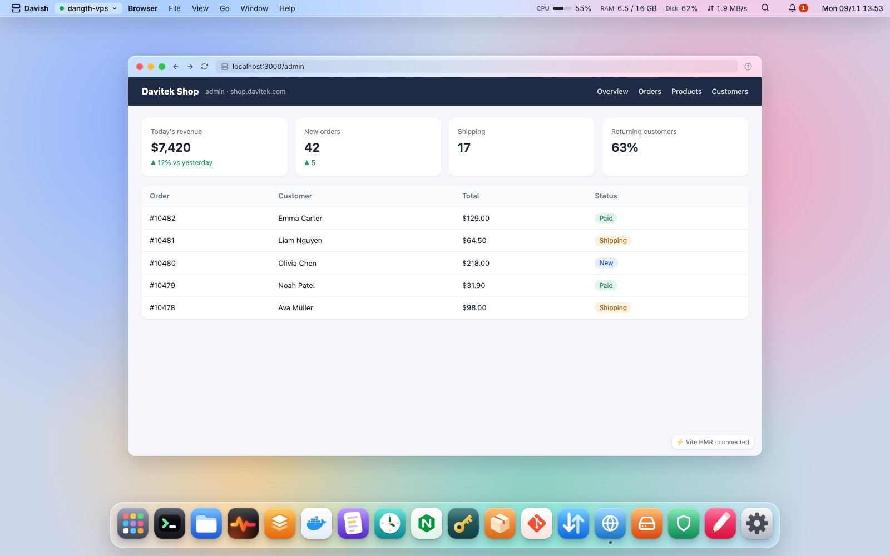

Type `localhost:3000` and see the web app running on the server, inside a Davish window: back, forward, reload, redirects and websockets (hot reload) stay on the server, logins keep working. It goes over SSH through a proxy on a random `127.0.0.1` port, so nothing clashes with what runs on your machine, and the page lives at its own origin, never able to reach Davish.

