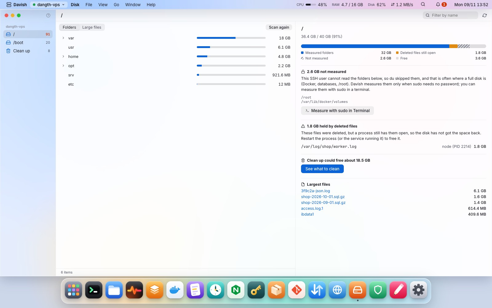
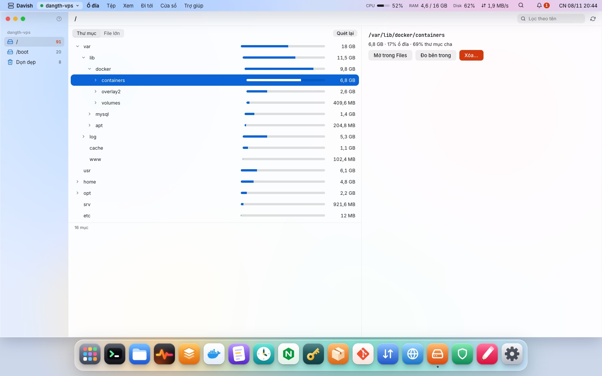
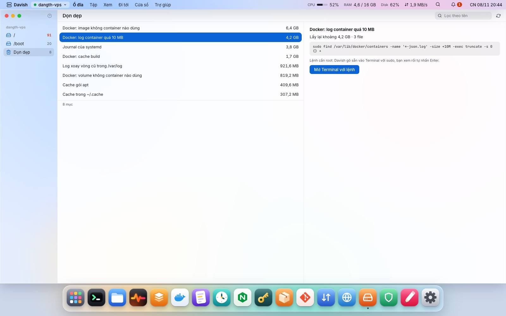

Where each disk's space goes, from one scan of the whole disk (as root through `sudo` when sudo needs no password or the session has it; otherwise **Measure with sudo…**). The overview splits the disk into measured folders, deleted files a process still holds open, what could not be measured and free space, and explains the gaps: the folders this user cannot read, with a `sudo du` to run in a terminal, and which process holds which deleted file. Folders open in place as a tree, deeper levels measured when opened; a Large files tab lists every file from 50 MB.

Delete a folder or file, or empty a file such as a log so the program writing it carries on, after seeing the exact command; anything from 1 GB, or a folder with content, asks for its name. System folders, package databases, Docker's and databases' data and home folders are refused, and root's files are deleted or emptied through `sudo` once you confirm. When a path goes through a link or a folder other users may change, Davish types the command into a terminal instead. Cleanups that need root run through `sudo` too; your own caches always run as you. Cleanups list the space they free: Docker images, stopped containers, build cache, volumes (flagged as data) and container logs, the journal, rotated logs, package caches, crash dumps, old temporary files, old snap revisions, `~/.cache` and the npm cache, each with its exact command. A full-disk alert opens it at the right mount.

  

  

