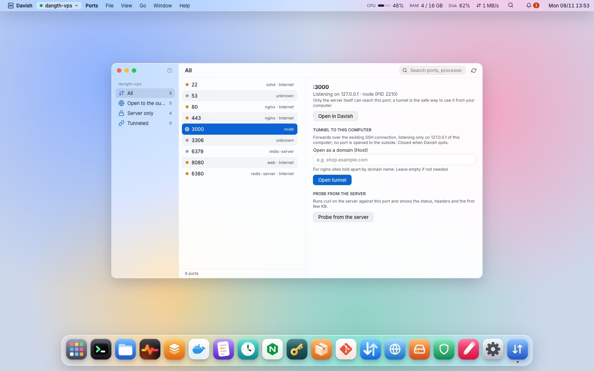

Every TCP port the server listens on, with its process or container. Open one in Davish's own browser window, or forward it to `127.0.0.1` on your machine over the SSH connection you already have, open it in your browser or point a database tool at it, even as a domain name for nginx sites. Nothing is opened to the outside.

**Open to the Internet** tells, for each port, whether the Internet can reach it, from where it listens, ufw's rules (read with `sudo -n` when needed) and Docker, whose published ports bypass ufw. Open or close a port with `ufw`, typed into a terminal; the port of the SSH session in use is never closed, and closing 80/443 warns about nginx sites. Databases and admin tools found open (Redis, PostgreSQL, Grafana…) are listed with one command that closes them all.
