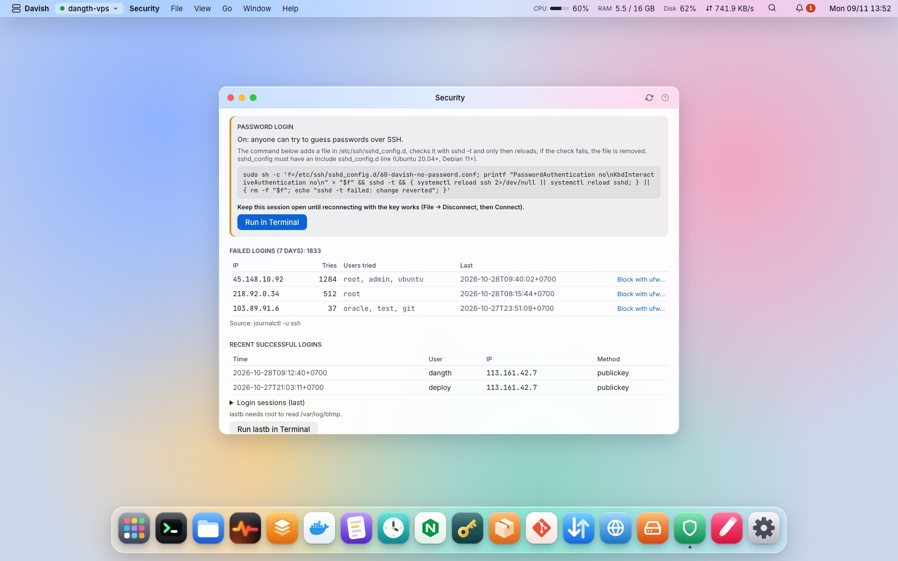

Who logs in over SSH and who keeps trying. At the top, the week in numbers (failed logins, unknown users, addresses, banned, successful logins), failed logins hour by hour, and the addresses and user names tried most, with those fail2ban banned or ufw blocks marked. Below, who is logged in right now, every address with the names it tried, recent logins, ufw and fail2ban. Failed logins and blocked addresses are tables you can select and copy from: each address with its tries, the names it tried, its last try and whether it is blocked, with Block or Unblock on the row; tick several to block them at once. Every block, unblock, ban or unban shows the exact commands first and runs once you confirm, through `sudo` with the sudo password asked once per session; what needs root to read (`lastb`, ufw, fail2ban) is read as root too. Password logins are turned off from a terminal, checked by `sshd -t` before the reload.

