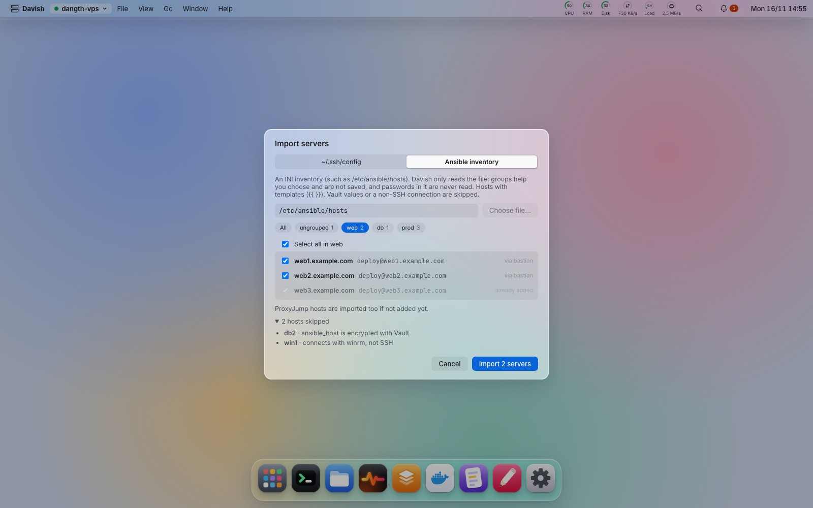

Import hosts from `~/.ssh/config` in one go, keys and `ProxyJump` included; Davish only reads the file. Servers behind a bastion connect through it, each hop with its own host key check, and the whole chain reconnects on its own.

Already use Ansible? The **Ansible inventory** tab reads an INI inventory (it finds `/etc/ansible/hosts`, `$ANSIBLE_INVENTORY` or the one in `~/.ansible.cfg`, or you choose the file): `ansible_host`, `ansible_user`, `ansible_port`, the key file and a `ProxyJump` in `ansible_ssh_common_args`, with group variables and ranges such as `web[01:03]`. Pick hosts one by one or a whole group at a time; groups are not saved. Passwords in the inventory are never read, and hosts that use templates, Vault or a non-SSH connection are listed as skipped, with the reason. YAML inventories are not read yet.

