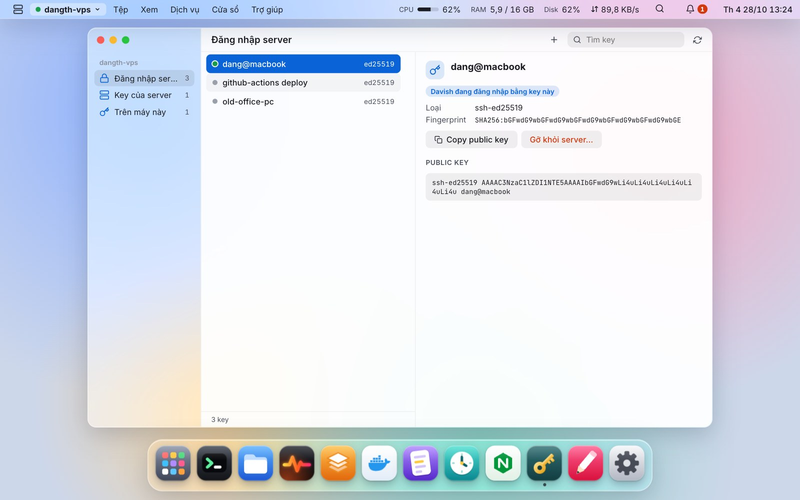

The server's `authorized_keys` with the key Davish logs in with marked; add or remove keys with a backup. Create a deploy key on the server and test it against GitHub or GitLab, checked against their published host key. Generate a key on your machine, put it on the server and switch to it.

