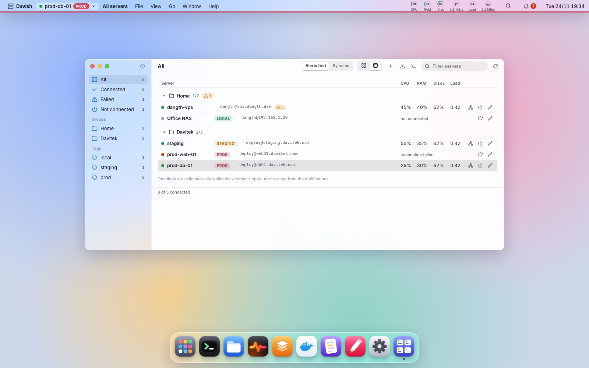
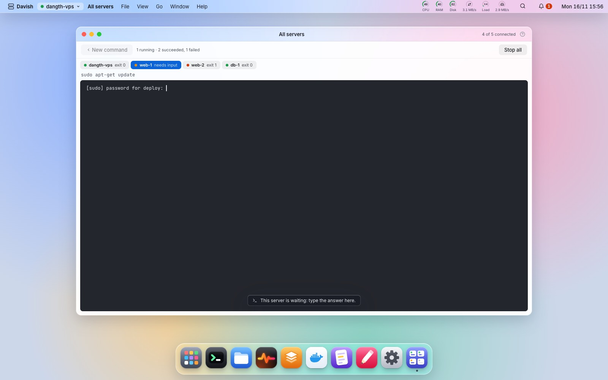

Every server in one window, from the server menu, Launchpad or Spotlight: connected or not, CPU, memory, the `/` disk, load, uptime and network, with its alerts (a failed service, a restart loop, a full disk…) counted and the latest one shown. Connect a server or switch to it from its card. Readings are collected only while the window is open, over the same session Monitor uses.

**Map** on a connected server's card shows which requests reach which program: each nginx site as a chain `domain → nginx :443 → :3000 → container (stack)`, static sites with their folder, and ports open to the outside that no site proxies to. A database port open to the Internet, an upstream nobody listens on and a certificate expiring within 14 days are flagged at the top, each with a button to the app that fixes it; every link opens its app (Nginx, the Browser, Docker at that container). Below, what runs (compose stacks and listening programs) and the disks. It only reads what Nginx, Ports, Docker and Disk already read. With four servers or more, the window filters by name and puts servers with alerts first. **List** shows every server as one compact row (readings, alerts, map, connect or disconnect, edit), and the window adds, imports, edits and disconnects servers itself. `⌘0` (Ctrl+0) opens it from anywhere, next to `⌘1`…`⌘9` for one server each.

**Run a command…** runs one command on the servers you tick, as `ssh server command` would: each server in its own terminal tab, at most four at a time, the rest waiting their turn. When a server asks something (a sudo password, `[Y/n]`), its tab comes forward and you answer there; Davish never types a sudo password for a run. The confirm dialog shows every server and the exact command; from three servers, or for a command that looks like it removes, stops or overwrites something, you type the number of servers to go ahead. Each tab ends with its exit code; **Run again** retries the ones that failed. **Update packages** prepares each server's own update with `sudo -n`: a server whose sudo wants a password says so, with a button to Terminal. Each server gets one line in the Command log.

