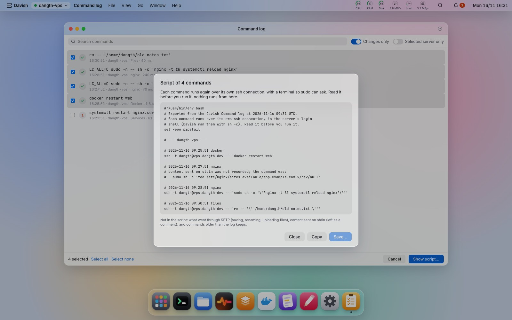

Every command Davish ran on a server, with its exit code and how long it took; any line can be typed into Terminal again or saved as a command. **Changes only** (on by default) hides the reads and polling, leaving what an action changed. **Export script…** turns the ticked commands into a bash script that runs them again, each over its own `ssh -t` so sudo and other prompts can ask: one block per server, the time and app above each line, Davish's sudo written as a plain `sudo` (never a password), and content sent on stdin, such as a file written as root, left as a comment because it is not recorded. Failed commands stay out unless you include them. Copy it or save it as an executable file; nothing runs from the dialog. What went through SFTP (saving, renaming, uploading) is not in the log.

