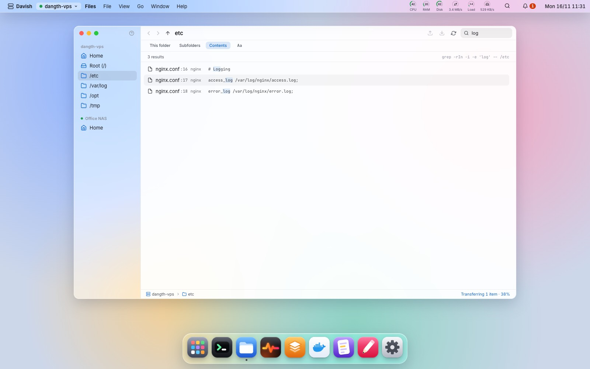

Finder-style browser over SFTP: upload, download, drag and drop from your OS, rename, delete, compress, and copy between servers through your machine. Hold a file and drag a little: a ring of actions opens around the pointer (open in Editor or Terminal, rename, delete, compress, copy the path, add to desktop); drop on a slice to pick it, in the middle or with Esc to cancel. Right-click empty space to create a file or folder in the folder on screen; Davish never overwrites an existing file.

Settings → Files can hide names that start with a dot (they show by default); it only tidies the list, the files stay on the server.

The search box filters the folder on screen. Pick **Subfolders** or **Contents** and press Enter to search the server instead: `find` by name across the whole tree, or `grep` through the files for a line (binary files, `.git` and `node_modules` are skipped). Up to 500 results arrive in a few seconds with the exact command that ran; a content result opens in the Editor at its line, and the folder button shows it in its folder. Places the account cannot read are counted, not retried as root, and **Stop** ends a long search.

