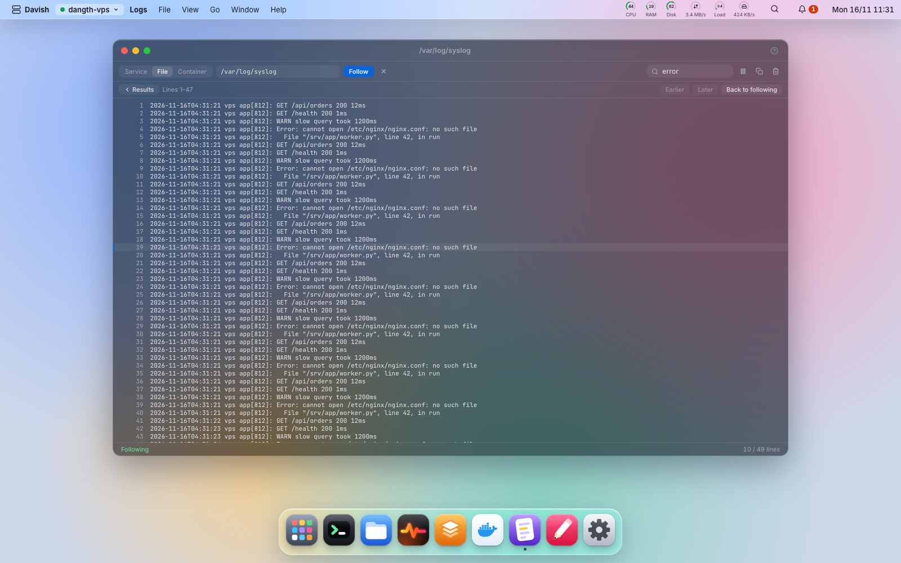
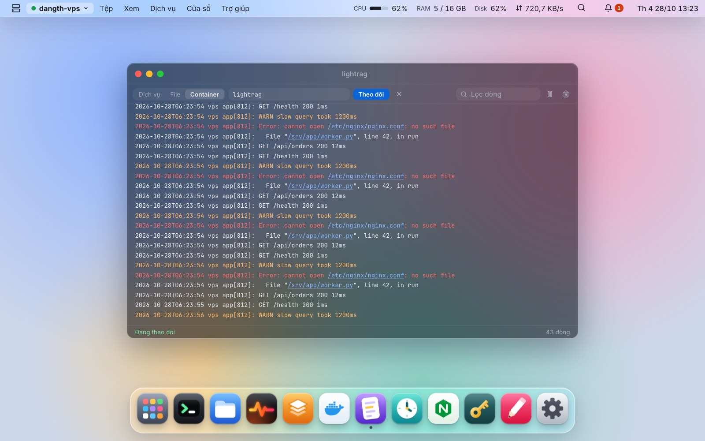

Follow a unit's journal, a file or a container. Filter, pause, highlight errors, and click a file path to open it in the Editor at that line. A log you may not read is followed again as root through `sudo`.

The filter only sees the lines on screen. **Search all** (or Enter in the filter) searches the source's whole history on the server and returns the latest 500 matching lines: `grep` for a file, `journalctl -g` for the journal, `docker logs | grep` for a container. For a file, click a result to read the lines around it, then page earlier or later; `sed` reads just that page, so a log of several GB is never downloaded.

