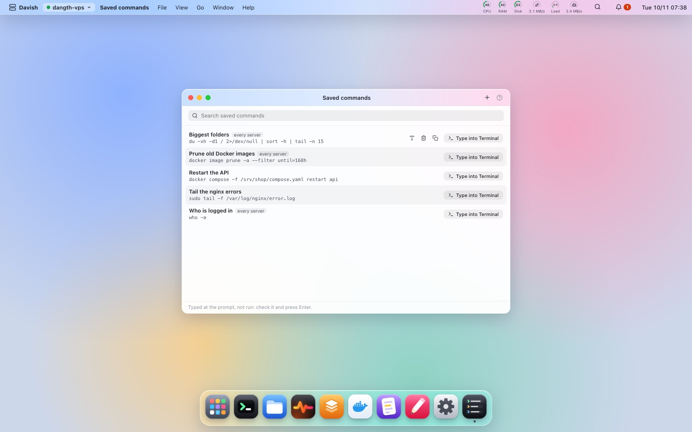

Keep the commands you type often, each with a name, for one server or every server. One click types a command into the server's Terminal for you to check and press Enter; nothing runs on its own. Spotlight (`⌘K`) finds them by name or command, and every line of the Command log can be typed into Terminal again or saved as a command. They are stored on your computer, in plain text: when a command looks like it holds a password, token or key, Davish warns you before you save it.

