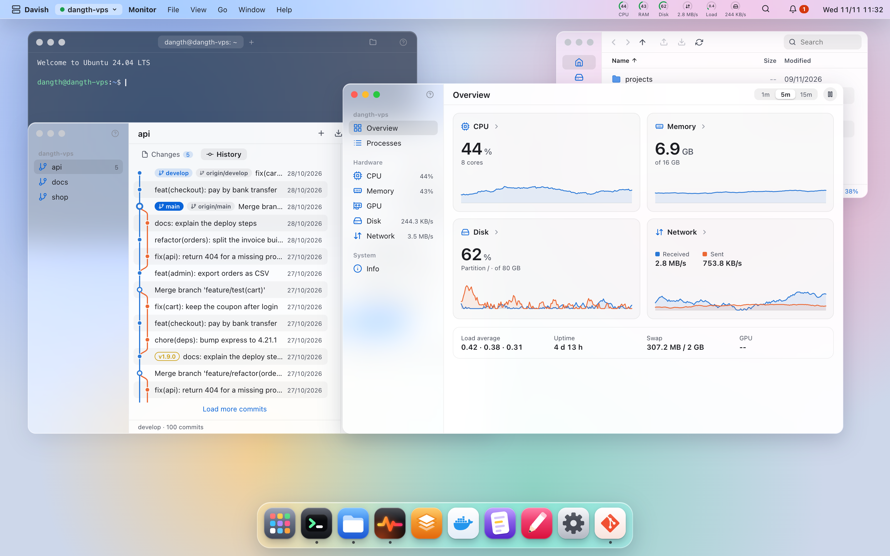
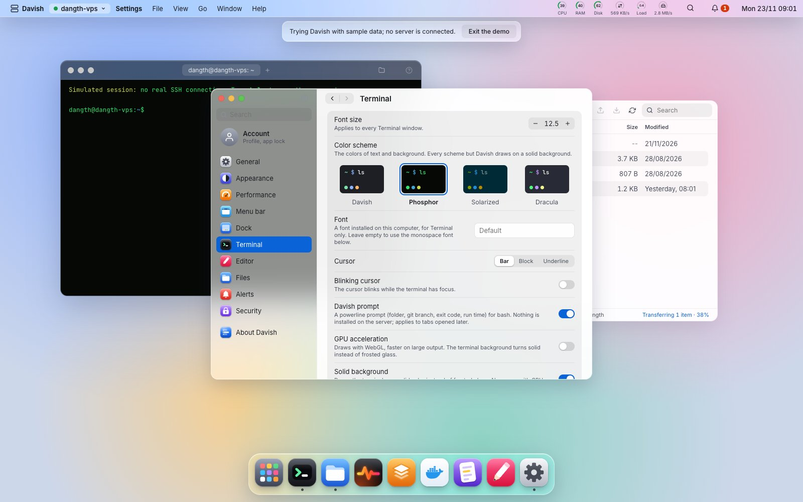

xterm.js with tabs, copy/paste, GPU rendering, and an optional powerline prompt injected into bash at login, with nothing written on the server.

Settings → Terminal changes how it looks and what it keeps: a **color scheme** (Davish, Phosphor for green on black like an old CRT, Solarized or Dracula; any scheme but Davish draws on a solid background), a **font** installed on your computer (left empty, it uses the app's monospace font), the **cursor** (bar, block or underline, blinking or not), a **solid background** in place of the frosted glass (always on with GPU rendering, Performance → Solid fills or a color scheme) and how many lines of **scrollback** each tab keeps (1,000, 5,000 or 20,000). Every change reaches open tabs at once.

