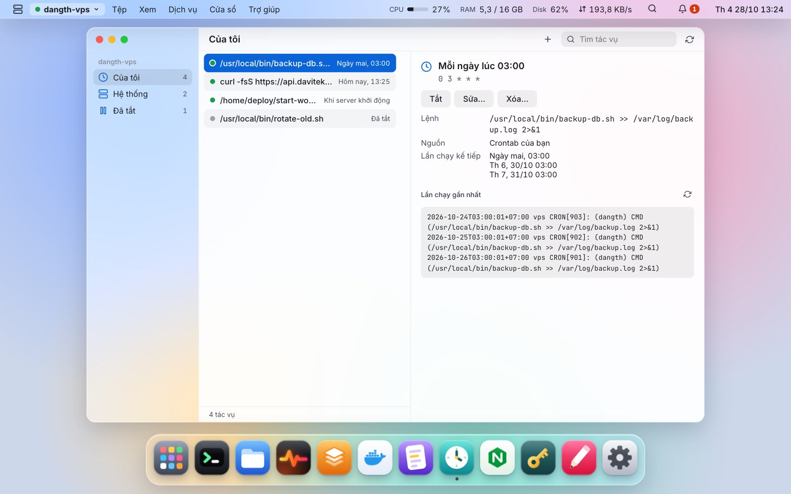

Your crontab and the system ones, schedules in plain words, next runs in the server's time zone, safe edits with a backup. If you may use sudo, root's crontab is listed and edited too, and system cron files you cannot read are read as root.

Each job lists the files and folders in its command (script, log, `cd` folder), one click from the Editor or Files. System jobs open their cron file and its folder.

