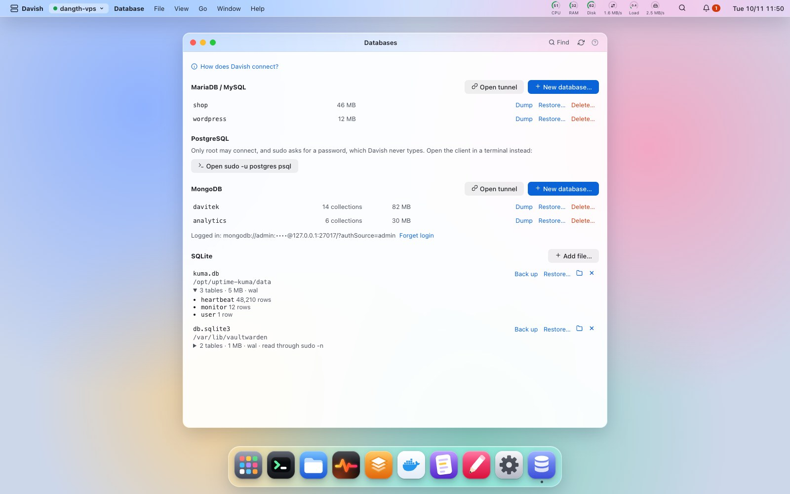
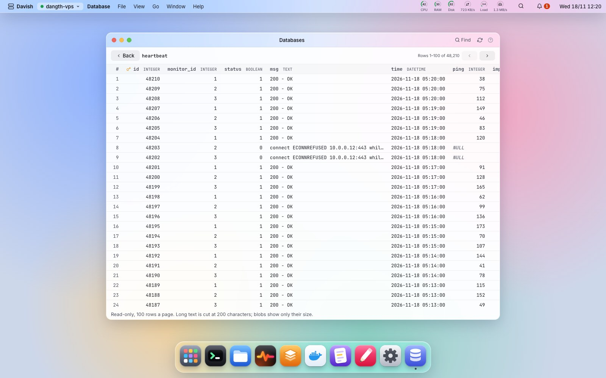

MariaDB/MySQL, PostgreSQL and MongoDB databases with their size, and SQLite files, from Launchpad or Spotlight. Create a database and a user that owns it with a random password, shown once and kept nowhere; the statement goes on stdin, so the password is neither in the command log nor in a shell history. Delete a database after typing its name. Dump one to `~/db-backups` (`mysqldump` / `pg_dump`, compressed) and download it from Files, or restore a dump after seeing the exact command and typing the name. Open the database server through a tunnel to use your own tools. Davish connects as you or as `postgres`; when only root may connect, it goes through `sudo`, asking for the sudo password once per session, and your dumps still land in your own `~/db-backups`.

**MongoDB** shows each database with its collections. When authentication is on, log in once with host, port, user and password or a connection string: Davish tries it first and only then keeps it in this computer's keychain, like your SSH password, never in a file; **Forget login** removes it. The connection string reaches `mongosh` on stdin, so it is never on a command line, in `ps` or in the command log; `mongodump` and `mongorestore` read it from a file only you can read, removed the moment they finish.

**Find** looks, read-only, for the database servers running (with MongoDB's port and whether authentication is on) and for SQLite files in `/var/lib`, `/opt`, `/srv` and the home folders, to add with one click. **SQLite** files, also added by path or with **Open in Database** in Files, show their tables and rows; click a table to read its rows, read-only and 100 to a page, sorted by any column or filtered by the text a column contains, with long text cut and blobs shown only by size, so a peek stays light. They back up with SQLite's online backup, safe while the app writes; putting one back is typed into a terminal, since the app using it has to stop first. **How does Davish connect?** in the app says all of this in plain words.

