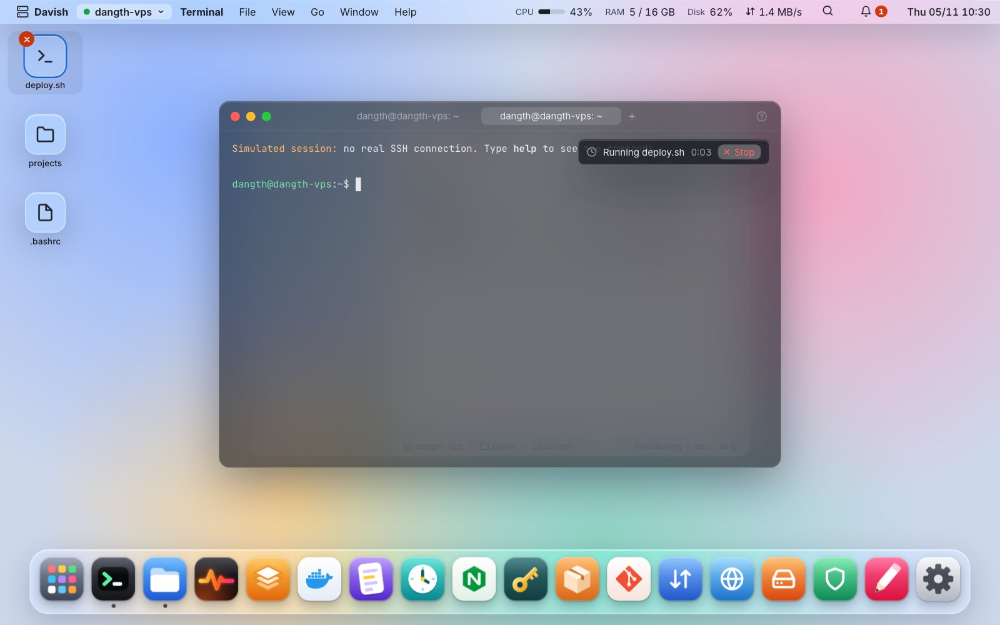

Drag a file, folder or script from Files onto the wallpaper, or right-click it and choose "Add to desktop" (`⌘⌥P`). Double-click to open: folders in Files, files in the Editor, scripts in a terminal tab. Each server has its own desktop, so staging's `deploy.sh` never shows on production. Right-click an icon and choose Customize (`F2`) to give it your own name, one of the built-in icons with a color, or a picture from your computer, as an alias would: the file on the server keeps its name, and the run dialog always shows the real one. Davish stores the path and these choices on your computer, never the file's content.

The first time a script runs, Davish shows the server name and the exact command. Choose "Run directly next time" and it runs right away from then on, as long as the script is unchanged; if it was edited, Davish asks again with a warning. While it runs, the terminal shows the elapsed time and a **Stop** button, and the icon shows an X; both send Ctrl-C to that session. A notification reports the end with the exit code, and every run goes in the command log.

