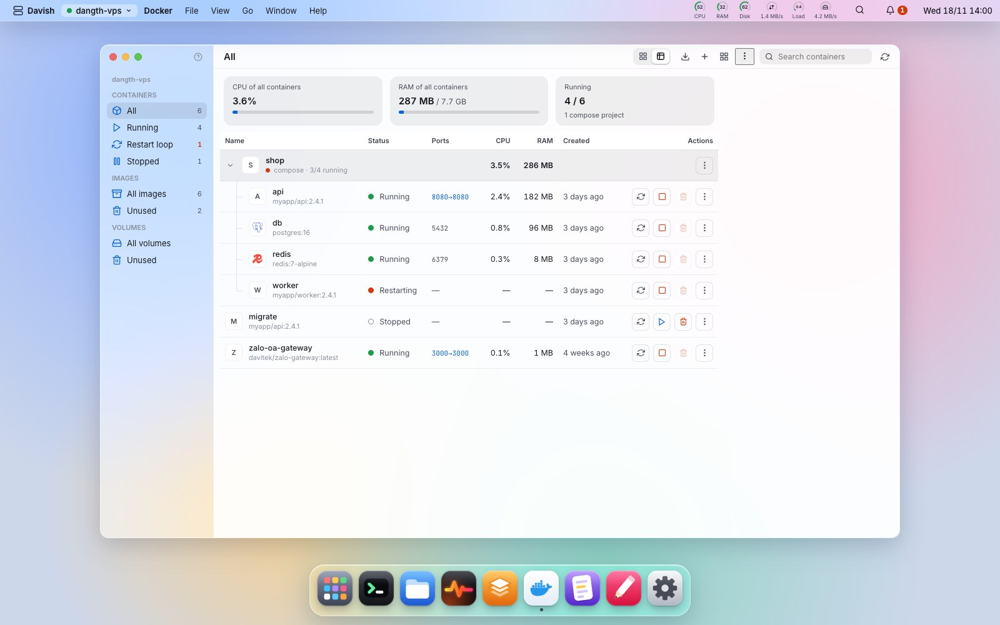
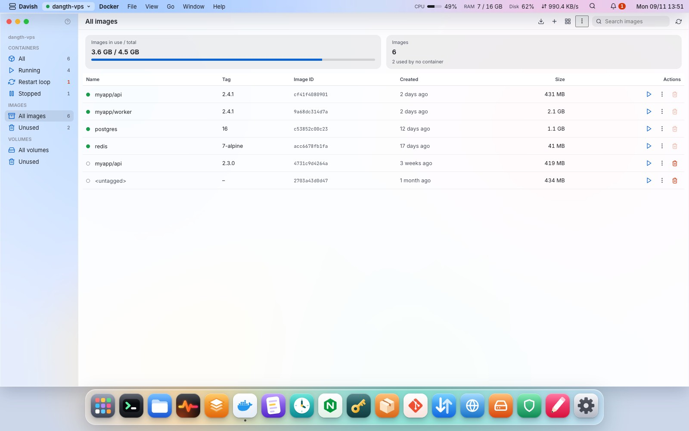

Laid out like Docker Desktop. Containers as cards or in a table, switched from the toolbar. The table is the default. Cards give each compose project, or lone container, one card: the project's own favicon, else the framework its code uses (Next, Nest, Express, Django, Laravel…, read from `package.json` and the like in the project folder over SFTP), else the logo of an image Davish knows (n8n, WordPress, Postgres…); nothing when none is found, how many of its containers run, its image, the ports it publishes (click one to open it in Davish's browser), CPU and memory, and a red edge when one keeps restarting; click the card for its containers. The table shows each container's logo, its name over its image, its state, ports as `8080→80`, CPU, memory and age, grouped by compose project with a tree line and the CPU and memory they use together on the project's row; restart, start or stop, delete and a ⋮ menu (logs, a shell in the container, details) sit right on the row, every destructive one showing its exact command first. A published port opens in Davish's own browser. Images with how much space the used ones take, their layers and config; run one in a terminal or remove the unused. Volumes with their size and whether a container still uses them. Restart-loop alerts stay.

**Pull an image…** and **Run a new container…**: a form for name, image, ports, environment (typed or a `.env` file), volumes, restart policy and network builds the full `docker run` line. Ports bind `127.0.0.1` unless you say otherwise, with a warning for `0.0.0.0`. The command is typed into a terminal so you press Enter and watch the progress.

**Compose**: each project's ⋮ menu has up, pull, restart and down, plus its compose file in the Editor; **New compose stack…** writes a `compose.yaml` from a template (one container, web + database, app + Redis) into a folder, never over an existing one. Create networks and volumes, and copy any container as the `docker run` command that would make it again.

  

  

