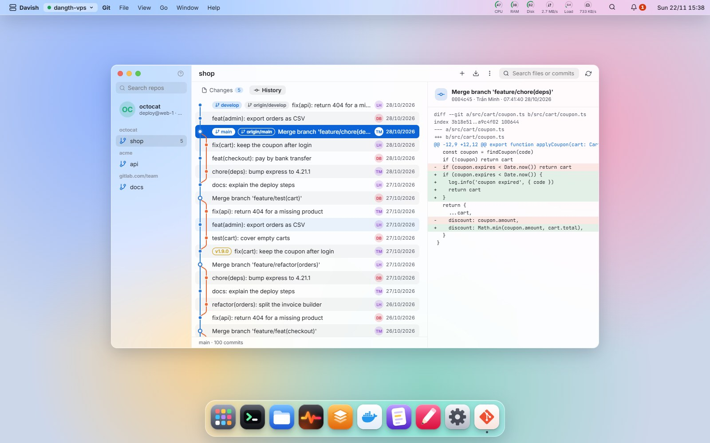
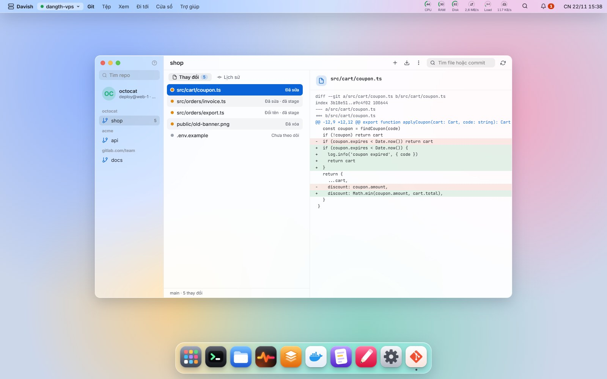

Finds the repositories in your home, `/var/www`, `/srv` and `/opt`, or folders you add. Branch, upstream and how far ahead or behind, changed files with their diffs, and a commit graph of every branch with merges and tags. Fetch, `pull --ff-only` (refused while the tree is dirty) and switch branches after confirming the exact command; `npm ci` / yarn / pnpm from the lockfile in a terminal. A rejected key leads to creating a deploy key.

**Clone a repository…** (SSH or HTTPS, folder, branch), **git init** and **Set a remote…** type the command into a terminal. For GitHub and GitLab over SSH, the host key they publish is added to `known_hosts` first; a button leads to creating a deploy key. **Deploy…** keeps a recipe per repository on your computer (pull, install, build, restart…) and runs it step by step in a terminal, stopping at the first step that fails. Davish looks at the repository (lockfile, `package.json` scripts, compose file, `go.mod`, `Makefile`) and at what runs the app from that folder (pm2, systemd, Docker compose), and offers the steps as switches: get the new code, install dependencies, build, restart the app, plus custom steps. Each step shows its exact command, and the choices are remembered. Deploy runs right away in a terminal; when a step needs sudo, the line is typed for you to press Enter and type the password. The terminal shows each step as done, running or failed with its time, a notification says when the deploy finished or which step failed, and the repository lists its last deploys with commit and duration.

  

  

