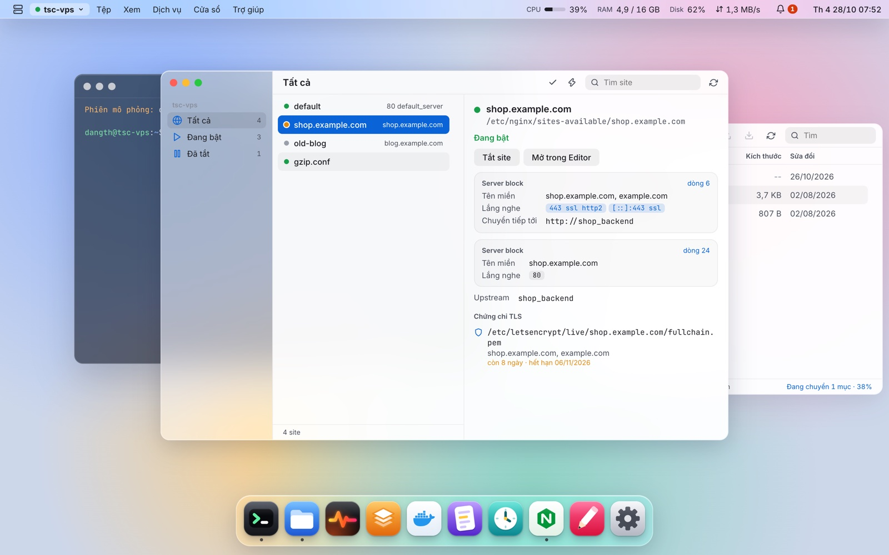
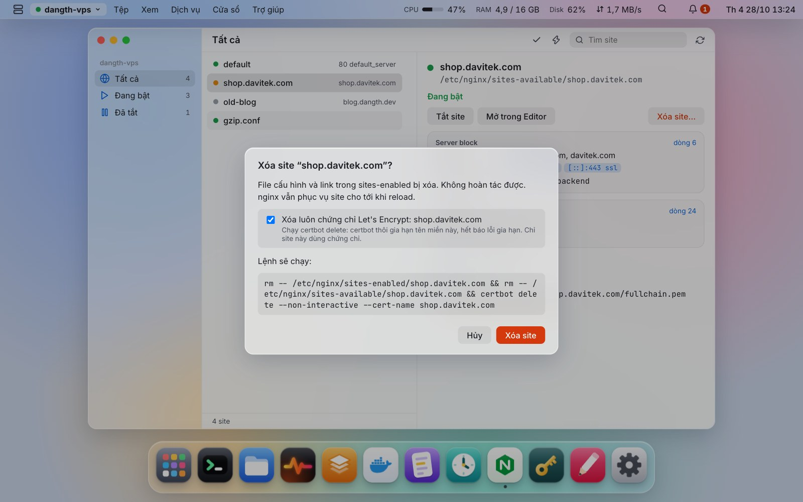

Sites, server blocks and upstreams; turn sites on or off, `nginx -t` before every reload, errors that open at the right line; TLS expiry alerts. Delete a site, and its Let's Encrypt certificate if no other site uses it.

**New site…** sets up a reverse proxy (to a port or a container, WebSocket optional), a static folder or PHP-FPM (the installed php-fpm socket is found for you). You see and can edit the generated config and the exact command before anything runs; the site is enabled only if `nginx -t` passes, otherwise it is turned off again and nginx's error is shown.

**Turn on HTTPS…** checks, from your machine, that each domain points to the server, warns about those that do not, then opens a terminal with `sudo certbot --nginx -d …` typed in (redirect HTTP to HTTPS optional).

**Quick change…** adds domains, points the proxy elsewhere (with what listens on the server as suggestions), turns gzip on or off and sets the upload size limit. The current file is backed up first and put back if `nginx -t` fails.

  

  

