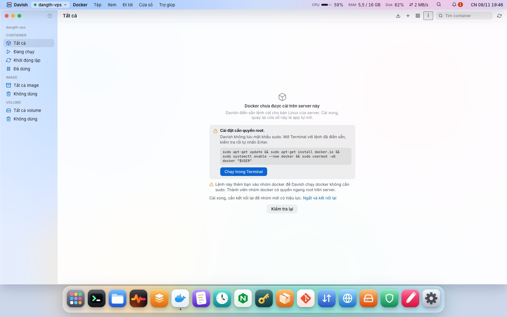
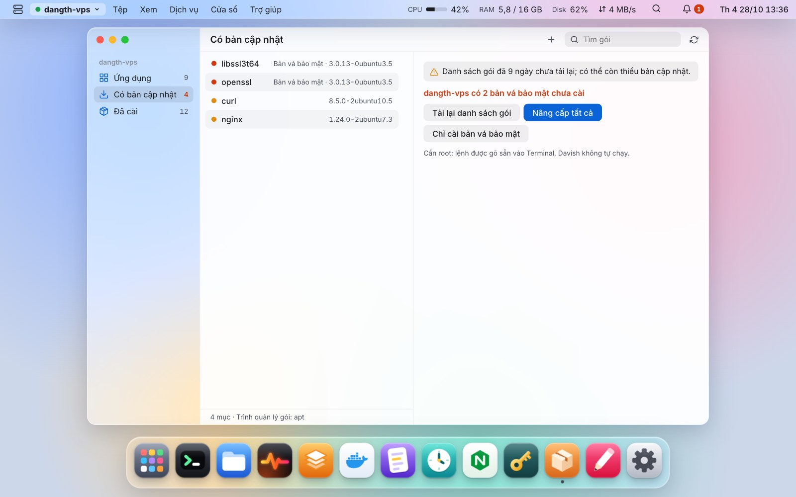
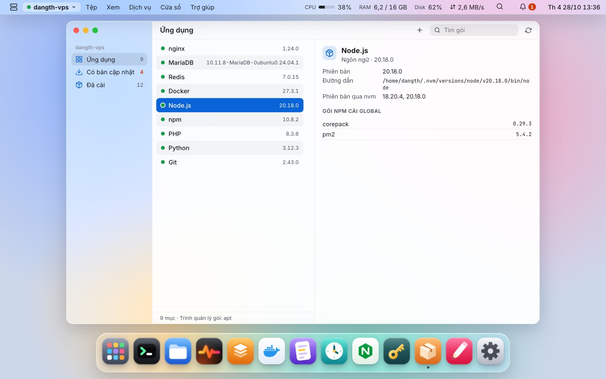

What apt, dnf, yum or apk installed and can upgrade, security fixes first, with an alert when you connect. The runtimes and server programs it finds (nginx, MariaDB, Redis, Docker, Node.js with nvm, PHP with php-fpm, Python…), each with its version, config files and service; also in Spotlight. Installing and upgrading type the `sudo` command into a terminal for you.

When Docker, nginx, git, MariaDB or PostgreSQL is missing, their app says so and shows the command that installs it for the server's Linux (apt, dnf, yum or apk), then enables and starts its service; one button types it into a terminal for you to check and run. Docker's command also adds you to the `docker` group, which the app warns is as good as root, and offers to reconnect so the group takes effect. Come back to the window once it is installed and the app opens. An account without sudo rights just gets told to ask whoever runs the server.

  

  

