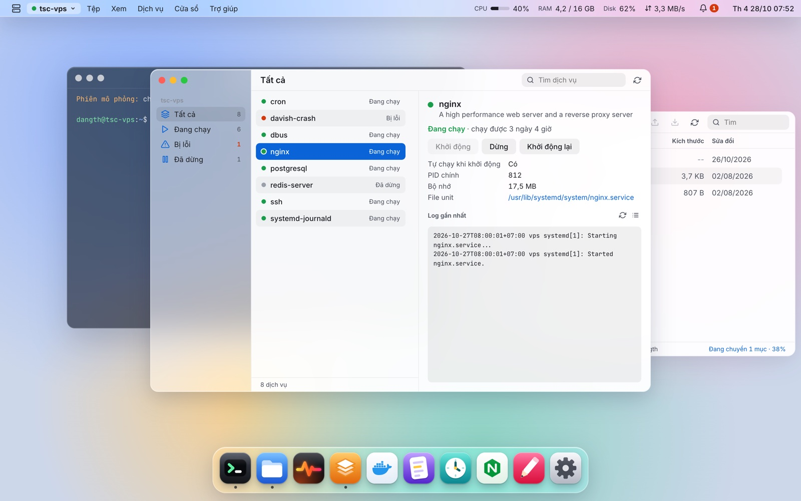

systemd units by state, their status and journal; start, stop and restart. Remove a unit you no longer use: an admin's unit is deleted, a package's (such as an old `certbot`) is masked with the timer that runs it. Logged in as a user who is not root, Davish runs what systemd refuses through `sudo`: it asks for the sudo password once per session, keeps it in memory only (never on disk, in the keychain or in a log, and gone after 15 minutes unused, when you disconnect or when you lock the app), and hands it to sudo on stdin, never on a command line.

