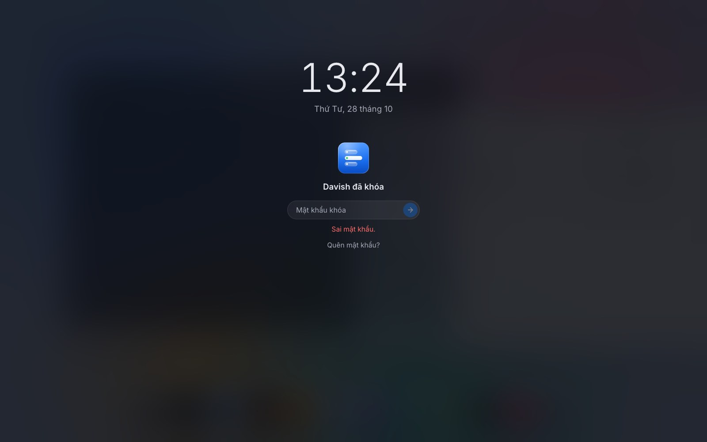
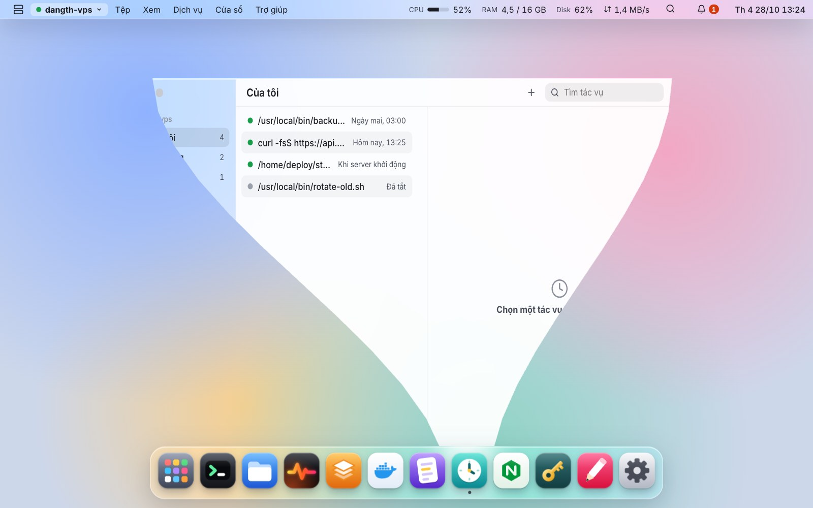

Touch ID or a password of its own covers everything when you step away. Forgot the password? Resetting it removes the saved server passwords first, so it never opens a way into a server. Windows open, close and minimize into the Dock with a genie effect.

  

  

