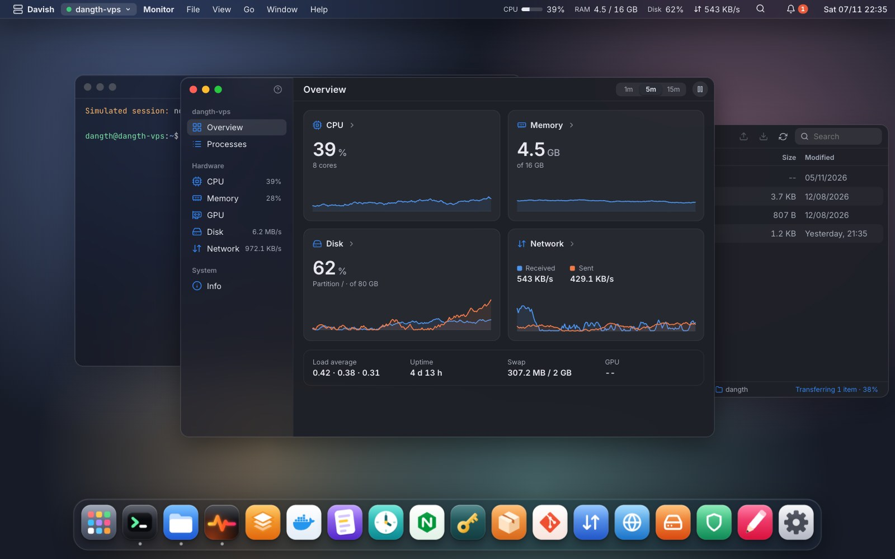
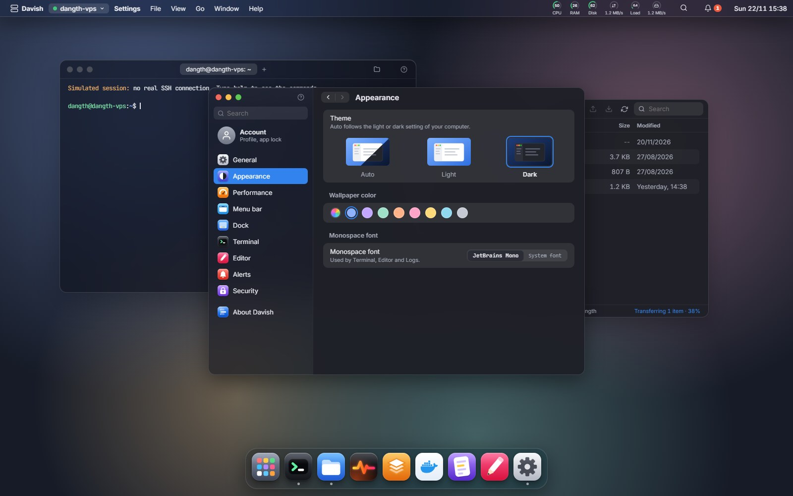
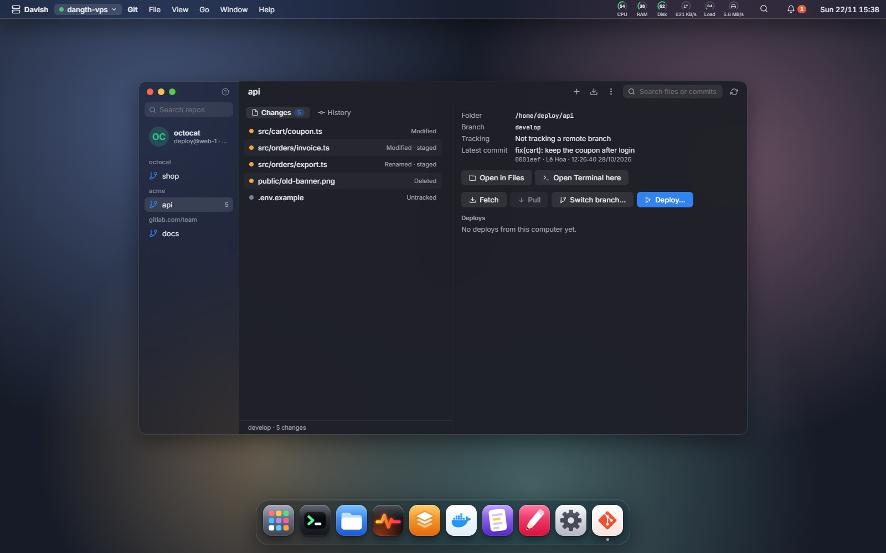
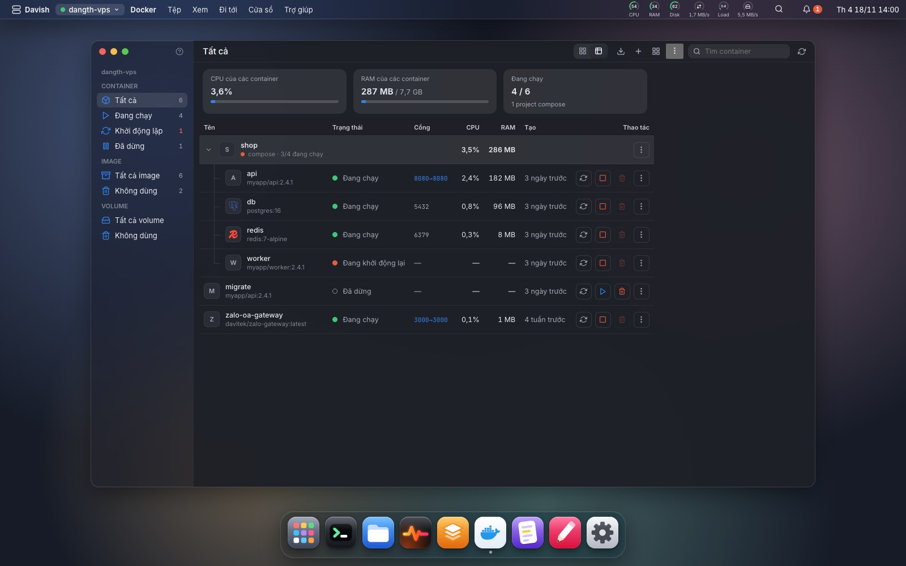
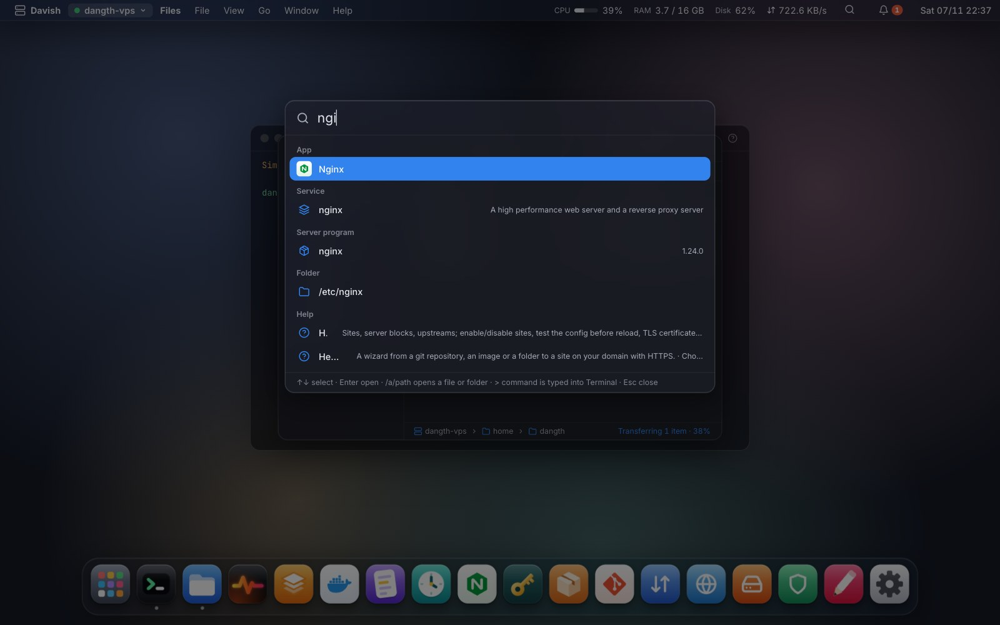

Davish comes in a light and a dark look. By default it follows your computer and switches when the system does; pick Light or Dark in Settings → Appearance → Theme to keep one. Terminal and Logs stay dark either way, and the wallpaper color you chose carries over, dimmed for the night.

Settings → Performance picks how much Davish spends on its own look: **Beautiful** (frosted glass), **Balanced** (no blur), **Light** (solid fills, short shadow, flat wallpaper, no motion), or **Auto**, which keeps the full look and suggests Light when this computer renders slowly. **Advanced** sets each effect on its own. Contributed by @tian2992. **Dragging windows** picks how a window follows the pointer: **Live** (the whole window), **Simple** (the same, but the glass is switched off until you let go) or **Outline** (only an outline moves, and the window goes there when you let go), for computers where dragging feels slow.

The Dock sits at the bottom by default; Settings → Dock moves it to the left, right or top edge (windows keep clear of it, minimizing shrinks a window into its tile) and can drop its glass so only the icons float over the wallpaper.

  

  

  

  

