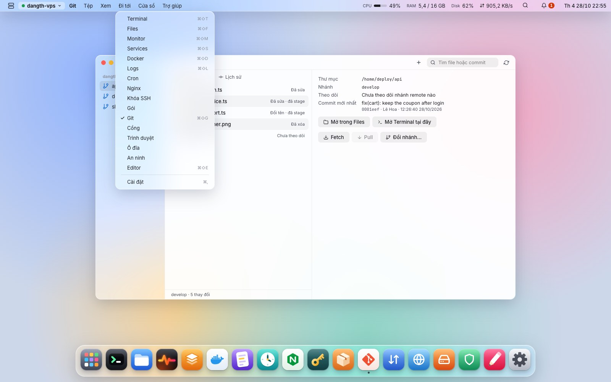
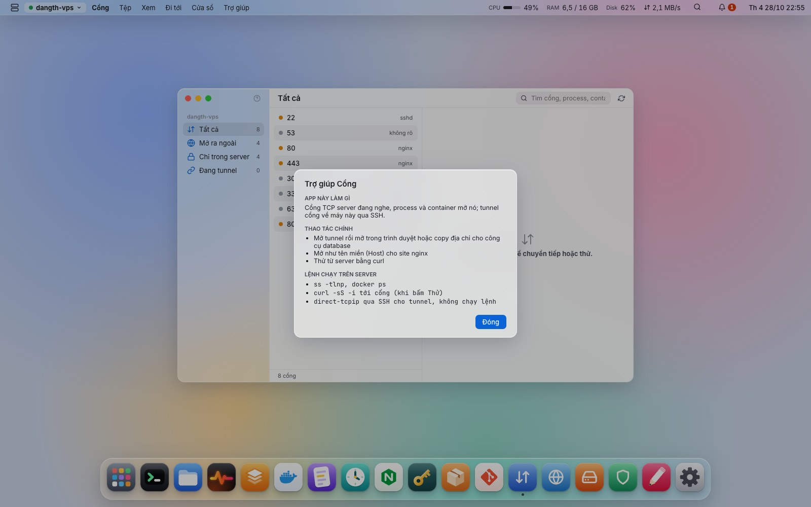

A real menu bar (File, View, Go, Window, Help and the focused app's own commands), every shortcut under `⌘/`, a `?` on each app explaining what it does and which commands it runs on the server, a first-run tour and a demo mode with sample data.

  

  

