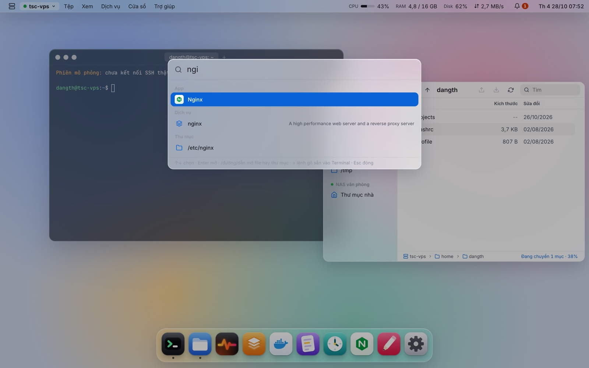
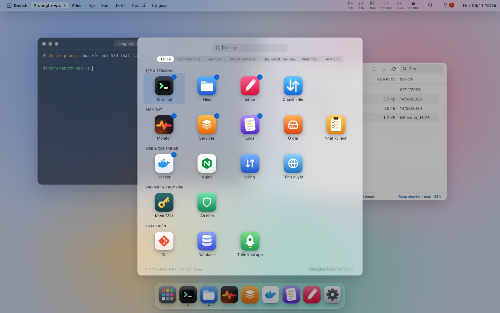

A real menu bar (File, View, Go, Window, Help and the focused app's own commands) with every shortcut listed under `⌘/`, and a `?` on each app explaining what it does and which commands it runs. `⌘K` (or the magnifier in the menu bar) to open an app, a service, a container, a folder, a `/path`, or `> a command` typed into a terminal. Launchpad (`⌘⇧A`) starts with the five apps you opened last, then every app in groups (files & terminal, monitoring, web & containers, security & access, development, system), with a tab per group and a search across all of them; `+` pins an app to the Dock, `−` takes it off, and one button puts the Dock back as it came.

  

  

