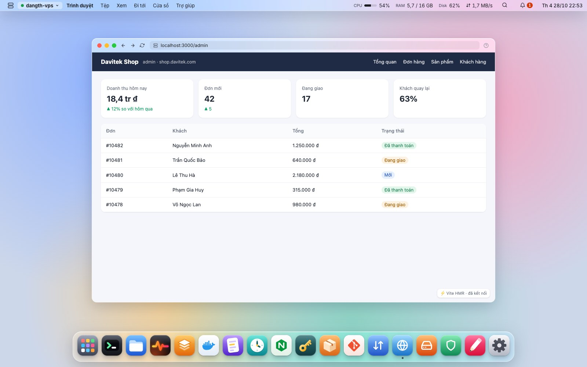

Gõ `localhost:3000` để xem web app đang chạy trên server, ngay trong một cửa sổ Davish: lùi, tới, tải lại, redirect và websocket (hot reload) đều ở lại server, đăng nhập vẫn chạy. Đi qua SSH bằng một proxy nghe `127.0.0.1` ở cổng ngẫu nhiên nên không đụng app nào trên máy, và trang ở origin riêng, không bao giờ chạm được Davish.

