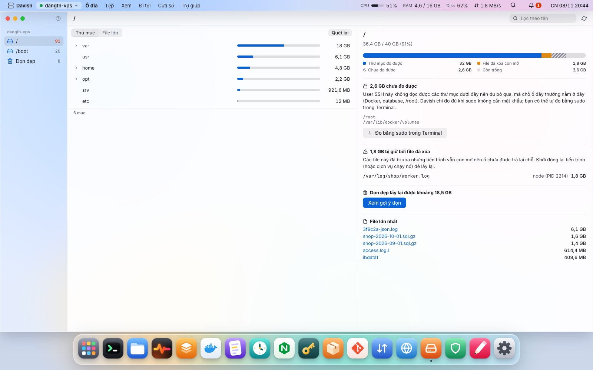
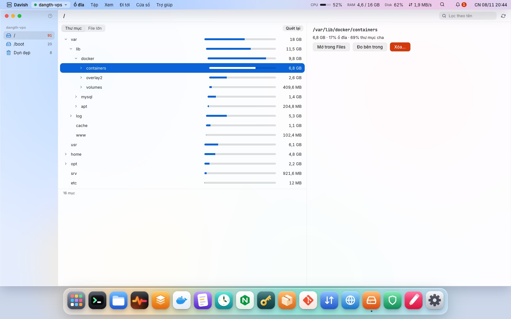
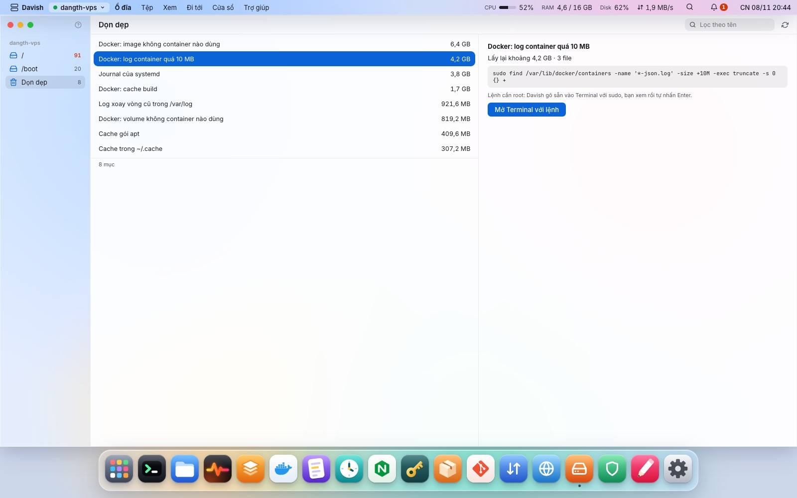

Ổ đĩa nặng ở đâu, từ một lần quét cả ổ (bằng root qua `sudo` nếu sudo không cần mật khẩu hoặc phiên đã có mật khẩu; nếu chưa thì có **Đo bằng sudo…**). Trang tổng quan chia ổ thành thư mục đo được, file đã xóa mà tiến trình còn giữ, phần chưa đo được và chỗ trống, rồi giải thích phần hụt: các thư mục user này không đọc được, kèm lệnh `sudo du` để chạy trong Terminal, và tiến trình nào giữ file đã xóa nào. Thư mục mở tại chỗ dạng cây, tầng sâu hơn được đo khi mở; tab File lớn liệt kê mọi file từ 50 MB.

Xóa thư mục hoặc file, hoặc làm rỗng file như log để chương trình đang ghi vẫn ghi tiếp, sau khi xem đúng lệnh; từ 1 GB hoặc thư mục có nội dung thì phải gõ tên. Thư mục hệ thống, cơ sở dữ liệu gói, dữ liệu của Docker và database, thư mục home đều bị từ chối; file của root được xóa hoặc làm rỗng qua `sudo` sau khi xác nhận. Đường dẫn đi qua link hay thư mục mà user khác có thể đổi thì Davish gõ sẵn lệnh vào Terminal thay vì chạy. Cleanup cần root cũng chạy qua `sudo`; cache của bạn luôn chạy bằng chính bạn. Mục Dọn dẹp kèm dung lượng lấy lại: image, container dừng, cache build, volume (đánh dấu là dữ liệu) và log container của Docker, journal, log xoay vòng, cache gói, dump lỗi, file tạm cũ, bản snap cũ, `~/.cache` và cache npm, mỗi mục hiện đúng lệnh. Thông báo ổ đầy mở thẳng đúng mount.

  

  

