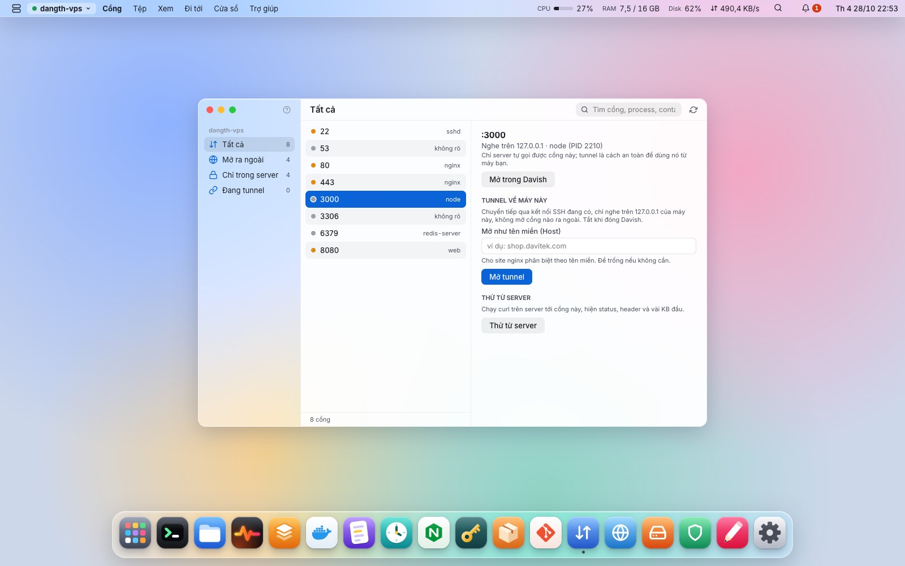

Mọi cổng TCP server đang nghe, kèm process hoặc container. Tunnel một cổng về `127.0.0.1` trên máy qua chính kết nối SSH đang có, mở trong trình duyệt hoặc trỏ công cụ database vào, kể cả mở như một tên miền cho site nginx. Không mở cổng nào ra ngoài.

**Lộ ra Internet** cho biết từng cổng Internet có vào được không, dựa trên nơi cổng đang nghe, luật ufw (đọc bằng `sudo -n` khi cần) và Docker (cổng publish của Docker vượt qua ufw). Mở hoặc đóng cổng bằng `ufw`, gõ sẵn vào Terminal; không bao giờ đóng cổng của phiên SSH đang dùng, đóng 80/443 thì cảnh báo về site nginx. Database và công cụ quản trị đang lộ ra (Redis, PostgreSQL, Grafana…) được liệt kê kèm một lệnh đóng tất cả.
