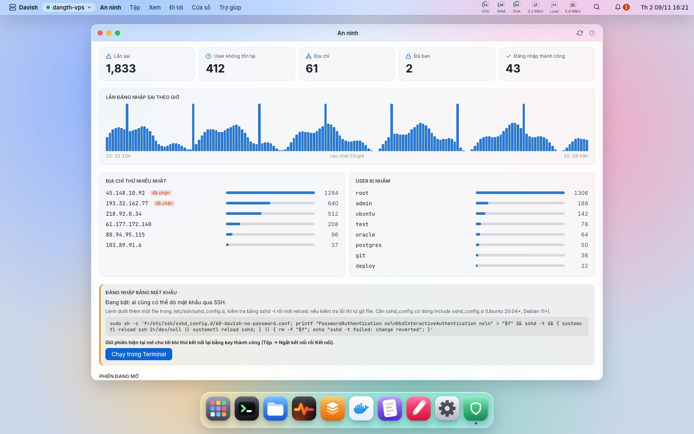

Ai đăng nhập qua SSH và ai đang dò. Phía trên là số liệu 7 ngày (lần sai, user không tồn tại, số địa chỉ, đã ban, đăng nhập thành công), biểu đồ lần sai theo giờ, địa chỉ và user bị thử nhiều nhất, đánh dấu địa chỉ fail2ban đã ban hoặc ufw đã chặn. Bên dưới là ai đang đăng nhập lúc này, mọi địa chỉ kèm tên user đã thử, đăng nhập gần đây, ufw và fail2ban. Đăng nhập sai và Đã chặn là bảng bôi đen, copy được: mỗi địa chỉ kèm số lần, user đã thử, lần thử cuối, đã chặn hay chưa, nút Chặn hoặc Bỏ chặn ngay trên dòng; tick nhiều dòng để chặn một lần. Mọi lần chặn, bỏ chặn, ban, bỏ ban đều hiện đúng lệnh trước, xác nhận là chạy qua `sudo`, hỏi mật khẩu sudo một lần mỗi phiên; những gì cần root để đọc (`lastb`, ufw, fail2ban) cũng được đọc bằng root. Tắt đăng nhập mật khẩu qua Terminal, có `sshd -t` trước khi reload.

