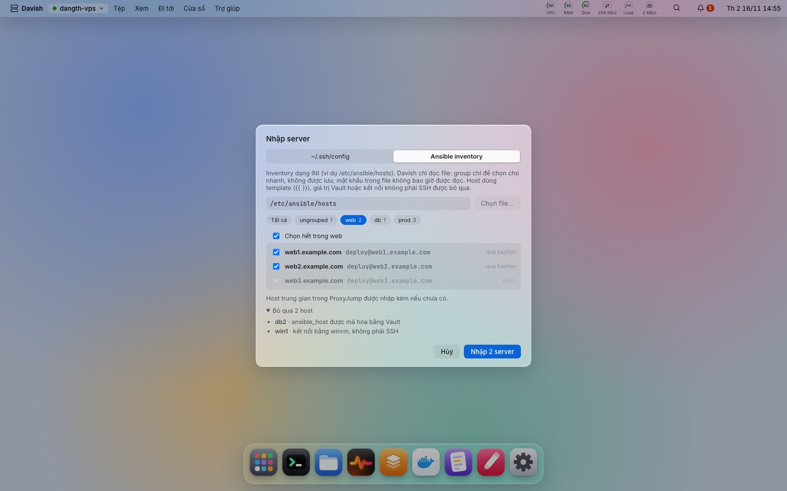

Nhập server từ `~/.ssh/config` một lần, kèm key và `ProxyJump`; Davish chỉ đọc file. Server sau bastion kết nối qua nó, mỗi bậc kiểm tra host key riêng, cả chuỗi tự kết nối lại.

Đã dùng Ansible? Tab **Ansible inventory** đọc inventory dạng INI (tự tìm `/etc/ansible/hosts`, `$ANSIBLE_INVENTORY` hoặc file khai báo trong `~/.ansible.cfg`, hoặc bạn tự chọn file): `ansible_host`, `ansible_user`, `ansible_port`, file key và `ProxyJump` trong `ansible_ssh_common_args`, có tính biến của group và dải như `web[01:03]`. Chọn từng host hoặc cả group một lần; group không được lưu. Mật khẩu trong inventory không bao giờ được đọc; host dùng template, Vault hay kết nối không phải SSH được liệt kê là bỏ qua, kèm lý do. Inventory YAML chưa đọc được.

