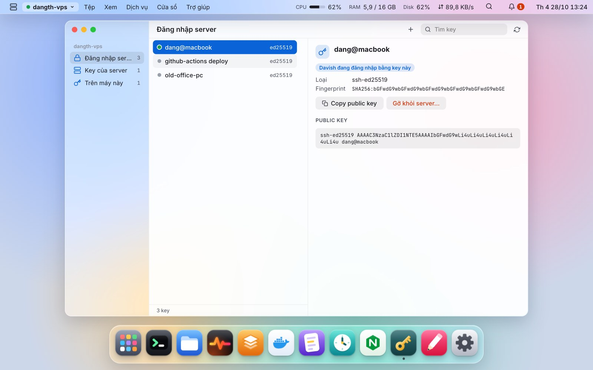

`authorized_keys` của server, đánh dấu key Davish đang đăng nhập; thêm, gỡ key có sao lưu. Tạo deploy key trên server và thử với GitHub, GitLab (kiểm tra đúng host key họ công bố). Tạo key trên máy, đưa lên server rồi chuyển sang đăng nhập bằng nó.

