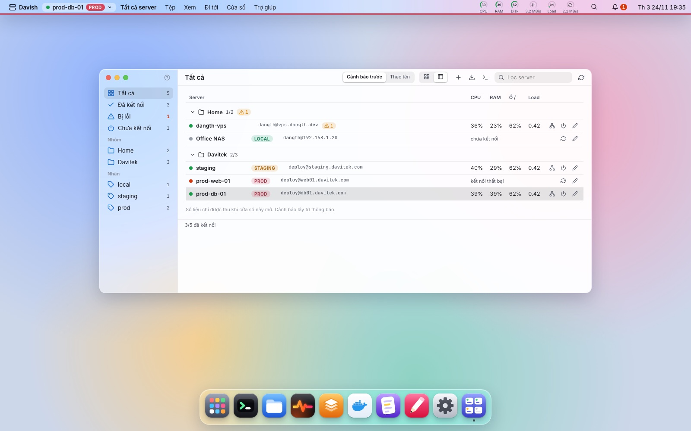
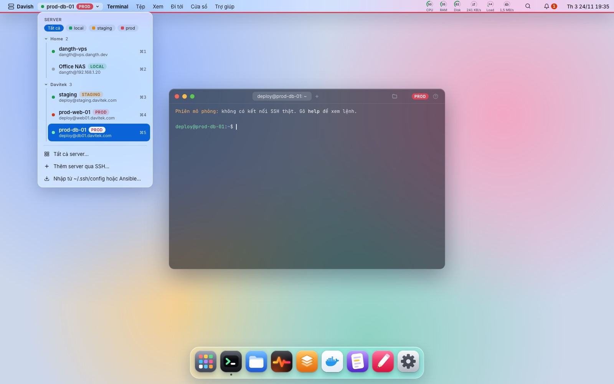
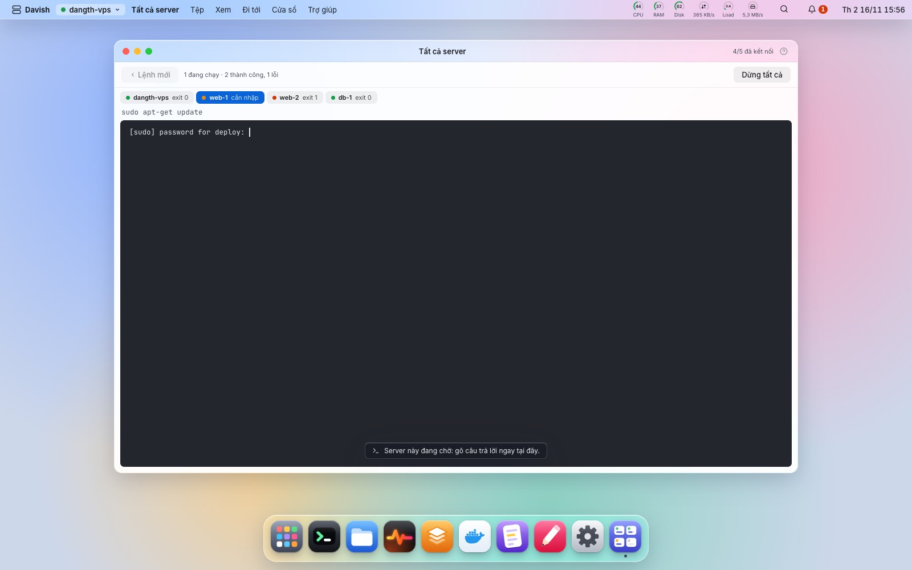

Mọi server trong một cửa sổ, mở từ menu server, Launchpad hoặc Spotlight: đã kết nối chưa, CPU, RAM, ổ `/`, load, thời gian chạy và mạng, kèm số cảnh báo (service lỗi, container khởi động lại liên tục, ổ đầy…) và cảnh báo mới nhất. Kết nối hoặc chuyển sang server ngay trên thẻ của nó. Số liệu chỉ được thu khi cửa sổ đang mở, qua cùng phiên mà Monitor dùng.

Nút **Bản đồ** trên thẻ server đã kết nối cho thấy request nào tới chương trình nào: mỗi site nginx là một chuỗi `tên miền → nginx :443 → :3000 → container (stack)`, site tĩnh kèm thư mục, và các cổng mở ra ngoài mà không site nào proxy tới. Cổng database mở ra Internet, upstream không ai nghe và chứng chỉ hết hạn trong 14 ngày được đưa lên đầu, mỗi cái có nút mở đúng app để sửa; mỗi mắt xích bấm được để mở app của nó (Nginx, Trình duyệt, Docker tại container đó). Bên dưới là những gì đang chạy (stack compose và chương trình đang nghe) và các ổ đĩa. Bản đồ chỉ đọc những gì Nginx, Cổng, Docker và Ổ đĩa vốn đã đọc. Cửa sổ có ô lọc theo tên, host, nhãn hoặc nhóm, và từ 4 server trở lên còn xếp server có cảnh báo lên trước được. Dạng **Danh sách** hiện mỗi server một dòng gọn (số liệu, cảnh báo, bản đồ, kết nối hoặc ngắt kết nối, sửa), và cửa sổ tự thêm, nhập, sửa, ngắt kết nối server. `⌘O` (Ctrl+O) mở nó từ bất cứ đâu.

**Nhóm và bộ lọc.** Đặt **Nhóm** cho server trong hộp thoại của nó (một cấp, tối đa 40 ký tự) thì cửa sổ xếp các server dưới tiêu đề thư mục gập được, ở cả dạng thẻ lẫn dạng bảng; thư mục cho biết bao nhiêu server trong đó đang chạy và số cảnh báo, và nhớ bạn đã gập hay chưa. Thanh bên lọc theo trạng thái kết nối (Tất cả, Đã kết nối, Bị lỗi, Chưa kết nối), theo nhóm và theo nhãn, mỗi mục có số đếm; ô tìm kiếm khớp tên, host, nhãn và nhóm. Không server nào có nhóm thì danh sách trông như trước. Menu server trên thanh menu cũng chia nhóm như vậy, và `⌘1…⌘9` theo đúng thứ tự nó hiện: nhóm A là 1, 2, 3, nhóm B là 4, 5, 6.

**Nhãn** giúp phân biệt môi trường. Trong hộp thoại thêm hoặc sửa server, chọn `local`, `staging`, `prod` hoặc tự gõ nhãn (tối đa 24 ký tự); nhãn lấy màu của server. Nhãn hiện cạnh tên server trên menu bar, trong menu server, trong cửa sổ này và trên thanh tiêu đề của mọi cửa sổ, và một vạch mảnh cùng màu chạy dưới menu bar, nên chữ `prod` màu đỏ luôn thấy dù đang mở app nào. Từ hai nhãn trở lên, menu server và cửa sổ này lọc được theo nhãn, ô tìm kiếm ở đây cũng khớp nhãn. Server không có nhãn trông y như trước.

**Nhân bản** (icon sao chép trên thẻ hoặc hàng) mở hộp thoại thêm server đã điền sẵn từ server đó: host, cổng, user, cách đăng nhập, đường dẫn key, server nhảy, nhóm, nhãn và màu, tên thành `tên (copy)`. Sửa chỗ khác biệt rồi lưu; chưa lưu thì chưa có gì được tạo. Mật khẩu và passphrase của key không được sao chép, control socket của ssh cũng không (nó thuộc về một server).

**Chạy lệnh…** chạy một lệnh trên các server bạn chọn, như `ssh server lệnh`: mỗi server một tab terminal, tối đa 4 server cùng lúc, các server còn lại chờ lượt. Server nào hỏi lại (mật khẩu sudo, `[Y/n]`) thì tab đó được đưa lên để bạn trả lời ngay trong tab; Davish không bao giờ tự nhập mật khẩu sudo khi chạy nhiều server. Hộp xác nhận hiện đủ tên server và đúng lệnh; từ 3 server trở lên, hoặc lệnh trông như xóa, dừng, ghi đè thứ gì đó, phải gõ số server mới chạy. Mỗi tab kết thúc với exit code; **Chạy lại** cho các server lỗi. **Cập nhật package** dựng lệnh cập nhật riêng cho từng server với `sudo -n`: server nào sudo đòi mật khẩu sẽ báo, kèm nút mở Terminal. Mỗi server có một dòng trong Nhật ký lệnh.

