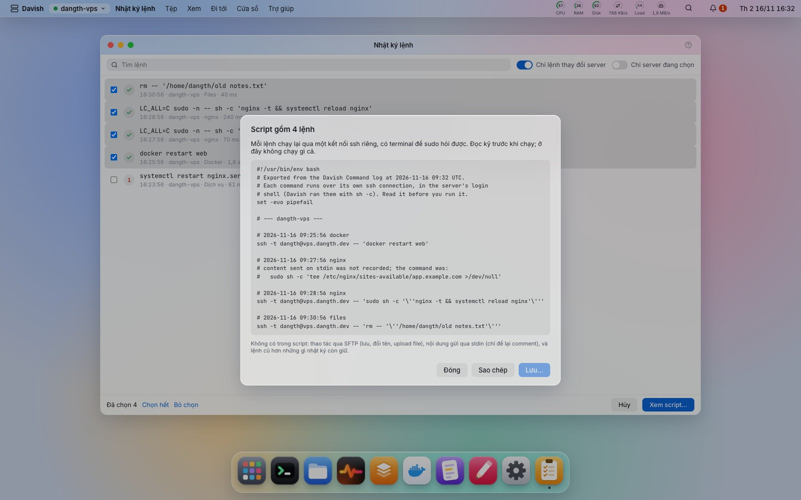

Mọi lệnh Davish đã chạy trên server, kèm exit code và thời gian chạy; dòng nào cũng gõ lại được vào Terminal hoặc lưu thành lệnh hay dùng. **Chỉ lệnh thay đổi server** (bật sẵn) ẩn lệnh đọc và polling, chỉ còn những gì các thao tác đã thay đổi. **Xuất script…** biến các lệnh được tick thành một bash script chạy lại chúng, mỗi lệnh qua một `ssh -t` riêng để sudo và các câu hỏi khác vẫn hỏi được: mỗi server một khối, trên mỗi dòng ghi giờ và app, sudo của Davish được viết lại thành `sudo` thường (không bao giờ có mật khẩu), còn nội dung gửi qua stdin (ví dụ file ghi bằng root) chỉ để lại comment vì không được lưu. Lệnh lỗi không được xuất trừ khi bạn chọn kèm. Sao chép hoặc lưu thành file chạy được; hộp xuất không chạy gì cả. Thao tác qua SFTP (lưu, đổi tên, upload) không có trong nhật ký.

