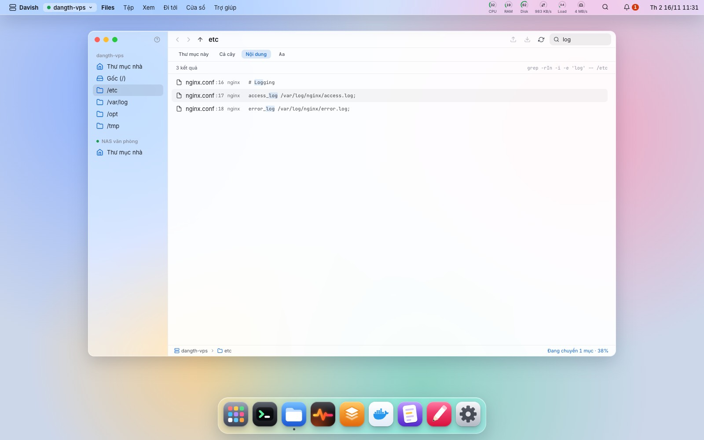

Trình duyệt kiểu Finder qua SFTP: tải lên, tải xuống, kéo thả từ hệ điều hành, đổi tên, xóa, nén, và copy giữa các server qua máy bạn. Chuột phải trên file để thấy mọi thao tác. Giữ chuột trên file rồi kéo nhẹ: một vòng thao tác mở quanh con trỏ (mở trong Editor hoặc Terminal, đổi tên, xóa, nén, copy đường dẫn, thêm vào màn hình chính); thả vào ô nào là chọn ô đó, thả ở giữa hoặc nhấn Esc để hủy. Chuột phải vào khoảng trống để tạo tệp hoặc thư mục ngay trong thư mục đang xem; Davish không bao giờ ghi đè file đã có.

Cài đặt → Files có thể ẩn các tên bắt đầu bằng dấu chấm (mặc định hiện); chỉ làm danh sách gọn hơn, file vẫn còn trên server.

Ô tìm lọc thư mục đang xem. Chọn **Cả cây** hoặc **Nội dung** rồi nhấn Enter để tìm trên server: `find` theo tên trong cả cây thư mục, hoặc `grep` trong nội dung file (bỏ qua file nhị phân, `.git` và `node_modules`). Tối đa 500 kết quả, kèm đúng lệnh đã chạy; kết quả nội dung mở trong Editor đúng dòng, nút thư mục hiện file trong thư mục chứa nó. Chỗ không có quyền đọc chỉ được đếm, không thử lại bằng root; nút **Dừng** ngắt lần tìm lâu.

