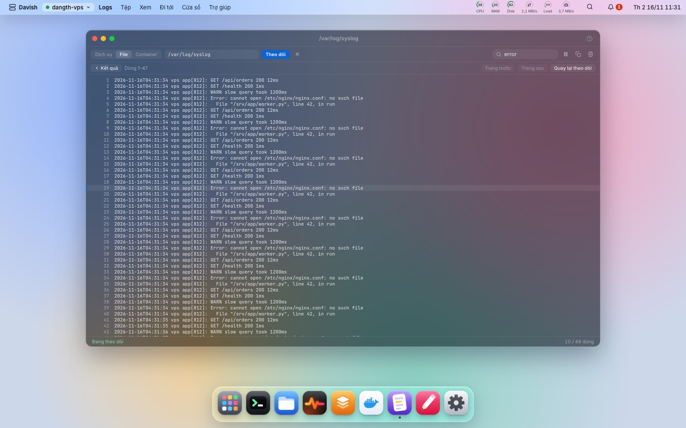
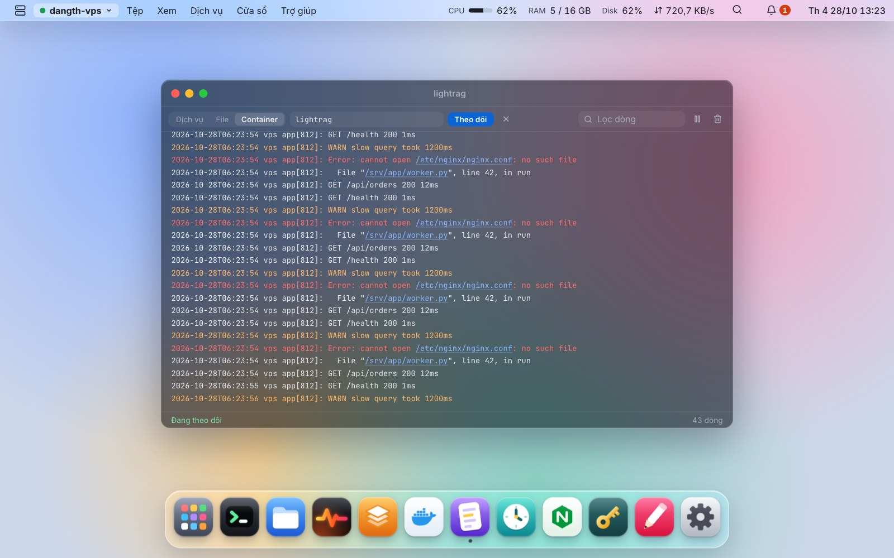

Theo dõi journal của dịch vụ, một file hoặc một container. Lọc, tạm dừng, tô dòng lỗi, bấm đường dẫn file để mở trong Editor đúng dòng. Log không đọc được thì được theo dõi lại bằng root qua `sudo`.

Ô lọc chỉ lọc các dòng đang hiện. **Tìm trong toàn bộ** (hoặc Enter trong ô lọc) tìm trong cả lịch sử của nguồn log ngay trên server và trả 500 dòng khớp gần nhất: `grep` với file, `journalctl -g` với journal, `docker logs | grep` với container. Với file, bấm một kết quả để đọc các dòng xung quanh rồi lật trang trước, trang sau; `sed` chỉ đọc đúng trang đó, nên file log vài GB cũng không phải tải về.

