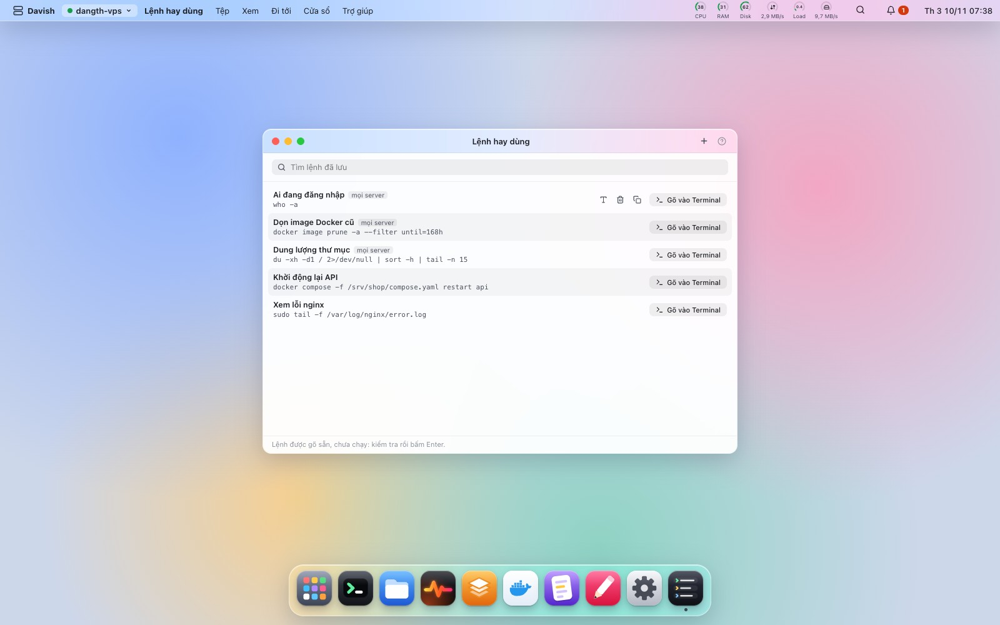

Lưu các lệnh hay gõ kèm tên, cho một server hoặc mọi server. Một cú bấm gõ sẵn lệnh vào Terminal của server để bạn kiểm tra rồi bấm Enter; không có gì tự chạy. Spotlight (`⌘K`) tìm được theo tên hoặc nội dung lệnh, và mỗi dòng trong Nhật ký lệnh có thể gõ lại vào Terminal hoặc lưu thành lệnh hay dùng. Lệnh được lưu trên máy bạn, dạng chữ thường: lệnh nào có vẻ chứa mật khẩu, token hay key thì Davish cảnh báo trước khi lưu.

