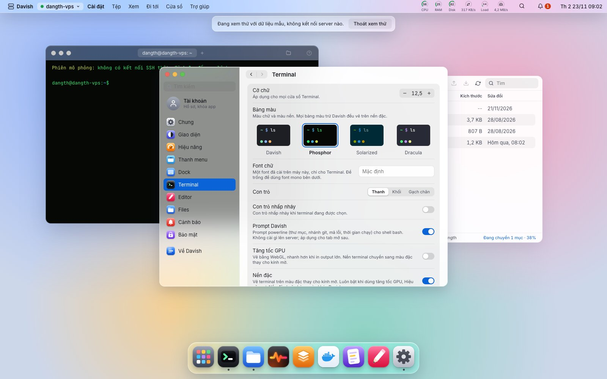

xterm.js nhiều tab, copy/paste, vẽ bằng GPU, và prompt powerline tùy chọn được nạp vào bash lúc đăng nhập, không ghi gì lên server.

Cài đặt → Terminal đổi giao diện và những gì terminal giữ lại: **bảng màu** (Davish, Phosphor xanh lá trên nền đen như màn hình CRT cũ, Solarized hoặc Dracula; mọi bảng màu trừ Davish đều vẽ trên nền đặc), **font** đã cài trên máy (để trống thì dùng font mono chung của app), **con trỏ** (thanh, khối hoặc gạch chân, nhấp nháy hoặc không), **nền đặc** thay cho kính mờ (luôn bật khi dùng GPU, Hiệu năng → Nền đặc hoặc một bảng màu) và số dòng **cuộn lại** mỗi tab giữ (1.000, 5.000 hoặc 20.000). Mọi thay đổi áp dụng ngay cho các tab đang mở.

