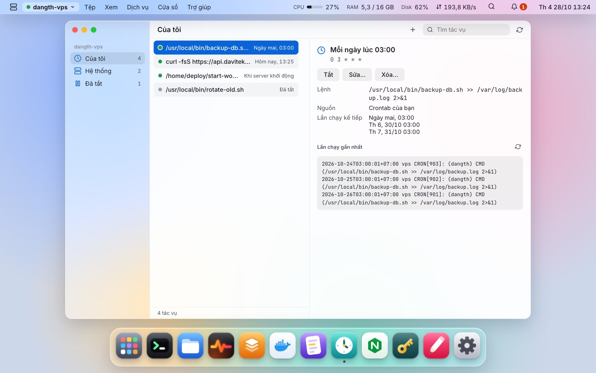

Crontab của bạn và của hệ thống, lịch nói bằng lời, lần chạy kế tiếp theo giờ server, sửa an toàn có sao lưu. Có quyền sudo thì crontab của root cũng hiện và sửa được, các file cron hệ thống không đọc được thì đọc bằng root.

Mỗi tác vụ liệt kê các file và thư mục trong lệnh của nó (script, log, thư mục `cd`), bấm là mở trong Editor hoặc Files. Tác vụ hệ thống mở được file cron và thư mục chứa nó.

