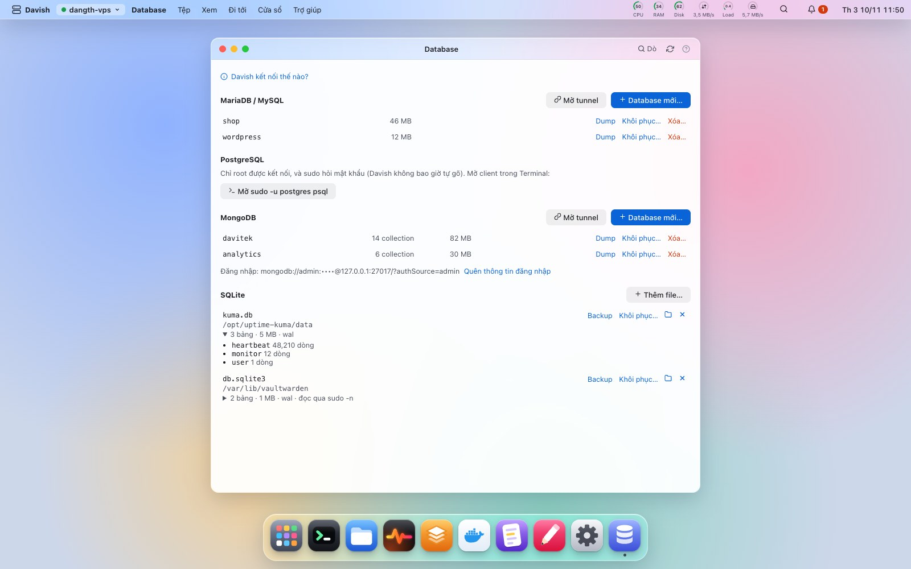
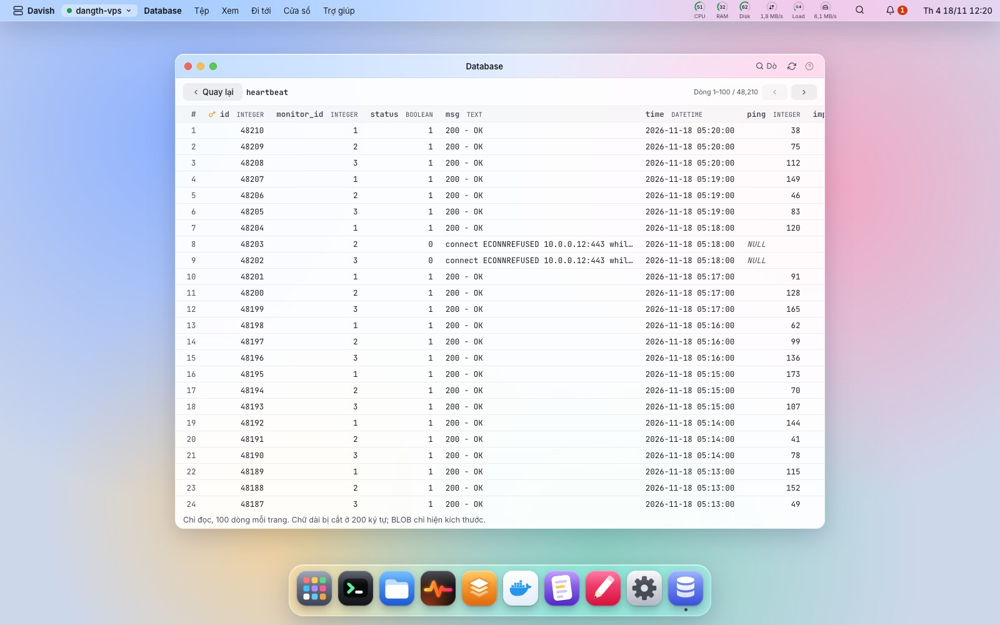

Database MariaDB/MySQL, PostgreSQL và MongoDB kèm dung lượng, cùng các file SQLite, mở từ Launchpad hoặc Spotlight. Tạo database và user sở hữu nó với mật khẩu ngẫu nhiên, chỉ hiện một lần và không lưu ở đâu; câu lệnh gửi qua stdin nên mật khẩu không nằm trong nhật ký lệnh hay lịch sử shell. Xóa database sau khi gõ đúng tên. Dump ra `~/db-backups` (`mysqldump` / `pg_dump`, nén gzip) rồi tải về từ Files, hoặc khôi phục từ bản dump sau khi xem lệnh chính xác và gõ đúng tên. Mở database server qua tunnel để dùng công cụ của bạn. Davish kết nối bằng user của bạn hoặc user `postgres`; khi chỉ root vào được thì đi qua `sudo`, hỏi mật khẩu sudo một lần mỗi phiên, file dump vẫn nằm trong `~/db-backups` của bạn.

**MongoDB** hiện từng database kèm số collection. Khi bật xác thực, đăng nhập một lần bằng host, cổng, user, mật khẩu hoặc connection string: Davish thử trước, được mới lưu vào keychain của máy này như mật khẩu SSH, không bao giờ vào file; **Quên thông tin đăng nhập** để xóa. Connection string đi vào `mongosh` qua stdin nên không nằm trên dòng lệnh, trong `ps` hay nhật ký lệnh; `mongodump` và `mongorestore` đọc nó từ một file chỉ bạn đọc được, bị xóa ngay khi chạy xong.

**Dò** tìm (chỉ đọc) database server đang chạy (kèm cổng MongoDB và có bật xác thực không) và file SQLite trong `/var/lib`, `/opt`, `/srv` và thư mục home, bấm một lần để thêm. File **SQLite**, thêm bằng đường dẫn hoặc **Mở bằng Database** trong Files, hiện bảng và số dòng; bấm tên bảng để xem dữ liệu, chỉ đọc, 100 dòng mỗi trang, sắp xếp theo cột hoặc lọc theo chữ một cột có chứa, chữ dài bị cắt và BLOB chỉ hiện kích thước nên xem nhanh mà không nặng app. File SQLite backup bằng cơ chế backup trực tuyến của SQLite (an toàn khi app đang ghi); khôi phục thì gõ sẵn vào Terminal vì app đang dùng file phải dừng trước. Khối **Davish kết nối thế nào?** trong app giải thích tất cả bằng lời dễ hiểu.

