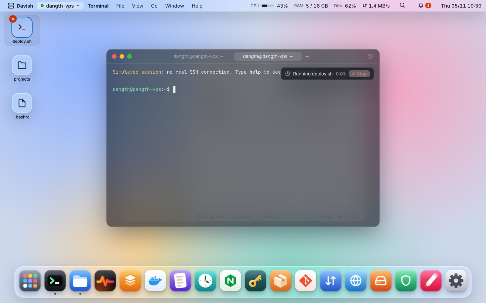

Kéo file, thư mục hoặc script từ Files ra nền desktop, hoặc chuột phải và chọn "Thêm vào màn hình chính" (`⌘⌥P`). Double-click để mở: thư mục vào Files, file vào Editor, script chạy trong một tab Terminal. Mỗi server có màn hình riêng, nên `deploy.sh` của staging không xuất hiện trên production. Chuột phải vào icon và chọn Tùy chỉnh (`F2`) để đặt tên riêng, chọn icon có sẵn kèm màu, hoặc dùng ảnh từ máy, giống một alias: file trên server giữ nguyên tên, và hộp thoại chạy luôn hiện tên thật. Davish lưu đường dẫn và các lựa chọn này trên máy bạn, không bao giờ lưu nội dung file.

Lần đầu chạy một script, Davish hiện tên server và đúng lệnh. Chọn "Lần sau chạy luôn" thì lần sau chạy ngay, với điều kiện nội dung script còn nguyên; script bị sửa thì Davish hỏi lại kèm cảnh báo. Trong lúc chạy, Terminal hiện thời gian và nút **Dừng**, icon có nút X; cả hai gửi Ctrl-C vào đúng phiên đó. Xong thì có thông báo kèm mã thoát, và mỗi lần chạy được ghi vào nhật ký lệnh.

