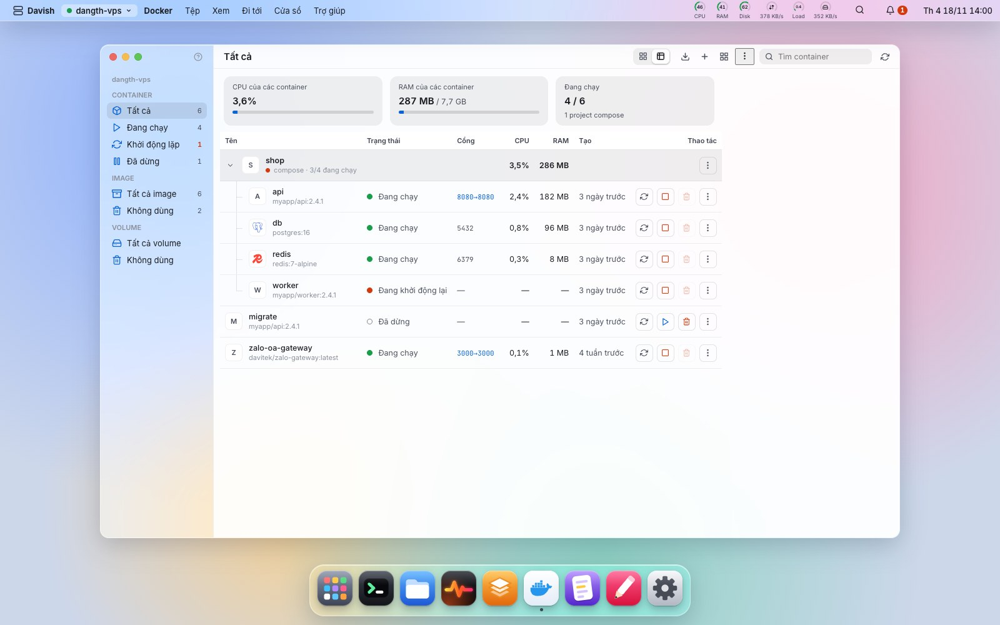
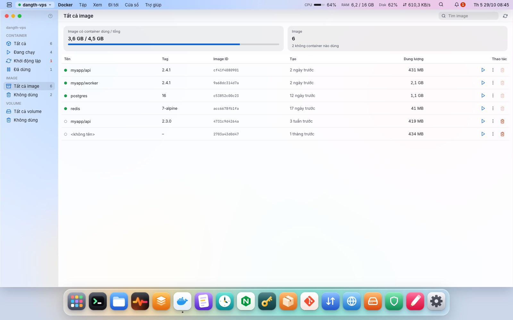

Bố cục như Docker Desktop. Container dạng thẻ hoặc bảng, chuyển bằng nút trên thanh công cụ. Mặc định là dạng bảng. Dạng thẻ cho mỗi project compose, hoặc container chạy riêng, một thẻ: favicon của chính dự án, không có thì framework mà code dùng (Next, Nest, Express, Django, Laravel…, đọc `package.json` và các file tương tự trong thư mục project qua SFTP), không có nữa thì logo của image Davish nhận ra (n8n, WordPress, Postgres…); không tìm được gì thì không có avatar, bao nhiêu container đang chạy, image, các cổng publish (bấm để mở trong Trình duyệt của Davish), CPU và RAM, viền đỏ khi có container khởi động lặp; bấm thẻ để xem các container của nó. Dạng bảng hiện logo, tên kèm image ở dòng dưới, trạng thái, cổng dạng `8080→80`, CPU, RAM và thời gian tạo của từng container, gom theo project compose bằng đường dạng cây, dòng của project hiện CPU và RAM chúng dùng chung; khởi động lại, chạy hoặc dừng, xóa và menu ⋮ (log, shell trong container, chi tiết) nằm ngay trên dòng, mọi thao tác phá hủy đều hiện đúng lệnh trước. Cổng publish bấm là mở trong Trình duyệt của Davish. Image kèm dung lượng image đang được dùng, các layer và cấu hình; chạy image trong Terminal hoặc xóa image không dùng. Volume kèm dung lượng và còn container nào dùng không. Vẫn cảnh báo container khởi động lại liên tục.

**Pull image…** và **Chạy container mới…**: form nhập tên, image, cổng, biến môi trường (gõ tay hoặc file `.env`), volume, chính sách khởi động lại, network rồi sinh đủ lệnh `docker run`. Cổng mặc định bind `127.0.0.1`, cảnh báo khi bind `0.0.0.0`. Lệnh được gõ sẵn vào Terminal để bạn nhấn Enter và xem tiến độ.

**Compose**: menu ⋮ của mỗi project có up, pull, restart, down và mở file compose trong Editor; **Stack compose mới…** ghi `compose.yaml` từ mẫu (một container, web + database, app + Redis) vào một thư mục, không bao giờ ghi đè file đã có. Tạo network, volume, và sao chép container bất kỳ thành lệnh `docker run` dựng lại nó.

  

  

