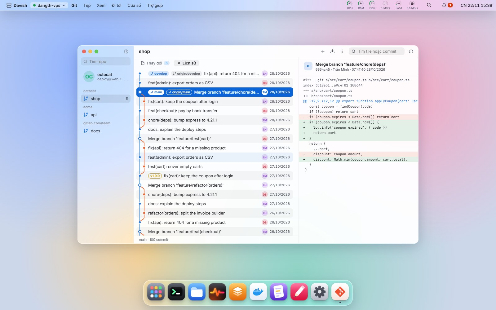
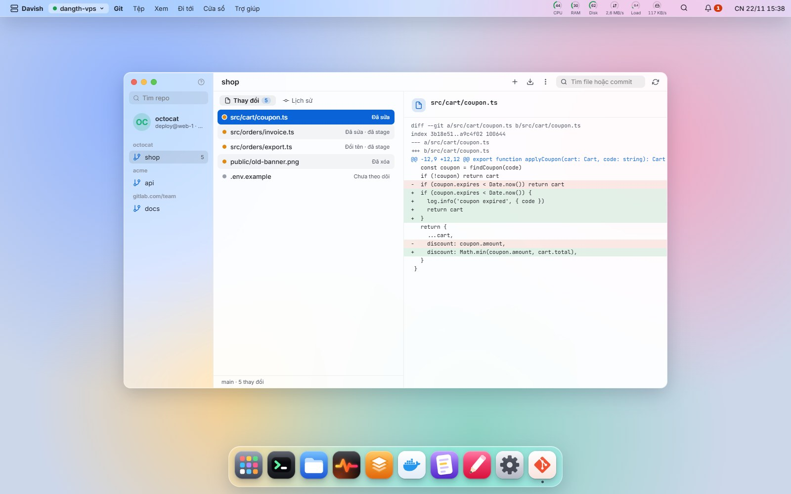

Tìm repo trong home, `/var/www`, `/srv`, `/opt` hoặc thư mục bạn thêm, nhóm theo user hoặc org của remote (của bạn đứng đầu). Nhánh, nhánh remote và số commit chưa đẩy/chưa kéo, file thay đổi kèm diff, biểu đồ commit của mọi nhánh với merge và tag. Fetch, `pull --ff-only` (bị chặn khi repo còn thay đổi chưa commit) và đổi nhánh sau khi xác nhận đúng lệnh; `npm ci` / yarn / pnpm theo lockfile trong Terminal. Remote từ chối key thì dẫn tới tạo deploy key.

Tài khoản ở đầu sidebar cho biết server làm việc với git dưới danh nghĩa ai: người dùng SSH, tên và email git, có lưu token HTTPS không, các key trong `~/.ssh`, và tài khoản GitHub hay GitLab mà key đó đăng nhập được. Phần này chỉ đọc: mỗi host được hỏi riêng bằng `ssh -T`, chỉ tin host key họ công bố, host nào server không kết nối tới thì bỏ qua. **Clone repo…** (SSH hoặc HTTPS, thư mục, nhánh) chạy bằng một nút khi key của server được chấp nhận hoặc repo public, xong thì mở luôn repo mới; repo cần token thì gõ sẵn lệnh vào Terminal để bạn đăng nhập ở đó. Với GitHub và GitLab qua SSH, host key họ công bố được thêm vào `known_hosts` trước; chưa có key được chấp nhận thì có nút dẫn tới tạo deploy key. **git init** và **Đặt remote…** gõ sẵn lệnh vào Terminal. **Deploy…** giữ công thức cho mỗi repo trên máy bạn (pull, cài, build, khởi động lại…) và chạy từng bước trong Terminal, dừng ở bước đầu tiên bị lỗi. Davish xem repo (lockfile, script trong `package.json`, file compose, `go.mod`, `Makefile`) và tìm app đang chạy từ thư mục đó (pm2, systemd, Docker compose), rồi đưa ra các bước bật/tắt được: lấy code mới, cài thư viện, build, khởi động lại app, cộng thêm bước tùy chỉnh. Mỗi bước hiện đúng lệnh sẽ chạy, lựa chọn được nhớ cho lần sau. Bấm Deploy là chạy ngay trong Terminal; có bước cần sudo thì lệnh được gõ sẵn để bạn nhấn Enter và nhập mật khẩu. Terminal hiện từng bước xong, đang chạy hay lỗi kèm thời gian, có thông báo khi deploy xong hoặc lỗi ở bước nào, và repo liệt kê các lần deploy gần đây kèm commit và thời gian chạy.

  

  

