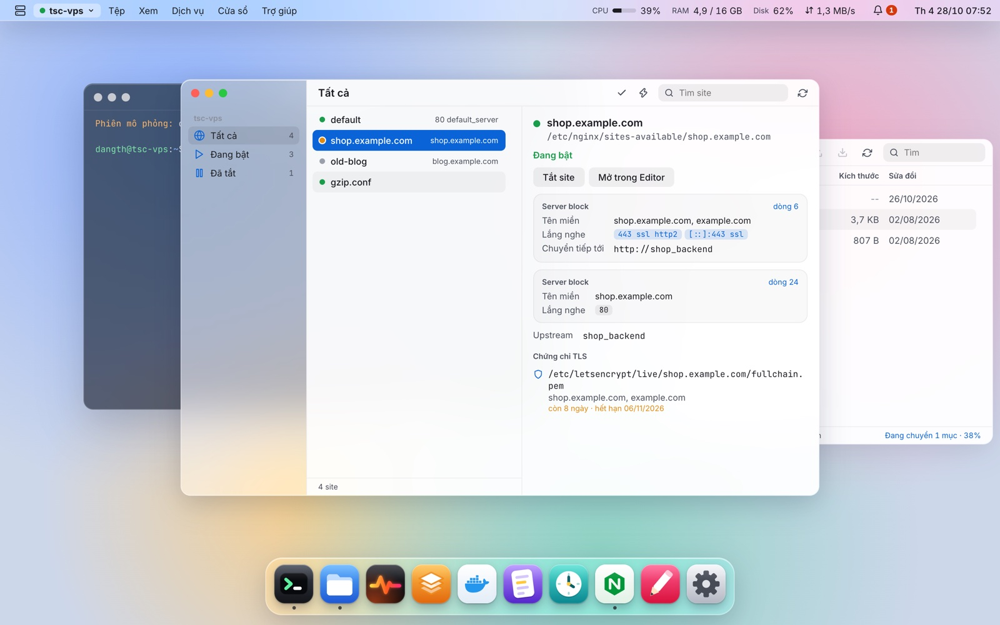
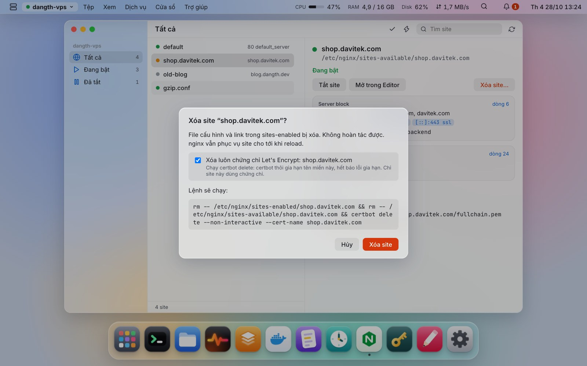

Site, server block và upstream; bật/tắt site, `nginx -t` trước mỗi lần reload, lỗi mở đúng dòng; cảnh báo chứng chỉ TLS sắp hết hạn. Xóa site, kèm chứng chỉ Let's Encrypt nếu không site nào khác dùng.

**Site mới…** dựng reverse proxy (tới một cổng hoặc container, có tùy chọn WebSocket), thư mục tĩnh hoặc PHP-FPM (tự tìm socket php-fpm đã cài). Bạn thấy và sửa được cấu hình sinh ra cùng lệnh chính xác trước khi chạy; site chỉ được bật khi `nginx -t` qua, lỗi thì tắt lại và hiện lỗi của nginx.

**Bật HTTPS…** kiểm tra (từ máy bạn) từng tên miền đã trỏ về server chưa, cảnh báo tên nào chưa, rồi mở Terminal với `sudo certbot --nginx -d …` gõ sẵn (tùy chọn chuyển HTTP sang HTTPS).

**Sửa nhanh…** thêm tên miền, đổi địa chỉ proxy (gợi ý từ những gì đang nghe trên server), bật/tắt gzip, đặt giới hạn dung lượng tải lên. File hiện tại được sao lưu trước và trả lại nếu `nginx -t` lỗi.

  

  

