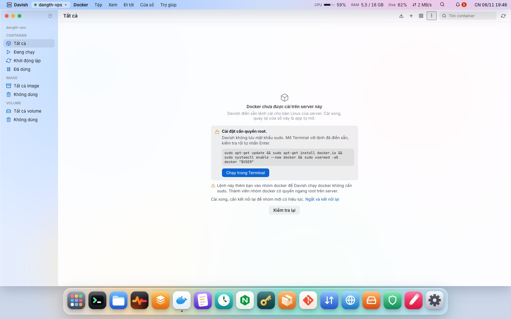
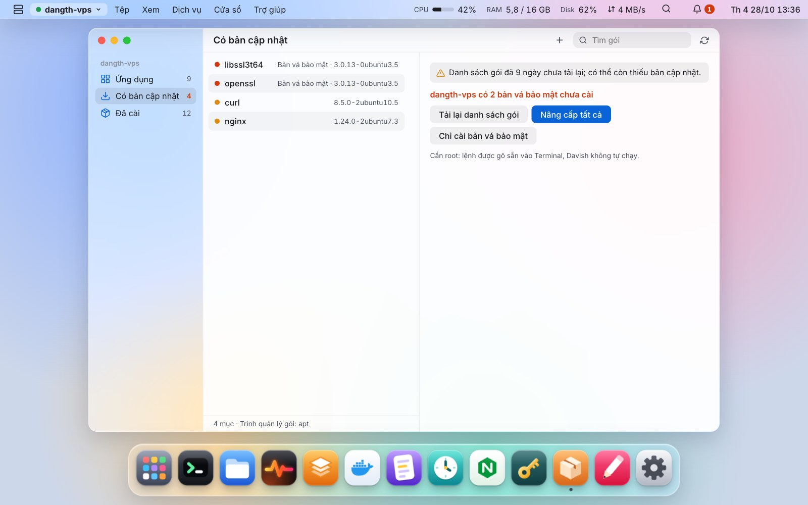
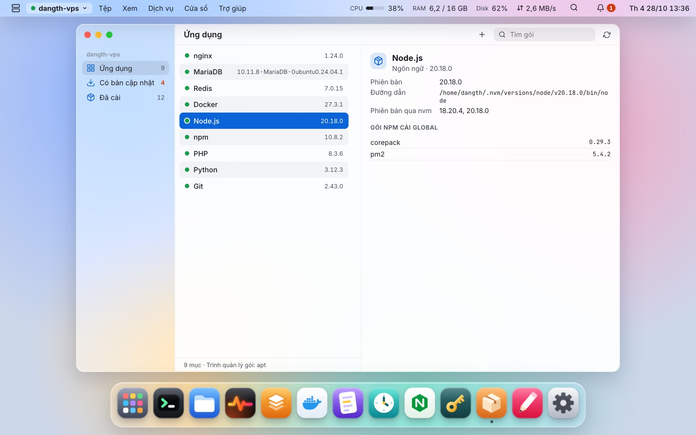

Gói apt, dnf, yum hoặc apk đã cài và có bản cập nhật, bản vá bảo mật lên đầu, có thông báo khi kết nối. Các runtime và chương trình trên server (nginx, MariaDB, Redis, Docker, Node.js qua nvm, PHP với php-fpm, Python…) kèm phiên bản, file cấu hình và dịch vụ; tìm được bằng Spotlight. Cài và nâng cấp thì gõ sẵn lệnh `sudo` vào Terminal cho bạn.

Server chưa có Docker, nginx, git, MariaDB hay PostgreSQL thì app tương ứng báo ngay và hiện lệnh cài cho đúng bản Linux của server (apt, dnf, yum hoặc apk), kèm bật và chạy dịch vụ; một nút gõ sẵn lệnh vào Terminal để bạn xem rồi tự chạy. Lệnh của Docker còn thêm bạn vào nhóm `docker`, app nói rõ nhóm này có quyền ngang root và có nút kết nối lại để nhóm có hiệu lực. Cài xong, quay lại cửa sổ là app mở bình thường. Tài khoản không có quyền sudo thì chỉ được báo nhờ người quản trị server cài.

  

  

